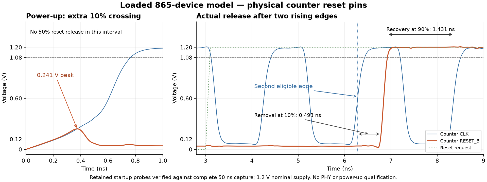

# 152 — Nominal charge-pump and filter current measurements
<!-- SPDX-FileCopyrightText: 2026 Hasan Melih Akbulut -->
<!-- SPDX-License-Identifier: CC-BY-4.0 -->

## Latest continuation — 12 October, 03:41 TRT

The RX return-metadata candidate completes actual whole-chip mapping and the
matched three-corner unplaced timing screen. It preserves the original return
cycle, 20 SRAM instances, 128 Ethernet response registers, ports and CPU
parameters. The previous portable carry-select candidate is **rejected**:
functional correctness does not compensate for its setup regression.

| PCIe setup slack (ns), unplaced | Prior replay/Ethernet | Carry-select, rejected | Return metadata |
| --- | ---: | ---: | ---: |
| SS | -1.262388 | -1.547447 | -1.240848 |
| TT | +0.330039 | +0.298894 | +0.373847 |
| FF | +1.211302 | +1.194228 | +1.246757 |

All seven setup and six hold groups are compared, including asynchronous and
path-delay groups. The return-metadata gain is modest: **21.540 / 43.808 /
35.455 ps** at SS/TT/FF. SS setup remains violated. Its new worst PCIe path
binds to **TX consumed data-credit bit 29 → limit bit 29**. Other groups and
small regressions remain visible in the complete comparison. Physical run 19
and independent reader 20 are queued behind the current native repair and
resource guards; they retain the original clocks, die, SRAM placement and
repair policy. No active predecessor input was modified.

The first mapping reader failed because it mistook native tie-zero net 209
for a register. A separate corrected reader checks the real `sg13g2_tielo`
Liberty function and driver, both class-register bits, ten units-register
bits, their PCIe clocks/resets, all 128 Ethernet registers and 20 SRAMs.
The original failure is retained; no missing driver is waived. The mapped
replay-successor invariant and its two actual D-pin faults pass again on
both new maps.

The [complete mapped and timing evidence](evidence/pcie-rx-map-timing-20261012.json)
contains **82 members / 37,758,701 bytes**, SHA-256
`95f832d17e0d23bf31630e698904574f67449d7a8767c0e765dbba550aaf4688`.
Every archive member and the complete anonymous download match. Active
physical outputs are excluded. **Full serial PHY, accepted main-chip routing
and final setup/hold remain open.**

## Proof continuation — 12 October, 03:41 TRT

The largest carry-select full-module proof still exhausts native memory at
the increased 8 GiB address-space limit. The alias diagnostic also terminates:
six stages pass, the seventh fails with native allocation exhaustion. Its
stale RUNNING record is superseded by the actual terminal-service/log review;
neither failed proof is reported as passed.

A separate compositional proof verifies the actual stateless replacement:
both 12-bit operands and the sole destination are bound, and reverting only
that block produces the entire reference module byte for byte. Native SAT
checks all **2^24 binary operand pairs** without assumptions. Two declared
carry-path faults yield counterexamples; unrelated source and operand changes
are rejected. This is parameter-independent stateless binary equivalence,
not a success claim for the failed whole-queue induction. The earlier
wrong-middle-carry control used an undeclared signal; it is explicitly
superseded by the new declared controls with hierarchy/check assertions.
The reusable checker is `scripts/check_pcie_rx_carry_replacement.py`.

Return metadata requires a different proof because it adds state. Actual RTL
reset-base and induction checks prove queue ownership and the cache/head
relationship for **four configurations**. The compiled cones retain all 15
inputs and have exactly one assumption: initial reset. There are no traffic
assumptions or latch cells. Exact source projection plus native SAT on every
changed accepted-return assignment establishes cycle equivalence from
corresponding reset common state, including corresponding unreset memory.
Two changed-output faults produce counterexamples.

The separate monolithic metadata proof ends **UNPROVEN, 74 bits**; it is not
an allocation failure or a reset-reachable counterexample trace. The
compositional theorem is stated separately and does not relabel that result
or claim equivalence from unrelated unreset states.

The [complete compositional proof evidence](evidence/pcie-rx-compositional-proofs-20261012.json)
contains **141 members / 4,548,637 bytes**, SHA-256
`a445a593a1f9ba34bfacb8b4e6d565b77f829b2df9e1fa0d4df188243a3e15c0`.
The archive preserves failed and successful methods, compiled proof cones,
controls and source projections; all members and the full anonymous readback
match. These results establish the stated digital transformations only.

## Latest continuation — 12 October, 02:52 TRT

Structural sharing proves 6,459 local equivalence points, but the largest RX
case still exhausts the native solver's 4 GiB address-space limit during
induction. The full case remains **unproven**. A fresh run now retries exactly
that case with an 8 GiB address-space limit, an available-memory launch guard
and a 7 GiB physical-memory cap. It reuses the three unchanged, individually
passed configurations only after checking their exact source/tool/log hashes.
Every configuration must pass before new chip mapping starts; no port or
proof obligation is waived. Only unstarted map/read controllers were replaced.

The [complete failure and recovery record](evidence/pcie-carry-memory-recovery-20261012.json)
contains **13 members / 2,036,807 bytes**, SHA-256
`0cc03b17bbd95c0e89fab98df7a203b1908fb5a1cab459bf4b6dfa69e1888a7a`.
All members and the complete anonymous download match. The active retry is
excluded. Native hold repair, conservative routing, DRC/LVS work and the long
PLL acquisition continue. **Full serial PHY, accepted main-chip routing and
final setup/hold remain open.**

## Latest continuation — 12 October, 02:48 TRT

The fresh Ethernet/replay chip's durable **post-setup, pre-hold-repair** snapshot
has an independent readback of all seven setup and six hold path groups at
three native corners. It uses the original 20/4/8/8/8 ns constraints, propagated
clocks and placement-estimated RC. It is not a routed or final timing result.

| Path group, setup slack (ns) | SS | TT | FF |
| --- | ---: | ---: | ---: |
| PCIe | -1.519184 | +0.029731 | +0.755070 |
| Main clock | -0.853211 | +6.815113 | +10.657912 |
| Ethernet RX | +0.793542 | +3.619019 | +4.473320 |
| Ethernet TX | +0.573467 | +3.456280 | +5.055291 |
| Asynchronous recovery | -0.860541 | +0.565565 | +1.409467 |

The worst PCIe setup path binds to **RX queue read index bit 1 → advertised
data-credit bit 23**, confirming the path targeted by the two RX experiments.
Hold remains negative before the ongoing native hold repair; all groups and
endpoints are retained in the evidence. No asynchronous group is hidden.

The first reader stopped because the generated Ethernet clock's period was
queried before OpenSTA expanded generated clocks. The native Tcl implementation
shows `report_clock_properties` calling `update_generated_clks`. A fresh reader
calls that first and verifies all five unchanged periods. It passes on the
exact same ODB and original SDC; no clock constraint was relaxed. Only the
unstarted final reader was replaced; native placement/repair inputs are untouched.

The [complete checkpoint and reader evidence](evidence/pcie-successor-setup-checkpoint-20261012.json)
preserves **26 members / 15,423,259 bytes**, SHA-256
`e57590d37f236a048b5532d131a6597b4aeea9f7ac14234e135a256139c9ed29`.
It includes the actual ODB/netlist/SDC, failed and corrected readers, native API
body, all-group paths and the carry proof's short-cone native memory failure.
Every member and the complete anonymous download match. Ongoing hold repair,
structural proof fallback and long analog acquisition are excluded.
**Full serial PHY, accepted main-chip routing and final setup/hold remain open.**

## Latest continuation — 12 October, 02:42 TRT

The 865-device parent completes its **50 ns, 0.15625 ps maximum-step** run:
320,071 finite samples, no native warnings/errors. Against the frozen 0.3125 ps
reference prefix, the predeclared 35–50 ns window passes unchanged bounds:

| Selected-probe comparison | Measured maximum | Limit |
| --- | ---: | ---: |
| Control voltage difference | 0.119855 mV | 5 mV |
| Absolute crossing displacement | 0.551946 ps | 5 ps |

All eight rising/falling crossing comparisons have equal, nonzero counts. An
independent full-wave reader reproduces the measurements; 6 mV voltage and
10 ps time perturbations fail its comparison. These are **in-memory reviewer
controls**, not new transistor simulations. No phase fitting or tolerance
relaxation is used. This closes the selected-probe numerical-convergence check;
the ongoing 1 µs acquisition run, full-device/PVT and serial-PHY qualification
remain separate. The earlier 1.25 ps coarse-step failure remains rejected.

A second RX timing candidate captures packet class and data-credit units at
TLP completion, retaining the original credit-return cycle. It passes **five
RX plus five buffered-packet tests**, zero skips/runtime errors. Wrong-class
and lost-units mutations each fail four of five RX cases. The first mutation
wrapper expected a success-only JSON field and failed after the native tests;
its original logs/XML are preserved and independently reviewed. Full sequential
queue-ownership equivalence remains required; this candidate is not adopted.

The portable carry-select candidate's largest proof also exhausts native memory.
Its three smaller configurations pass. Its map controller correctly stops before
CAD dispatch. The idle timing reader is replaced; fresh mapping still requires
all four configurations to be proved. The short-cone retry also exhausts native
memory; a structural-sharing fallback is running with every equivalence
obligation retained. No failed result is
relabelled as passing.

The [full waves, tests, fault controls and recovery evidence](evidence/pcie-halfstep-and-return-metadata-20261012.json)
are publicly preserved in two verified capsules: **16 members / 78,027,084 bytes**
for the half-step comparison, and **115 members / 1,766,166 bytes** for the RX
candidate and proof recovery. Every member and both complete anonymous downloads
match. The combined physical run is in hold repair; a separate reader examines
its durable setup checkpoint without changing the active run. **Full serial
PHY, accepted routing and final setup/hold remain open.**

## Latest continuation — 12 October, 02:33 TRT

The mapped replay address audit is now closed for this exact synthesized
candidate. A reusable native-Liberty checker follows the actual current-address
D cone, tries both inverted-state candidates and proves exactly one correct
binding. All **12 physical flip-flops** share the intended PCIe clock/reset.
Reset establishes current address zero and successor one; the mapped D logic
preserves successor = current + 1 modulo 64 for arbitrary other boundary state.
Both actual D-pin mutations produce counterexamples. Wrong-clock and missing-net
controls fail before dispatching SAT. The earlier legal postfix-reset-notation
reader rejection is preserved. This is a local state invariant, not full-chip
functional equivalence, protocol progress, CDC or timing approval.

The [complete mapped-state evidence](evidence/pcie-mapped-successor-invariant-20261012.json)
contains **47 archive members, 1,638,356 bytes**, SHA-256
`11f8741b4a570509cd6fcd709dda6a9c9d1ddf62225f0d45d844b5369866a2ad`.
All archive members and the complete anonymous public download match. The
[supported checker](../scripts/check_pcie_mapped_successor.py) requires the exact
mapped JSON, native Liberty and Yosys executable; it does not rely on generated
instance numbers.

The combined Ethernet/replay physical run has completed placement and CTS;
three-corner reporting and subsequent repair/readback remain active. Portable
RX carry-select full-module equivalence has passed three configurations. The
fourth is pending. The older function-local candidate's fourth configuration
exhausted the solver's memory and is preserved as **unproven**, not a logic
counterexample. A fresh trial uses Yosys
[`equiv_simple -short`](https://yosyshq.readthedocs.io/projects/yosys/en/0.40/cmd/equiv_simple.html)
to stop cones at shared nodes while retaining all equivalence obligations and
the final unfiltered assertion. No output is removed or assumed correct.
Ongoing proof/physical/analog outputs are excluded from the completed capsule.
**Full serial PHY, accepted main-chip routing and final setup/hold remain open.**

## Latest continuation — 12 October, 02:01 TRT

The registered replay candidate's **seven passing port tests and three rejected
address mutations have now been replayed with zero runtime/GPI diagnostics**.
The original captures did execute all seven tests, but their bundled launcher
also reported an unexpected Python executable. They remain historical evidence;
the new captures use the same native simulator through the existing direct
loader wrapper. The three real mutations fail 6, 6 and 7 tests respectively,
with no skipped cases or runtime errors. Three separate formal mutations also
fail their native equivalence checks; a final string/path bug in their recorder
is retained and independently reviewed. The reset-zero mutant differs only in
an internal state bit, so it alone is not evidence of an external-port failure.

The portable RX carry-select candidate passes **all 16,777,216 two-input
arithmetic combinations**, both carry-error controls, **five RX tests and five
buffered-packet tests**, with zero skips or GPI diagnostics. Full-module
sequential equivalence is still running; the chip map and timing screen wait
for all four parameter cases. It is not adopted. The original function-local
attribute compile failure and the earlier five-pass run with a GPI error are
preserved. No test bound or expected result was relaxed.

The [complete clean-runtime and carry-control record](evidence/pcie-clean-runtime-carry-20261012.json)
links **121 archive members, 559,151 bytes**, SHA-256
`658b0ee567e7ed134ff3d273bd4d1a9cb8f02b39db134dc2277498a2288d06cc`.
Every member and the complete anonymous public download match. Ongoing full
module proofs, physical runs and analog captures are excluded. The fresh
Ethernet/replay floorplan/placement/CTS experiment, earlier conservative route,
full native DRC/LVS queue and both analog runs continue. **Full serial PHY,
accepted main-chip routing and final setup/hold remain open.**

## Latest continuation — 12 October, 01:49 TRT

The new Ethernet capture and registered PCIe successor address now have a
**fresh whole-chip floorplan/placement/CTS experiment running**. It retains the
same 20 ns CPU, 4 ns PCIe and 8 ns Ethernet targets, die, SRAM macros and repair
policy. The earlier conservative route continues; its inputs are unchanged.
An independent all-group, three-corner post-CTS reader is queued with explicit
clock-period checks. These are development runs, not accepted routing/timing.

Whole-chip mapping and unplaced measurement of the new candidate finish:

| PCIe setup, unplaced | Prior Ethernet capture | Registered successor |
| --- | ---: | ---: |
| SS (ns) | -1.359263 | -1.262388 |
| TT (ns) | +0.366104 | +0.330039 |
| FF (ns) | +1.241055 | +1.211302 |

SS improves by 96.875 ps, while TT/FF regress by 36.065/29.753 ps. The worst
reported path is **RX queue read index to the advertised data-credit counter**,
so this global change does not establish a direct replay-path timing gain.
A separate three-nibble carry-select adder candidate now targets that RX path.
Its complete 24-bit input-space SAT check passes, and two carry-error controls
fail as expected. Full RX module/packet tests and mapping are separate gates. The first function-local
attribute form fails Icarus parsing; its original compile failure is retained.
The portable candidate moves the same kept intermediates to module scope and
passes a fresh complete arithmetic proof plus both fault controls. New module
proofs and port tests are running; only the unstarted map/read controllers were
replaced. No healthy CAD run was interrupted.

The original direct six-plus-six flip-flop audit stops on the successor LSB:
Yosys keeps its physical state in a reset-zero, inverted-polarity implementation
and leaves the old positive wire alias unused. The native pre-map circuit has
LSB reset value one. Inventory records eleven direct Q bindings and the extra
flip-bits state candidate with the same PCIe clock/reset; **full LSB equation
binding is still open**. This audit failure is retained, not waived. Three
actual address mutations fail 6, 6 and 7 of the seven external port cases.
Their wrapper subsequently hit a string/path error; independent review verifies
all completed native XML/logs and input hashes without rerunning or altering
the failed captures.

The filled original core additionally passes **31 native antenna categories
and 52 device categories, zero markers**, with 108 input hashes independently
rechecked for each. **Six of seven GitHub groups now pass; BEOL remains pending.**
The independent 37-rule density check remains a pass for that same filled GDS.
This does not close full-chip LVS, qualified RC, full serial PHY or final timing.

The [complete mapping and native evidence](evidence/pcie-successor-map-and-native-20261012.json)
is **18,587,349 bytes**, SHA-256 `134c3e6d52099b5c509d1f0bfcf961a5d09a5c985560898771558eab171a7441`. All
71 archive members and the complete anonymous download match. It retains
mapping/STA, the failed alias audit, the port-fault wrapper failure and native
antenna/device reports. Active physical outputs and analog captures are excluded.

## Latest continuation — 12 October, 01:16 TRT

The Ethernet capture now passes **both concurrent CPU/PCIe/Ethernet scenarios,
zero skips**, using 16 vendor functional FIFO SRAM instances. The second drops
PCIe link while Ethernet continues. Independent review checks native XML, all
source/runtime/output hashes and equality with committed capture RTL. Each
scenario transfers three Ethernet frames; the 7.2 ms startup bound is unchanged.
This closes the joint functional check, not physical timing or serial PHY.

Two more filled-core groups, **geometry_angle and supplemental_wide**, pass
with zero markers and 108 independently rechecked input hashes each. Four of
seven native groups now pass; BEOL, antenna and device groups remain pending.
The separate 37-rule density check already passes.

The 1.25 ps analog acceleration experiment is **rejected**. In the fixed
35–50 ns window it differs from the frozen 0.3125 ps prefix by **55.148 mV**
on VCTRL and **510.296 ps** on feedback edges; divider edge counts also differ.
Limits remain 5 mV and 5 ps, with no phase fitting. The original 1 µs run
continues unchanged. A separate **0.15625 ps** half-step run now checks numerical
convergence. These are selected-probe checks, not full PHY qualification.

The [joint and rejected-step evidence](evidence/pcie-joint-and-timestep-20261012.json)
contains 41 archive members, **34,973,718 bytes**, SHA-256
`e0d61accb4c70beb4fcf812cbf6b4d428325b9ad243bea1b2f1cb35d24c7f463`.
Every member and complete anonymous download match. Failed analog waveforms
are included; active captures are excluded.

A stateless replay successor decoder passes full equivalence for actual 4×38
and two smaller configurations, plus seven port tests. Whole-chip mapping
succeeds, but matched unplaced PCIe setup worsens by **158.353 ps SS / 220.126 ps
TT / 149.919 ps FF**. It is not adopted. A separate registered successor address
candidate passes all four full-module equivalence cases and seven port tests;
its whole-chip synthesis and timing screen are underway. The conservative route and its
extracted readback remain active/queued, followed by the repaired RX candidate.
**Full serial PHY, accepted main-chip routing and final setup/hold remain open.**

The [complete replay experiment archive](evidence/pcie-replay-successor-20261012.json)
retains the rejected one-hot and stateless candidates, all mapped/STA outputs,
the large 8×64 proof's native out-of-memory failure, and the distinct registered
candidate's four completed proofs and seven tests. The stateless 2×65 case was
not reached after the failure; it is not counted as passed. All **154 archive
members**, **19,891,498 bytes**, and the complete anonymous download match
SHA-256 `72e1a0bcafe03eccccf92bbaaa103524650351eb2a2e0699d2468383dcc376e5`.
Active registered-candidate mapping and fault controls are excluded.

## Latest continuation — 12 October, 00:46 TRT

Ethernet cross-port read capture is committed in `7ad40bde`: **32 unit tests,
zero skips, four rejected checker mutations, and 37 real-PDK SRAM cases pass**.
Tests cover every address/bit fault in the small oracle, the full 2,048-address
sequence, unknown data, first-failure termination, captured-word authority,
reset cancellation and invalid-state failure. Synthesis verifies the 64 added
cross-read response bits alongside the 64 March response bits. The concurrent
CPU/PCIe/Ethernet test has passed its first scenario; the link-loss scenario is
still running. Routed timing of this RTL remains pending.

The [complete capture and RX repair capsule](evidence/pcie-eth-cross-and-rx-input-20261012.json)
is **142,225,940 bytes**, SHA-256
`ffb7b0649ce4b1f8e3fdde37ba8bce7f812a4d5a040754ad355148102ee7858d`.
Every member and the complete anonymous public download are verified. It retains
the failed post-map alias guard and the corrected actual-driver audit, the
initial RX hold failure and the endpoint repair. Active joint simulation and
routing outputs are excluded.

The measured PCIe RX-data path includes excessive shared hold delay. Removing
three identity delays improves setup but creates a **-57.413 ps** FF hold path.
Adding one delay only at that endpoint restores all six worst corner values
to nonregression against the prior combined candidate. Native placement and
restricted cell-equation equivalence pass; **115,449 retained cell geometries
and all power geometry remain exact**. This final candidate contains 97 added
endpoint delays, two load buffers, 21 sized drivers and six removed shared
input delay cells in total.

| Fresh placement estimate | SS | TT | FF |
| --- | ---: | ---: | ---: |
| Setup slack (ns) | -4.059812 | -0.832233 | +0.075600 |
| Hold slack (ns) | +0.315223 | +0.190223 | +0.050119 |

**These values use layer-RC placement estimates, not routed SPEF.** The older
combined route and readback controllers were stopped while still waiting;
their CAD run directory did not exist. The improved candidate now waits for
the running conservative 95-cell route and its independent extracted readback.
No healthy CAD process was interrupted. A new readback controller's initial
missing-file race is retained; its replacement retries missing/partial JSON.

The exact filled original core is being checked in
[seven parallel GitHub native groups](https://github.com/Melihakbulut221/nssoc/actions/runs/38177044286).
The [filled-core density and partial native record](evidence/pcie-filled-core-density-20261012.json)
now verifies **37 native density rule executions and zero markers**. All 48
native input hashes and all 45 locked rule dependencies match. The report has
seven empty slit categories: upstream emits other density categories only on
violations, so category count alone is not the coverage criterion. The new
independent reviewer requires the full execution log, completion, exact GDS,
locked dependencies, zero report items and the global-density summary. Its
13 controls reject missing/repeated rules, native errors, wrong top/categories,
added markers, missing item inventory and an out-of-range density summary.
The complete native report/log, reviewer and tests are publicly archived and
fully read back.

| Global density | Measured | Native range |
| --- | ---: | ---: |
| Activ | 38.81% | 35–55% |
| GatPoly | 26.12% | at least 15% |
| Metal1 | 38.60% | 35–60% |
| Metal2 | 35.94% | 35–60% |
| Metal3 | 39.02% | 35–60% |
| Metal4 | 48.62% | 35–60% |
| Metal5 | 47.96% | 35–60% |
| TopMetal1 | 41.32% | 25–70% |
| TopMetal2 | 43.28% | 25–70% |
| LBE | 0.00% | at most 20% |

Two GitHub groups also pass independent local readback: **161 grid categories**
and **20 pin/forbidden categories**, all with zero markers. Each review checks
108 input hashes and the exact filled GDS. The remaining native groups are
still running; **this is not full DRC closure**. Original full-core DRC continues
locally; transistor LVS remains queued. Fill-aware RC/timing is not qualified.
The fine-step 1 µs analog capture continues unchanged.
A separate 50 ns, 1.25 ps-step experiment checks whether diagnostic runs can
be accelerated: a fixed 35–50 ns window requires identical edge counts,
no more than 5 ps absolute edge displacement and 5 mV VCTRL difference against
an immutable complete-row prefix of the running 0.3125 ps reference. No phase
fit or device-equation change is permitted. This is selected-probe convergence,
not full electrical, PVT or serial-PHY qualification.

**Full serial PHY, accepted main-chip routing and final setup/hold remain open.**

## Previous continuation — 12 October, 00:34 TRT

The original routed digital core now has **all 35 fill tiles generated**.
The complete geometry audit passes: every original shape and instance in
423 cells is retained; 927,937 fill-shape definitions are added in 35 new cells.
The exact filled GDS SHA-256 is
`2b8fead5fa691588efa2754a85b156f77765ba6fd101b6eaee06ed063de3f525`.
The unchanged native density deck is running on that entire filled GDS.
**Geometry preservation does not establish density, DRC, LVS or timing closure.**

The [fill and request-profile record](evidence/pcie-filled-core-and-request-profile-20261012.json)
links a complete 719,195,732-byte capsule containing all fill tiles, checkpoints,
logs, the interrupted first attempt and the separate request-only CPU experiment.
All members and the full anonymous public download are verified. A separate
[21,734,704-byte native-check bundle](evidence/pcie-filled-core-native-input-assets-20261012.json)
pins that exact filled GDS and 84 native deck dependencies for parallel GitHub
verification. The original unfilled antenna pass does not apply to this new GDS.

The **REQ_REG=1, MEM_RDREG=0** profile passes mapped request connectivity and
whole-CPU firmware checks. Execution increases from 430,231 to 537,006 cycles
(**24.818%**). Matched unplaced main-clock SS setup improves by 0.775618 ns,
but PCIe SS setup regresses by 0.192725 ns. This profile is **not adopted**;
its CPU benefit and whole-chip tradeoff require physical measurement.

A separate Ethernet repair registers the cross-port SRAM zero-check response,
as the March engines already do. The isolated candidate passes 24 unit tests,
four deliberate checker faults, and all 37 real-PDK SRAM scenarios. Mapped
connectivity confirms 64 new cross-read response bits and the existing 64 March
response bits in the correct domains. The original post-map audit failed on a
removed signal alias; the native mapping succeeded, and a fresh audit checks
actual Q drivers through the surviving alias. The failure remains recorded.
Matched unplaced Ethernet RX/TX SS setup improves by 1.596745/1.857131 ns;
main-clock setup regresses by 0.472286 ns, so this is not full timing acceptance.
The concurrent CPU/PCIe/Ethernet test is still running. The derived startup
sequence is 7.053312 ms plus synchronization overhead, within the unchanged
7.2 ms test bound. Canonical RTL now includes this capture; physical integration
and the remaining checks are pending.

The conservative 95-cell candidate continues detailed routing. A subsequent
RX-input experiment removes three shared delay cells, then repairs the single
resulting FF hold violation with one endpoint-only delay. Its estimated six
worst corner values are nonregressing; native geometry and logic proof are
being checked before any routing dispatch. Whole-core native DRC, the queued
transistor LVS and the 1 µs analog acquisition diagnostic continue.

**Full serial PHY, accepted main-chip routing and final setup/hold remain open.**

## Previous continuation — 11 October, 23:50 TRT

The original unfilled routed digital core passes the independent IHP native
antenna deck: **31 complete rule categories, zero markers** in
[GitHub run 38170849296](https://github.com/Melihakbulut221/nssoc/actions/runs/38170849296).
Downloaded report/log hashes, the exact original GDS and **108 input hashes**
are checked again locally. This result belongs to that original core;
it does not transfer to fill or ECO candidates and does not close full DRC,
LVS, serial PHY or timing.

The [combined repair and native-antenna record](evidence/pcie-conservative-combined-and-antenna-20261011.json)
contains complete public capsules with successful local and anonymous
readback. Twenty measured small buffers are sized, three shared PCIe input
delay cells are removed, and one loaded NAND is sized. The first combination
makes FF setup positive but reduces TT/FF hold margin. Adding delay only at
three measured D endpoints recovers that loss. The final candidate contains
**96 endpoint delays and two input-load buffers**, with **21 sized drivers**.
Native placement, the restricted cell-equation proof and exact geometry/PG
checks pass; **115,428 other cell geometries** are preserved.

| Fresh placement estimate | SS | TT | FF |
| --- | ---: | ---: | ---: |
| Setup slack (ns) | -4.059812 | -0.966571 | +0.075600 |
| Hold slack (ns) | +0.315223 | +0.190223 | +0.050119 |

All six worst values are nonregressing against the conservative 95-cell
parent under identical SDC and fresh layer-RC estimates, without SPEF.
**These are not extracted timing results.** The parent is in detailed
routing after global antenna repair reaches zero; the combined candidate
waits for its actual routed readback, then runs fresh routing/extraction and
independent three-corner STA. After native antenna repair, the parent's
retained geometry and power geometry still match, although the tool changes
18 fixed-placement flags. The strict flag audit failure remains recorded;
later physical geometry must be checked again.

The SS CPU path is traced from an Ibex register-file read-address flip-flop
to a RAM command. A separate **REQ_REG=1, MEM_RDREG=0** experiment is now mapping
and running the whole-CPU firmware test. It uses the existing request-stage
option and leaves the memory response direct. Earlier protocol/formal inputs
are hash-verified; new mapped connectivity, firmware cycle cost and physical
measurements remain required. Default RTL parameters stay unchanged.

Local whole-core DRC continues, full transistor LVS remains queued, and fill
continues across 35 tiles. A new controller waits for complete fill and the
full geometry-preservation check before running native density on the entire
filled GDS. The 1 µs analog diagnostic remains active.

**Full serial PHY, accepted main-chip routing and final setup/hold remain open.**

## Previous continuation — 11 October, 23:17 TRT

The [conservative placement and route record](evidence/pcie-conservative-placement-and-route-start-20261011.json)
passes native placement legality and a restricted original-to-candidate
cell-equation proof. Exactly **115,357 retained cells** preserve their original
master, orientation, origin, location and power-terminal connections. Their
power-wire geometry and via identities also match. Only 95 added cells may
move. All **113,778 old regular wires and 868,978 guides** are cleared before
rerouting; the post-placement audit confirms zero remaining old route objects.

| Fresh placement estimate | SS | TT | FF |
| --- | ---: | ---: | ---: |
| Original setup (ns) | -5.182930 | -2.385632 | -0.921397 |
| Conservative candidate setup (ns) | -4.394085 | -1.794042 | -0.568617 |
| Original hold (ns) | +0.239416 | +0.058583 | -0.046732 |
| Conservative candidate hold (ns) | +0.315223 | +0.190223 | +0.046287 |

These are matched layer-RC estimates, with unchanged SDC and no loaded SPEF.
Setup remains negative. The candidate's fresh global/detail route and actual
extraction have started; independent three-corner SPEF readback follows.
No final timing acceptance follows from positive estimated hold.

The complete **127,912,494-byte** preparation/proof/failure capsule passes
local member verification and complete anonymous public readback, SHA-256
`3dff641d9bcc75a9602839daa8b280197deb33b10bbac61f947a6aa07c3ae8d0`.
It contains the earlier native route failure and geometry diagnosis as well
as the conservative repair; live CAD output is excluded. All originals remain.

The original unfilled core's independent **31-category native antenna run**
is [active on GitHub](https://github.com/Melihakbulut221/nssoc/actions/runs/38170849296).
Local full native DRC, the 35-tile fill candidate and the 1 µs analog capture
continue; transistor LVS is queued behind DRC. A separate experiment sizes
20 measured critical-path drivers while preserving all other cell geometry.
It is not adopted and does not alter the running 95-cell route.

**Full serial PHY, accepted main-chip routing and final setup/hold remain open.**

## Previous correction — 11 October, 23:10 TRT

The two-buffer physical route **fails** natively with `DRT-1231` (a pin has
no access point), returning code 2 at 22:53:55. The original routed core is
unchanged. A separate geometry audit finds **56,098 retained instances with
changed orientations and eight with changed positions** in the candidate.
Its placement database also retains **112,403 signal and 1,375 clock regular
wire objects** from the old route. Power-terminal connectivity and the power
special-wire shape counts match the original. These observations invalidate
the earlier attribution of the estimated gain solely to two buffers; they
do not yet prove which change caused each routing violation.

The old Boolean proofs and estimates remain available, but neither this
candidate nor its 93-delay descendant is physically accepted. The descendant's
routing/readback queues were stopped while still waiting, before native CAD
started. A fresh candidate restores the original geometry of retained cells,
locks them during placement, and clears old signal/clock routes and guides.
Only the 95 added cells may move. Its legality, fresh estimates, logic proof,
routing and extracted timing must all be checked anew.

The [failure and geometry audit record](evidence/pcie-conservative-eco-rebuild-20261011.json)
preserves the native failure and exact local diagnostic paths. Full serial
PHY, accepted main-chip routing and final setup/hold remain open.

## Previous continuation — 11 October, 22:29 TRT

The [endpoint hold and density repair record](evidence/pcie-endpoint-hold-and-density-repair-20261011.json)
records a proved physical candidate, not timing closure. Independent expanded
routed-SPEF reporting reproduces all six original worst slacks and all **36**
FF hold violations: 35 in the PCIe clock domain and one in the main clock domain.
Thirty-three are self-feedback paths. Only the affected D inputs receive
positive delay cells; their other net loads remain connected as before.

The first 36-cell candidate leaves one estimated negative endpoint. A 37th
cell makes estimated hold positive, but with only 0.513 ps at FF. Adding
56 cells at other endpoints below a 50 ps estimated margin gives **93 total
delay cells**, alongside the already proved two input-load buffers:

| Placement estimate | SS | TT | FF |
| --- | ---: | ---: | ---: |
| Setup slack (ns) | -4.506493 | -1.802632 | -0.572929 |
| Hold slack (ns) | +0.315650 | +0.193966 | +0.050010 |

All three worst setup values are unchanged from the two-buffer parent.
Each side uses the same fresh layer-RC estimate, with no old SPEF loaded;
clocks, uncertainty and exceptions are unchanged. Restricted cell-equation
proofs pass for all three candidates. The 93-cell candidate is queued after
the running two-buffer route and independent readback, followed by its own
routing, extraction and independent STA. These estimates cannot establish
routed hold closure or SRAM/RC qualification.

A separate existing `REQ_REG=1 / MEM_RDREG=1` profile passes 17 bus tests,
formal prove/BMC/cover, actual mapped register/clock checks and the 28-check
whole-CPU firmware run. Its matching default-profile control also passes.
However, firmware cycles increase from **430,231 to 647,534 (+50.508%)**;
unplaced SS setup worsens by 195.446 ps. This alternate profile is **not
adopted**, and its placed/routed impact remains unmeasured. Original defaults
stay zero. The earlier optimized-alias audit error and post-simulation Python
receipt error remain recorded separately from corrected successful checks.

The original routed core's native density run completes with **152 markers**:
Activ global density plus global/window density shortages in Metal2–5 and
upper metals. This is a failure. Main native DRC remains active and full
transistor LVS remains queued. The core has no prBoundary or EdgeSeal; the
native density deck uses its exact existing layout extent. The fill runner
now supports that same extent only through an explicit option, rejects an
ambiguous EdgeSeal, and adds no boundary to the original geometry. Real fill,
resume, three geometry-corruption controls and the explicit extent tests pass.
A separate 35-tile fill candidate is queued behind resource guards; subsequent
native density/DRC/LVS and **fill-aware extraction/timing** are still required.

The 1 µs analog diagnostic stopped at 67.984531 ns when free disk crossed
its 8 GiB safety floor. Its incomplete original raw capture is retained.
A fresh, unchanged 865-device run is active after storage recovery; it saves
25 columns and does not constitute full-device electrical characterization.
There is no elapsed-time cutoff. The previous complete 50 ns capture remains
separate and public.

The [complete original routed-core capsule](https://github.com/Melihakbulut221/nssoc/releases/download/evidence-20261006-pcie-closure/nssoc-routed-core-extracted-sta-and-rejected-ecos-20261011.tar.gz)
now passes complete anonymous readback: 1,182,255,535 bytes, SHA-256
`54374f1772b0bdccffa4b6f1d9b4afff0e5e8b231ad7c995b30a0685db4970ed`.
Original source files remain locally. The
[new endpoint/pipeline capsule](evidence/pcie-endpoint-hold-pipeline-assets-20261011.json)
also passes complete anonymous readback: **664,823,458 bytes**, 464 members,
SHA-256 `672d94470cbbbfa39020bf65619e5ddff97aadd2e22e3669b3d24225ef7c94cb`.

**Subsequent execution update:** the fill controller was stopped under an
incorrect assumption that it was still waiting for RAM; it had begun its
first tile. That controller error interrupted about 115 CPU seconds, with
zero completed tiles. Original inputs and partial outputs were retained.
Native resume verifies the same hashes and uses a separate attempt directory;
the resumed run has completed its first tile. No elapsed-time watchdog caused
this interruption. The two-buffer routing run now reports many Metal1 errors
in its initial iterations; an independent power-connection/geometry diagnosis
is in progress. No final route verdict is inferred from those iterations.

The [exact routed-core native input bundle](evidence/pcie-routed-core-native-input-assets-20261011.json)
passes archive roundtrip, 84 native dependency checks and complete anonymous
public readback. It preserves the original `soc_top` GDS byte-for-byte and all
31 native antenna rule categories. The GitHub shard workflow can now select
this explicit manifest; the runner verifies that every command targets the
same approved top cell. **52 tests pass**, including mismatched, missing,
duplicate and unsupported top-cell rejection. Independent native antenna
execution is prepared; no antenna result is claimed yet.

**Full serial PHY, accepted full-chip routing and final setup/hold remain open.**

## Previous continuation — 11 October, 21:14 TRT

The [two-buffer proof and delivery record](evidence/pcie-two-buffer-routing-and-full-wave-20261011.json)
adds a small, scoped timing candidate. It retains both original PCIe input
delay cells and inserts one `buf_8` after each. With identical layer-RC
placement estimates and no old SPEF on either side, setup improves by
**676.437 ps SS, 583.000 ps TT and 348.468 ps FF**. Hold worsens by
2.257 ps / 3.268 ps / 0.290 ps; FF hold remains negative. These are candidate
selection measurements, not extracted timing closure.

The first logic run rejects a cell/net identifier collision. A separate
rename changes only the two net names; every cell master, pin connection,
location, orientation and placement status is checked unchanged. The native
restricted cell-equation proof then passes. Original failures are retained.

The candidate is now routing in a fresh directory. Optional post-GRT design
and timing optimization searches are disabled to isolate this two-buffer
change. Original constraints, antenna repair, route checkers, extraction and
three-corner STA remain enabled. An independent ODB/SPEF readback is queued
after native completion. No result is accepted from estimated timing alone.
Full native DRC on the previous routed core is still active; its complete
transistor LVS remains queued behind it.

The full 50 ns analog waveform's three lossless parts and metadata now all
pass complete anonymous GitHub readback. Original captures remain locally.
Only verified redundant packaging archives and rebuildable documentation
caches were removed to make space. Byte-identical completed CAD outputs now
share disk storage while preserving every original path and byte; receipts
record all changes. Those completed evidence files must remain immutable.

**Full serial PHY, final setup/hold and accepted full-chip signoff remain open.**

## Routed-core snapshot — 11 October, 21:01 TRT

**Full serial PHY, accepted main-chip routing and final setup/hold remain open.**
The [routed-core evidence record](evidence/pcie-routed-core-sta-and-signoff-20261011.json)
contains the exact result and source digests for this update.

The digital PCIe packet / Ethernet SRAM core completes detailed routing with
**zero router DRC errors and zero antenna nets/pins** after the third repair.
The independent antenna check also reports zero. Critical disconnected pins
are zero; three unused CAN/SpaceWire top-level inputs remain. These interfaces
are not active in this core. The layout has 391,685 physical instances and
20 SRAM macros. Its GDS streamout completes; it contains neither the complete
serial PHY nor an integrated padframe.

Nominal routed SPEF extraction completes. Native STA and an independent ODB /
SPEF reader agree within 1 fs at all three library corners:

| Corner | Setup slack (ns) | Setup violations | Hold slack (ns) | Hold violations |
| --- | ---: | ---: | ---: | ---: |
| SS | -7.875245 | 9,629 | +0.234352 | 0 |
| TT | -3.833596 | 6,105 | +0.056391 | 0 |
| FF | -1.402299 | 4,149 | -0.048270 | 36 |

Slew violations remain 497 / 326 / 201 and capacitance violations 38 per
corner. All 1,078 unannotated drivers are independently checked in the routed
ODB: each has no load and no wire; no loaded driver has missing or partial
annotation. Original netlist-reader warnings are retained. These results do
not qualify the SRAM libraries or the nominal extraction model.

Full native main DRC is running on the actual GDS with all 37 rule tables and
recommended checks. Its elapsed-time cutoff is explicitly disabled; memory
limits remain. The full transistor reference schematic is assembled from the
powered implementation netlist and original vendor CDL, including SRAM
interiors. Native LVS is queued behind DRC to limit concurrent memory use.
Neither verification has yet passed on this routed layout.

A general electrical repair adds 449 buffers and preserves the restricted
cell-equation proof, but is **rejected**: a matched placement-estimated screen
worsens setup by 1.599 ns / 0.728 ns / 0.489 ns. No reroute or adoption follows.
A fresh, smaller experiment retains the two existing PCIe input delay cells
and adds one load-isolation buffer after each; matched timing and logic
checks are running. The refresh-lookahead RTL experiment is also **rejected**
for setup regressions of 90.988 ps / 270.430 ps / 166.492 ps.

The 1 µs, selected-probe 865-device acquisition diagnostic continues with the
original 0.3125 ps step. It is not an all-device electrical or full-PHY approval.
The full 50 ns result and independent reviews below remain unchanged.

## Previous snapshot — 11 October, 20:19 TRT

**Full serial PHY, accepted main-chip routing and final setup/hold remain open.**
The [full-capture and timing experiment record](evidence/pcie-parent865-full-readback-and-refresh-20261011.json)
binds this snapshot to its native results.

The **865-device / 8,783-wire-element model finishes 50 ns** with 160,072 rows
and 2,438 columns. Independent full-record functional/startup, all-device
voltage-extrema and fixed-phase division rereads complete. Electrical and
phase checks pass. The original native verdict remains **FAIL**: its global
10% reset-edge count includes the 0.241 V power-ramp excursion before 1 ns.
The unchanged raw record and failed verdict are retained.

A separate full-record measurement associates rail crossings with the actual
reset request, as the component measurement already does. All sixteen checks
pass, including two rising-edge release, the 1 ns settling check and the
unchanged **900 ps / 100 ps** limits: measured recovery is **1.431 ns** and
removal is **492.616 ps**. All original crossings are retained; thirteen actual
waveform corruptions are rejected. This is not a reclassification of the
original native result or a power-up, PLL, PVT, qualified-PEX or PHY approval.

A fresh **1 µs selected-probe transistor diagnostic** starts at 20:16 TRT.
The device equations, physical wire network, fixture and native startup are
byte-preserved; only duration, saved probes and raw output destination change.
It retains the 0.3125 ps maximum step and the existing 100 ppm / 50 ps / no-slip
acquisition criteria in the final 800–900 ns and 900–1000 ns windows. Four
actual native-export corruptions are rejected. This run observes 25 columns;
it cannot establish all-device electrical safety over the longer interval.

Main-chip antenna violations are down from **514 nets / 599 pins to
10 nets / 10 pins** after the second repair, whose detailed routing reaches
zero router violations. The third repair is routing. Final extracted STA and
independent signoff remain pending; healthy CAD has no elapsed-time cutoff.

The EOP ownership cofactor is **rejected** despite its logical proof and tests:
whole-chip unplaced setup worsens by **166.796 ps SS, 356.709 ps TT and
217.102 ps FF**; SS hold worsens by 5.143 ps. No physical adoption follows.
The mapped critical endpoint is the FC refresh counter. A new candidate
registers its final-byte decision one accepted byte early and retains it
through EOP stalls. Reset-based induction proves all actual FC states and
ports equal for refresh settings 128, 0 and -1. Eight original port tests pass;
a 2,400-cycle internal-counter and port comparison catches three real RTL
faults. Earlier port-only mutation misses and wrapper errors remain recorded.
Whole-chip mapping has started; timing acceptance is pending.

The [full-record methods and rejected EOP experiment](https://github.com/Melihakbulut221/nssoc/releases/download/evidence-20261006-pcie-closure/nssoc-parent865-full50ns-methods-and-eop-rejection-20261011.tar.gz)
are publicly verified: 23,061,138 bytes, SHA-256
`47d418c90674cee14bac63e6b11143170e1c4f0461ae8ef110d5729b850d3508`.
The 2,894,949,617-byte original compressed waveform is being published as
three lossless parts; full public readback is still in progress. Original
captures stay local. A redundant, already-public 1.67 GB packaging archive
was removed after checking its full local hash, previous anonymous readback,
current GitHub digest and retained source members; this freed the timing run
from its storage wait.

## Earlier snapshot — 11 October, 19:47 TRT

**Full serial PHY, accepted main-chip routing and final setup/hold remain open.**
The [new evidence record](evidence/pcie-reset865-and-credit-bank-20261011.json)
binds the component repair, loaded-parent preparation and rejected timing
experiment to their native receipts.

The **108-device reset circuit now passes all seven nominal and all 27 PVT
captures**, with full functional rereads and independently recomputed device
extrema. The limits remain 900 ps recovery at 90% rail, 100 ps removal at 10%
rail, 1 ns settling, 600 ps asynchronous assertion and 1.5 V absolute LV
terminal difference. The two added contacts and MIM capacitors fix the two
remaining FF internal-node voltage failures. The matrix covers native MOS
TT/SS/FF, -40/27/125°C and nominal/reassertion/200 fF cases; typical CAP/RES
models and unqualified wire RC remain limitations.

The **865-device loaded-parent layout** passes all 560 native DRC categories
with zero markers and both hierarchical and flattened transistor LVS. The
original 757 devices and 61 prior macro reference planes are preserved. Its
25 parent conductors and 83 probes yield **98 R / 242 C**; all twelve raw-export
corruption controls pass. Rebinding the reset child to its actual parent
reference planes yields **236 R / 529 C**, with thirteen RC and six composition
controls. The assembled model contains **865 devices and 8,783 wire elements**;
seven composition faults are rejected. A wrapper initially selected the first
hierarchical child instead of the named top; the native checks passed and the
corrected readback confirms the actual 865-device top. Two extraction-wrapper
errors are also retained; the successful Magic output was audited without
rerunning healthy CAD.

A fresh **50 ns, 2,438-column loaded-parent transistor capture is running**.
Before launch, eleven waveform fault controls and six boundary controls passed.
The prospective measurement checks two rising edges at the reset cell and
900 ps/100 ps margins at the destination counter's actual pins. The first /4
uses the previously validated fixed input-phase anchor strictly before 8 ns;
the other raw division and rail checks remain unchanged. The old fixed-3.1 ns
measurement is retained as a diagnostic. Full-capture functional, electrical
and independent phase rereads are queued. Component success does not establish
PLL acquisition, jitter, serial PHY qualification or main-chip timing.

The first antenna repair finishes its detailed-routing pass with **zero router
violations**, down from the original 18. Antenna violations fall from
**514 nets / 599 pins to 49 nets / 54 pins**. The second automatic repair is
active. These are intermediate OpenROAD results, not final DRC or setup/hold
acceptance; healthy CAD has no elapsed-time termination limit.

The bounded data-unit metadata candidate passes three temporal equivalence
configurations, ten port tests and three actual mutants. Synthesis reduces
four active slot records from **36 to 8 flip-flops**; the two completion slots
are optimized away in both the baseline and candidate. An incorrect wrapper
expected six named storage arrays and literal zeros. The corrected audit
checks all actual FF and tie-low drivers and rejects six corruptions.
Nevertheless, the candidate is **rejected**: unplaced setup worsens by
326.586 ps SS, 442.167 ps TT and 288.788 ps FF, and SS hold worsens by 84.005 ps.
No physical adoption follows.

The next candidate replaces dynamic sent-credit writes with three constant
class banks while retaining the accepted-EOP cycle. Temporal equivalence passes
for refresh settings 128, 0 and -1; eight original port tests pass. A new
[stalled-EOP regression](../hw/soc/tb/cocotb/test_soc_pcie_fc_tx_eop.py)
passes on both the golden design and candidate and catches wrong-class,
unaccepted-EOP and early-byte snapshot mutations. It closes a real gap in the
three original FC tests, which missed the unaccepted-EOP mutation. The original
miss remains recorded. Whole-chip synthesis finishes, but setup regresses by 266.476 ps SS,
244.538 ps TT and 150.227 ps FF. SS hold improves by 30.814 ps; this does not
justify the setup regression. This candidate is also rejected before PnR.
The temporal proofs use equal-observation induction and are not an independent
reset-reachability proof.

The 68 complete gated106/gated108 captures and their methods are packaged into
1,669,863,932 bytes, SHA-256
`4ab66e6ac59cd7e4e1dec761e7406ce8cfb2a548043ee5a28727564e7e88b76d`.
The [complete archive](https://github.com/Melihakbulut221/nssoc/releases/download/evidence-20261006-pcie-closure/nssoc-reset-gated106-gated108-full-captures-20261011.tar.gz)
passes full anonymous download verification. The two original 106-device FF
failures are preserved. The [865-device physical and rejected-credit records](https://github.com/Melihakbulut221/nssoc/releases/download/evidence-20261006-pcie-closure/nssoc-reset865-physical-and-credit-rejections-20261011.tar.gz)
also pass full verification: 473 members, 42,752,543 bytes, SHA-256
`64759d83ed7156b8e8ccf85f1ca5eae466a3a6ea6198f2a520b7c5641dcaa14d`.
The [rejected FC bank experiment and new EOP test](https://github.com/Melihakbulut221/nssoc/releases/download/evidence-20261006-pcie-closure/nssoc-fc-sent-bank-rejection-and-eop-test-20261011.tar.gz)
are fully verified too: 18,919,625 bytes, SHA-256
`df0f14efc5393cbf2a98c56e431e507a6fc9a46a08d7d47e6c0067e4fe1e67a6`.

The running loaded-parent capture has an **incomplete 18.525 ns diagnostic**.
A 0.241 V power-ramp excursion crosses the fixed 10% level before 1 ns, while
the actual reset release occurs later. The original new parent oracle counts
both crossings globally and is therefore expected to reject this record.
It remains unchanged. A separate reader associates rail crossings with the
actual reset request, as the component oracle already does, retaining all raw
edges, the low-rail check from 1 ns, every 50% glitch check and the same
900 ps/100 ps limits. Thirteen waveform corruptions are rejected. The prefix
shows 1.431 ns recovery and 493 ps request-associated removal; complete capture
and independent electrical review are still required. This is not a revised
native PASS or a power-up qualification.

The next timing candidate changes only FC ready on EOP to use registered
ownership. An exact copy of the actual FC, arbiter and registered egress is
proved with arbitrary producer, peer, credit-limit and ready inputs. Joint
state-range and ownership invariants close by reset-based digital induction;
three real ownership/range faults produce counterexamples. A second assertion
proves identical ready transfers whenever FC valid is asserted. The changed
ready has one fanout, and that consumer reads it only under valid, establishing
the compositional transition argument. Five buffered port tests and three
actual ready mutants pass. Whole-chip mapping is active. No monolithic SoC
miter, four-state startup or timing acceptance is claimed. The earlier
incomplete induction attempts and out-of-range counterexamples are retained.

The separate stalled-EOP regression now has its own
[make target](../hw/soc/tb/cocotb/Makefile.soc_pcie_fc_tx_eop) and runs in the
[PCIe workflow](../.github/workflows/pcie-buffered-soc.yml). Its canonical RTL
run passes one test with zero skips.

## Earlier snapshot — 11 October, 18:35 TRT

**Full serial PHY, accepted main-chip routing and final setup/hold remain open.**
The [new repair record](evidence/pcie-async-reset-and-credit-width-20261011.json)
binds the following intermediate results to their local native evidence.

The rising-edge reset with its unused inverter tied to VSS completes **22/27
PVT points**: three SS reassertion cases miss the 600 ps asynchronous bound,
and two FF reassertion cases exceed the unchanged 1.5 V device limit. All
34 nominal/PVT captures have independent functional and electrical reviews.
A stale description in its PVT preparation metadata is retained and explicitly
corrected: the actual pinned oracle and independent reader use 1 ns settling,
900 ps recovery at 90% rail and 100 ps removal at 10% rail.

A real NAND gate now makes assertion reach the parallel output drivers directly:
`release_n = !(stage2 & RESET_B)`. Deassertion still waits for two rising clock
edges. This **106-device layout** passes all 560 DRC categories, hierarchical
and flat LVS, five actual fault controls, all 416 terminal bindings and wire
controls. Its **229 R / 483 C** native model passes all seven nominal cases
and **25/27 PVT points**. All three SS reassertion failures are fixed; FF -40°C
and 27°C device-voltage failures remain. All 34 captures have independent reviews.

Native LVS and complete waveforms identify the remaining overshoot at both
synchronizers' internal `NET3` diffusion nodes. A fresh **108-device layout**
adds actual contacts and two MIM capacitors to VDD. Inter-gate diffusion is
extended below 20 µm without intersecting gates; existing MIM geometry above
that partition remains unchanged. It passes all 560 DRC categories, both LVS
forms and five fault controls. All **420 terminals, 187 unique probes,
235 R / 528 C**, thirteen RC fault controls and six composition faults pass.
All seven 295-column nominal transistor captures pass and have independent
functional/electrical reviews. The 27-point PVT suite is active. This is not a
qualified PEX result, loaded-parent validation or complete PHY acceptance.

The kept-credit-presum experiment is also **rejected**: unplaced setup worsens
by 502.436 ps SS, 279.360 ps TT and 19.282 ps FF relative to the same baseline.
Actual chip equivalence and six retained 12-bit sum cutpoints pass, but that
does not justify physical adoption. A fresh candidate instead narrows only
per-slot data-unit metadata to the packet-size bound while retaining 12-bit
advertised counters and cycle behavior. Ten port tests pass with zero skips;
three actual boundary/corruption mutants are rejected. Full-module proofs
gate mapping. The first proof attempt exhausted its 4 GiB address space;
its result is retained. A forward-deduplicated retry also exhausts memory. Both failed proof results
are retained and their mapping gates stop before native CAD. A fresh version
keeps the original named 12-bit observation wires as actual zero extensions
of bounded storage. It still requires full equivalence against the original
golden module; no assumptions are added.

The main chip's first route pass leaves 18 violations. Its automatic antenna
check finds 514 net / 599 pin violations and starts repair; the incremental
routing pass currently reports 4,487 violations at 40% of iteration zero.
These intermediate counts are not final DRC or timing acceptance. Healthy
native CAD continues without an elapsed-time termination limit.

The completed rising98B records are [publicly available](https://github.com/Melihakbulut221/nssoc/releases/download/evidence-20261006-pcie-closure/nssoc-reset-rising98b-pvt-and-node-diagnosis-20261011.tar.gz):
**583 members, 772,335,600 bytes**, SHA-256
`db746f0e9abe325f692f69453afb2f6f7f865e71bdbb643cb13bbea7afd7aa1d`.
The complete anonymous download was verified. All 34 native captures,
independent reviews, physical checks and internal-node diagnoses are included;
the five failed PVT verdicts remain unchanged.

The [48-capture reset and rejected-credit archive](https://github.com/Melihakbulut221/nssoc/releases/download/evidence-20261006-pcie-closure/nssoc-reset-direct-rising-and-rx-presum-20261011.tar.gz)
is also fully anonymously verified: **1,156 members, 1,152,296,493 bytes**,
SHA-256 `b08180d8cf1b90534a2a200ac88c4499d602f80466669441d9b323bf216acbb2`.
It preserves the direct106 review-wrapper failure caused by its old 250-column
bound and the corrected independent reader of all seven 292-column captures.
All native failed verdicts and both larger credit-proof memory failures remain.

## Earlier snapshot — 11 October, 17:47 TRT

**Serial PHY, accepted main-chip routing and final setup/hold remain open.**
The [updated evidence record](evidence/pcie-reset-pvt-and-odb-binding-20261011.json)
distinguishes verified results from rejected experiments and active work.

A timing readback bug was found and reproduced against the actual archived logs:
LibreLane's `read_current_odb` reads **`CURRENT_ODB`**, not `_ODB_IN`.
The offer `readback14` and its 27-buffer experiment loaded stage 23 CTS rather
than final stage 25. The subsequent 33-gate experiment also read stage 23 rather
than its intended preceding ECO. Their numbers are **not valid final-stage or
cumulative ECO evidence**. Original files and logs are retained. A new
[loaded-input checker](../scripts/check_openroad_loaded_inputs.py) requires the
actual ODB/SDC load messages and immutable input digests. It rejects the real
stale readback, accepts the corrected one, and passes seven regression tests.

Corrected `readback15` uses the saved stage-25 ODB/SDC, all 15 native layer RC
and 21 via-resistance entries, three corners and propagated clocks. A new
35-buffer experiment starts from that verified database. Its whole connectivity
graph and three-library identity functions pass, including four actual graph
fault controls; unmodified instances retain their locations and orientations.

| Corner | Correct post-CTS setup / hold (ns) | Verified 35-buffer ECO setup / hold (ns) |
| --- | ---: | ---: |
| SS | -1.315444 / -0.241729 | -1.312653 / -0.241729 |
| TT | +0.136184 / -0.228778 | +0.154086 / -0.228778 |
| FF | +0.831007 / -0.276223 | +0.837943 / -0.276223 |

These are **placement estimates**, not routed signoff. The small SS gain does
not close timing. The remaining worst path runs from receive-ownership queue
read pointer to a cumulative advertised data-credit counter. A new constant-bank
sum candidate moves addition before head selection without changing latency.
Ten port tests and three actual mutants pass. Three full-module configurations,
including both modes of the actual 2-slot/8-DWORD chip instance, are proven;
the larger 3-slot/16-DWORD proof hit its 4 GiB address-space limit. An unchanged
6 GiB retry has started after the available-memory check. Mapping the proven chip instance
produces unplaced setup regressions of **583.922 ps SS, 323.756 ps TT and
79.148 ps FF**. This candidate is rejected for physical adoption. A keep-only
attribute experiment tests whether synthesis preserves the intended sum
cutpoints; it needs its own mapping and timing evidence.

The 107-device reset candidate passes native DRC/LVS and all seven nominal
transients, but its 27-point PVT screen is **9 passes / 18 failures**: SS settling
and rails fail, and FF device voltage limits fail. Every complete capture was
independently reviewed. A different 98-device layout taps the second synchronizer's
internal inverted state to bypass two output stages. Its DRC/LVS, 384-terminal
binding, 213 R / 455 C extraction and 13+6 fault controls pass. Six nominal cases
pass; the 200 fF case fails the unchanged high-rail settling check, so PVT is held.
All seven electrical screens pass and all seven captures were independently
reviewed. The 100-device strengthened internal-inverter variant passes all seven
nominal cases, but PVT is again **18 passes / 9 SS failures**; all captures have
independent reviews. A still stronger 106-device variant fails the heavy-load
nominal rail check. Neither is adopted.

A new **physical clock-polarity change** uses two rising-edge synchronizer
flops, allowing recovery before the following rising edge over a full cycle.
The prior falling-edge failures are unchanged. New criteria were declared
before simulation from both DFF sizes across the three pinned Liberty grids:
maximum recovery is 803.284 ps and removal is 36.949 ps. The new component
requires **900 ps recovery measured at the 90% rail**, **100 ps removal
measured at the 10% rail**, and full settling within 1 ns. Asynchronous assertion
retains its 600 ps bound; absolute electrical limits are unchanged. Seven
positive synthetic cases and ten faults, including the old falling-edge
phase, missing clock and delayed 90% rail, validate the new oracle.

The rising-edge layout passes DRC/LVS and wire controls. All seven transistor
functional cases pass, but **all seven electrical cases fail**: the now-unused
clock inverter reaches about 1.520 V. Native LVS identifies the offending
transistor as `CLKINV.X1_0`. Independent full-capture functional review uses
conservative sample brackets rather than the primary interpolated edge
algorithm and agrees. A fresh layout ties this unused inverter input to VSS;
its 560-category DRC, hierarchical/flat LVS, wire controls and all seven
nominal transistor cases pass. The PVT run has begun: the first SS reassertion
case fails the unchanged 600 ps asynchronous-assertion bound, while the other
completed functional checks in that case pass. Full matrix and independent
review are pending. No reset, PHY or PEX qualification
is claimed, and the loaded parent must be revalidated after a passing candidate.

The [1,095-member completed evidence capsule](https://github.com/Melihakbulut221/nssoc/releases/download/evidence-20261006-pcie-closure/nssoc-reset98-pvt106-and-replay-timer-20261011.tar.gz)
is **969,582,911 bytes**, SHA-256
`dbe48cc80a19b808a240afc95d8ad5919a4f0b3210b1e88bce1ca7d708a7e3ab`.
The full anonymous download matches. It contains all 41 reset98/reset106 captures,
their independent reviews, rejected replay-timer mapping, and the independent
853-device parent phase-boundary diagnosis. The latter explains raw 3/5 counts
without accepting the original failed parent result. The [841-member reset107/direct98 and ODB archive](https://github.com/Melihakbulut221/nssoc/releases/download/evidence-20261006-pcie-closure/nssoc-reset107-direct98-and-odb-binding-20261011.tar.gz)
is now fully anonymously verified: **1,112,238,792 bytes**, SHA-256
`f47716b464f491ba8217827ed7318f7560cf10d0498188d95b884a10d468a1a9`.
It contains all 41 additional complete captures and the actual stage-25
database, corrected readback, graph audits and preserved failed experiments.

The **complete 853-device parent capture** is also public: six verified parts
total **2,860,751,595 bytes**, whole SHA-256
`a0c85567289cd144c66f93c8a92665e7170d61e25160c9444d25567f870efa26`.
The evidence record supplies every part URL/hash plus the independently
verified [40-member methods and reviews archive](https://github.com/Melihakbulut221/nssoc/releases/download/evidence-20261006-pcie-closure/nssoc-reset853-functional-failed-20261011.records.tar.gz).
The parent's original failed functional verdict remains unchanged.

Main-chip detailed routing has fallen to **18 intermediate violations**,
concentrated in two small regions. The seventh repair iteration is active; it has no elapsed-time
termination limit. Final extraction, routed timing and physical acceptance are
still pending.

## Earlier snapshot — 11 October, 16:08 TRT

The new reset-release candidate contains **94 MOS fingers and four MIM
capacitors**. Adding contacts to the two previously isolated PMOS NET7 diffusion
nodes required physical diffusion extensions and rerouting. The final candidate
passes all **560 native DRC categories, hierarchical and flat 98-device LVS,
and five actual geometry/reference fault controls**. Failed spacing and
inter-layer short attempts remain in the evidence. No LVS mismatch was waived.

All 384 device terminals are classified. The extracted metal model contains
**211 R / 450 C**, with 169 geometric reference points, 31 conductors, thirteen
raw-RC corruption controls and six composition controls. **All seven nominal
24 ns reset/load simulations pass**, including 200 fF, and all seven complete
captures were independently remeasured. The new 27-point PVT diagnostic completed **18 passes / 9 failures**.
All fast-corner cases now pass, including the six previously failing electrical
screens. All nine slow-corner cases still fail settling or rail requirements.
Independent remeasurement of all 27 complete PVT captures agrees. Wire RC and intrinsic body models remain unqualified.

The [new evidence record](evidence/pcie-reset98-and-replay-20261011.json) links the
[359-member physical/composition archive](https://github.com/Melihakbulut221/nssoc/releases/download/evidence-20261006-pcie-closure/nssoc-reset98-composition-and-replay-20261011.tar.gz).
All **21,100,030 bytes** were anonymously downloaded and hash-verified. It also
contains the complete 853-device parent composition, physical supply reference
plane rebinding, seven composition fault controls and immutable native test
inputs. The 853-device parent still uses the earlier reset96 macro. Its **50 ns
transient completes with nine of ten functional checks passing and all 853
electrical screens passing**. Physical counter-reset release and recovery,
modulo-five state and the 80:1 VCO/feedback ratio pass. The first-divider
interval check still reports 3/5 instead of 4 at some boundaries and fails;
the parent is not accepted. Independent full-wave review is in progress. The newer reset98 nominal captures and active PVT results
are outside this archive and await their own publication.

The replay next-address register candidate passed four full-module equivalence
configurations, seven port tests and three actual fault controls. Its whole-chip
unplaced setup screen nevertheless regresses **294.871 ps at SS, 162.849 ps at TT
and 90.166 ps at FF** against the same registered-credit-offer baseline. It is
**rejected for physical adoption**. SS hold improves only 31.708 ps; TT and FF
hold are unchanged. A separate ACK-to-replay-timer control candidate passes four full-module
equivalence configurations and all seven port tests. The canonical regression
now explicitly checks timer restart on a partial forward ACK and frozen timing
during training. Two formerly undetected faults are caught; the three candidate
mutants and two canonical mutation tests fail as intended. Full-chip mapping
is running, without an adoption or timing-gain claim.

Main-chip detailed routing and the registered-credit-offer hold repair remain
active, without elapsed-time termination limits. The earlier three-corner
post-global-route negative slacks remain the latest complete timing evidence.
**Full serial PHY, routed main-chip acceptance and final setup/hold are open.**

## Earlier snapshot — 11 October, 15:22 TRT

The stronger reset-release macro (**94 MOS fingers + two MIM capacitors**) passes
native DRC, hierarchical and flat transistor LVS, and all seven nominal reset
and load tests, including the previously failing 200 fF case. Its complete
wire model contains **205 R / 411 C**, with all 380 device terminals classified.
The independent full-capture electrical review agrees with all seven results.

The expanded PVT diagnostic is **12 passes / 15 failures** across 27 points:
TT/1.20 V, SS/1.08 V and FF/1.32 V at −40, 27 and 125 °C, each with nominal,
reassertion and heavy-load cases. SS fails settling/rail requirements; FF at
−40 and 27 °C fails the unchanged 1.5 V device screen. The isolated PMOS NET7
node reaches approximately 1.554 V while its other terminal is near zero.
All 27 complete captures were independently remeasured. These are real open
circuit issues; the macro is not PVT-qualified.

The new **853-device PLL development layout** physically connects this reset
macro between external reset and the modulo-five counter. It passes all 560
native DRC categories and both hierarchical and flat transistor LVS. Its 25
parent wire nets and 83 physical reference points pass the extracted wire graph
and capacitance audit. Subsequent composition rebinds the reset macro's two
supply contact points to their actual parent attachment positions; the full
model has 8,638 wire elements. Its **50 ns loaded transient is running**, with
an explicit actual-counter-reset phase oracle and the legacy fixed-phase
measurement retained. This PLL development layout is not the routed main chip
or a complete PCIe serial PHY.

The [new evidence record](evidence/pcie-reset96-parent853-20261011.json) links the
[666-member public archive](https://github.com/Melihakbulut221/nssoc/releases/download/evidence-20261006-pcie-closure/nssoc-reset96-parent853-and-sta-20261011.tar.gz).
All 786,316,107 bytes were anonymously downloaded and SHA-256 verified. It
contains the 34 full component captures, including failures, and the physical
parent checks. The newer parent composition and ongoing parent transient are
outside this completed archive.

Independent three-corner STA now restores the native flow's 15 metal RC and
21 via resistance entries. The fast-corner result matches the native report
exactly; earlier standalone runs omitted runtime-derived RC entries and are
retained as incomplete comparisons. The actual post-global-route results are:

| Corner | Setup slack (ns) | Hold slack (ns) |
| --- | ---: | ---: |
| SS | −6.547359 | −0.184963 |
| TT | −3.120804 | −0.612679 |
| FF | −1.262906 | −0.863248 |

These are intermediate estimates. Main-chip detailed routing is still active.
The worst SS setup path runs from the PCIe retry read pointer to its prefetched
byte output. A parallel next-address register candidate passes full-module
formal equivalence at four parameter points, all seven port tests, and three
actual fault controls. Whole-chip mapping and timing comparison are queued
behind the existing resource guard; no timing gain or adoption is claimed.
The separate registered-credit-offer physical flow continues hold repair.

Storage for the new parent transient was recovered by removing only the local
replica of the previously published **26,944,620,741-byte failed 570-device
capture**. All 26 part hashes, the ordered whole-file hash, current GitHub
asset digests and sizes, and fresh public samples were verified first. The
failure records and public waveform remain available. The
[archive receipt](evidence/pcie-native-wave-archive-20261011.json) and
[exact-byte restore script](evidence/pcie-native-wave-restore-20261011.py) preserve
recovery. Pass an output filename as the script's first argument when restoring
on a different checkout or machine.

**Full serial PHY, completed main-chip routing and final setup/hold closure
remain open.** Active native jobs have no elapsed-time termination limit.

## Earlier snapshot — 11 October, 14:38 TRT

A physical reset-release macro now exists with **86 MOS fingers and two MIM
capacitors**. Two falling-edge flip-flops delay reset release until two counter
clock edges have occurred. The two 2 × 2 µm MIM devices suppress the internal
NET9 undershoot found during reset reassertion. The corrected layout passes all
560 native DRC categories, hierarchical and flat transistor LVS, and five
actual reference/geometry fault controls. The first layout's six Metal1 spacing
violations remain recorded.

All 348 native device terminals are classified and bound to geometry. The
component model includes 183 wire resistors and 389 wire capacitors; thirteen
raw extraction mutations and six composition mutations are rejected. **This is
an isolated development macro with unqualified wire RC**, not a complete PHY
or a macro already connected into the 757-device parent.

| Native 24 ns / 500 MHz case | Result |
| --- | --- |
| Nominal, 50 fF output load | Pass |
| Reset held asserted | Pass |
| Clock stopped before release | Pass |
| Reset reassertion | Pass |
| Earlier and later reset release | Both pass |
| Heavy 200 fF output load | Fail: high rail settles too slowly |

The reassertion test's largest terminal difference is **1.427629 V**, below the
unchanged 1.5 V screen; the earlier 86-device wire model reached 1.590421 V and
failed. Normal-load release leaves approximately **644.6 ps** before the next
rising clock edge. The heavy-load failure is retained. A new 96-device layout
adds a parallel physical output inverter; it requires its own extraction and
simulation before adoption. PVT, statistical metastability, the actual parent
load and parent-level reset phase remain unqualified.

The [compact evidence record](evidence/pcie-reset-release-20261011.json) covers
32 complete finite captures with independent electrical remeasurement,
including failed input-buffer and clock-gate-loading alternatives. Its archive
contains 784 members and 560,206,801 bytes (SHA-256
`4e5a070d13f34a7e0f498724ae72574d317a4891dee47e57b842f9be85b68a4b`).
The archive's [complete public download](https://github.com/Melihakbulut221/nssoc/releases/download/evidence-20261006-pcie-closure/nssoc-reset-release-and-grt-20261011.tar.gz)
has been read back anonymously and its full byte count and SHA-256 verified. Both earlier 757-device full-wave publications have now completed;
their original functional failures remain unchanged.

The main chip has entered **detailed routing** after post-global-routing repair.
The saved native mid-route report covers only the fast corner; its setup/hold
slacks are −1.262906/−0.863248 ns. A separate explicit three-corner readback is
being reconciled with the native reporting flow. These intermediate values do
not establish final timing. The registered-credit-offer alternative continues
its separate post-CTS repair. **Full serial PHY, completed main-chip routing,
and final setup/hold acceptance remain open.**

## Earlier snapshot — 11 October, 13:32 TRT

The RX constant-slice candidate is **not adopted**. Its three full equivalence
proofs, ten port tests and three real mutation controls pass, but the completed
whole-chip unplaced comparison worsens setup at every corner:

| Corner | Registered-offer baseline (ns) | RX constant-slice candidate (ns) |
| --- | ---: | ---: |
| SS | -1.099456 | -1.251007 |
| TT | +0.641544 | +0.446049 |
| FF | +1.415919 | +1.293485 |

No physical run is launched for this regression. The better registered-offer
baseline continues in its fresh physical flow; the original main-chip route
continues post-global-routing timing repair. Final routing and timing remain
unaccepted.

The 757-device reset-margin run finishes **FAIL: 7/9 checks pass**. This is
6/8 of the unchanged original checks plus the new no-hidden-clock guard.
The modulo-five state/complement check changes from failing to passing.
`vco_first` and `vco_feedback` still fail. All 757 electrical/geometry screens
pass, and independent functional, electrical and causal-phase readers complete.
The causal phase result does not waive the two original raw-ratio failures.
The reset ramp ends earlier in this fixture; **a physical reset-release circuit
has not been added and full serial PHY is not complete**.

The [evidence record](evidence/pcie-postcts-rx-20261011.json) adds the complete
mapping/verdict and native-review capsule: 51 members, 19,054,197 bytes, with
all archive members and all anonymous public-download bytes verified. The
large native waveform has a separate queued full-publication job; it is not
included in that capsule or claimed delivered early. Original failures,
waveforms and acceptance checks remain preserved. The combined placed-design
hold/reset results below remain intermediate; **SS setup and final extracted
signoff are still open**.

## Earlier snapshot — 11 October, 13:24 TRT

The combined placed-design experiment now has **nonnegative hold, reset
recovery and reset removal in all three corners**. SS data setup remains
negative, and the smallest margins are too small to treat as routed closure:

| Corner | Setup (ns) | Hold (ns) | Reset recovery (ns) | Reset removal (ns) |
| --- | ---: | ---: | ---: | ---: |
| SS | -1.698460 | +0.162229 | +0.001118 | +0.377424 |
| TT | +0.039251 | +0.104576 | +1.164570 | +0.161027 |
| FF | +0.758207 | +0.000238 | +1.798518 | +0.048727 |

This combines 176 data/output delay cells, using the smaller delay variant at
internal data loads, with 165 reset-buffer drive changes. A full graph check
binds the combined starting database to the already checked delay experiment.
Only the specified buffer masters change; their Boolean functions pass at all
three libraries and four graph fault controls are rejected. Placement of
unsized cells is preserved. **These are placement-RC measurements, not final
extracted timing, and the combined candidate is not adopted or routed.**

The original main-chip route continues through antenna repair after zero
global-routing overflow. The registered credit-offer candidate's real joint
CPU/PCIe/Ethernet tests finish **2 passed, 0 failed, 0 skipped**, without runtime
diagnostics. Its fresh placement/CTS flow has started. The RX constant-slice
candidate completes full-chip mapping after all three equivalence proofs;
independent three-corner timing is running.

The 757-device reset-margin transient has reached its native completion
footer; measurement and independent full-wave review still determine its
verdict. Reset-stimulus changes remain diagnostic and do not constitute a
physical reset-release circuit or a complete serial PHY.

The [evidence record](evidence/pcie-postcts-rx-20261011.json) now links the two
additional fully verified public capsules: 52 members / 54,111,336 bytes and
21 members / 24,757,051 bytes. They contain the completed small-delay,
165-buffer, combined-graph and joint-traffic evidence. A further 1,809,872,433
bytes of fully verified public download caches were evicted; restoration
methods and all original native captures are retained. **Full serial PHY,
routed main-chip acceptance and final setup/hold remain open.**

## Earlier snapshot — 11 October, 13:12 TRT

The recovered main-chip post-CTS repair has returned. Independent STA of its
saved database reports these minima across **every reported path group**:

| Corner | Setup (ns) | Hold (ns) |
| --- | ---: | ---: |
| SS | -1.594565 | +0.162229 |
| TT | +0.039248 | +0.019906 |
| FF | +0.758207 | -0.207803 |

These are placement-RC estimates, not routed signoff. A removal-only scan finds
zero negative reset endpoints in all three corners. The subsequent **recovery
and removal** scan finds **846 SS recovery violations**, worst -1.560459 ns;
therefore reset timing is not closed. The independent full negative-path
inventory reports 5,376 SS maximum-delay paths and 166 FF minimum-delay paths.
No individual group reaches the 5,000-path reporting cap.

The main design has completed global routing with **zero overflow** and a
saved output database. Detailed routing and final extracted STA remain open.
Two separate experiments operate on copies of the completed post-CTS database:

- 176 identity delay cells target the 166 actual failing data/output loads.
  Existing placed-cell coordinates are frozen and checked; setup and hold are
  remeasured in all corners and the complete connection graph is audited.
- 161 overloaded reset buffers on the failed recovery paths change from
  `sg13g2_buf_1` to `sg13g2_buf_4`. The experiment checks whether recovery improves
  without creating removal failures. It does not change clock constraints.

The 176-delay experiment passes whole-graph and three-Liberty identity checks,
four graph fault controls, and preserves all 112,568 existing placed-cell
coordinates. Hold becomes +0.162229 / +0.104576 / +0.000238 ns at SS/TT/FF,
but setup becomes -2.089581 / -0.003025 / +0.758207 ns. **It is not adopted:**
SS setup worsens by 0.495016 ns and the FF hold margin is only 0.238 ps.
A fresh candidate uses the smaller `dlygate4sd1_1` at internal data loads.

The 161-buffer experiment passes complete graph, three-Liberty function,
four fault and original-database binding checks. Worst SS recovery improves
from -1.560459 to -0.235278 ns; reset-removal margins remain positive at all
corners, with FF +0.041767 ns. Global setup and hold are still negative.
A fresh 165-buffer experiment also sizes the four remaining measured slow
nodes. Neither reset candidate is accepted as final timing.

The earlier queued
reset-delay experiment correctly makes no edit when its removal-only input
contains no negative endpoints; this is not a recovery-pass result.

The RX metadata snapshot candidate passes ten port tests and rejects three
actual RTL mutations, but its full-module induction leaves 77 equivalence
cells unproven. It is **not adopted or mapped**. The failed proof and an initial
mutation-result writer error are preserved; the corrected mutation reader
counts the actual completed JUnit cases.

A separate **combinational** candidate gives each receive-credit class its own
constant counter slice, avoiding variable slice selection around the adders.
It adds no RX latency. Ten port tests and three actual mutation rejections pass;
full equivalence passes all three configurations `(4,1,0)`, `(8,2,1)` and
`(5,3,0)`, with no input assumptions. Whole-chip mapping/timing is running.
The tuple denotes maximum TLP DWORDs, slots per class and completer-only mode.
The candidate inherits the separately documented registered credit-offer
latency change; the RX proof does not erase that change.

The [post-CTS and RX record](evidence/pcie-postcts-rx-20261011.json) identifies
completed results and two immutable public evidence capsules: 322 members
(72,310,810 bytes) and 59 members (54,136,961 bytes). Every archive member
and every byte of both anonymous public downloads is verified. Another
3,626,531,867 bytes of generated HTTP range caches were removed only after
complete local/public readback hashes, current GitHub digests and fresh
anonymous samples agreed. Original native captures and exact restoration
methods remain. The 757-device reset-recovery fixture simulation continues
with its original checks; **full serial PHY, routed main chip and final timing
are still open**.

## Earlier snapshot — 11 October, 12:32 TRT

The complete 757-device nominal 50 ns run is **FAIL: 5/8 original functional
checks pass**. All 757 device geometry/electrical screens pass, and independent
readers reproduce the result. The causal /4 phase check passes, while the
original interval-count checks remain failed. The modulo-five counter misses
its first clock at 3.165568 ns: actual reset terminals cross 0.6 V around
3.05083–3.05090 ns, leaving a short recovery interval. All 18 later sampled
states are one count behind the original oracle. A separate run gives the
reset stimulus more recovery time by ending its ramp at 2.1 ns; this is a
**fixture diagnostic, not a physical reset-release circuit or full PHY fix**.
The original failed waveform and checks remain unchanged.

The longer solver comparison also passes: every saved column and all three
clock-edge checks agree over the first 8 ns of a complete 50 ns Sparse run
and a complete 8 ns KLU run. Both full raw hashes and trailers are verified.

A complete reset-path scan of the setup checkpoint found 82 violating loads.
A separate layout experiment inserts 101 noninverting delay cells, selected
per load. All 82 loads now pass removal and recovery at all three corners:

| Corner | Worst removal (ns) | Worst recovery (ns) |
| --- | ---: | ---: |
| SS | +0.305930 | +1.199531 |
| TT | +0.152534 | +1.856946 |
| FF | +0.052000 | +2.245828 |

The first graph audit rejected the experiment because eight cells inserted
during setup repair had 16 unconnected power pins in the intermediate database.
A fresh run explicitly completes global power connections before taking the
baseline graph. The audit permits exactly those 16 `NONE`→`VPWR`/`VGND`
connections and then proves the complete graph unchanged after collapsing the
101 identity delay cells. Three Liberty function checks and four graph fault
controls pass. **Global data hold and SS setup are still negative.** The main
hold repair continues separately; a queued reader will inventory its actual
remaining reset failures before another ECO is applied to that result.

A registered credit-offer candidate breaks the late credit-accounting path
across clock cycles. It can add one cycle of backpressure and accepts at most
one ordinary debit per two clocks; replay bypass is unchanged. Inductive
accepted-transaction refinement proves the credit counters, limits and status
outputs match the canonical module and that the candidate cannot overgrant.
Five port/oracle/progress cases, five buffered-flow cases and three real RTL
fault counterexamples pass. The first proof-record writer and fault-reader
errors, and a random test that failed to reach wrap coverage, are retained;
fresh corrected runs pass without weakening the assertions or wrap criteria.

Whole-chip **unplaced** timing improves at all setup corners:

| Corner | Prior setup (ns) | Credit-offer setup (ns) | Credit-offer hold (ns) |
| --- | ---: | ---: | ---: |
| SS | -1.367352 | -1.099456 | -0.500955 |
| TT | +0.367535 | +0.641544 | -0.539480 |
| FF | +1.243015 | +1.415919 | -0.601382 |

The joint CPU/PCIe/Ethernet test with 16 vendor SRAM models and POR MBIST is
running on the actual candidate sources. Fresh placement/CTS/repair is queued
behind a clean joint result and resource checks. The zero-latency cofactor
candidate was not adopted: its SS setup remained worse at -1.392801 ns.

The [reset-bank and offer evidence](evidence/pcie-reset-bank-20261011.json)
links two fully verified public capsules: the offer sources/controls
(140 members, 18,848,974 bytes) and completed reset, mapping, waveform-review
and method records (63,856,630 bytes). The old failed 16 µm experiment's full
waveform is also public; publication of the new failed 757-device waveform is
in progress. To preserve routing space, 56 generated archive transfer copies
were removed only after full local hashes, prior full anonymous public
readbacks, current GitHub digests and fresh public byte samples agreed.
The original sources and native captures remain; exact restoration scripts
are retained. **Full serial PHY, routed main chip and final setup/hold remain
open.**

## 11 October continuation: recovered runs and measured solver speed

Earlier session-owned jobs stopped externally without a final transient footer
or a post-repair database. Their cause is unknown; stale `RUNNING` JSON files
are not proof of a live calculation. The original incomplete outputs remain.
Fresh runs now use independent user services with no elapsed-time deadline.
The 757-device, geometry-valid model is running the original 50 ns test again.
The chip repair resumes from the completed CTS database with the two
connectivity-proved reset delay cells; it now saves a database after setup
repair, before starting hold repair.

Independent timing of that **intermediate, placed** setup checkpoint is:

| Corner | Setup slack (ns) | Hold slack before hold repair (ns) |
| --- | ---: | ---: |
| SS | -1.614687 | -0.824862 |
| TT | +0.028450 | -0.639819 |
| FF | +0.751208 | -0.676601 |

The slow setup path is traced in the actual placed netlist from
`credit_data_consumed_o[29]` to `credit_header_limit_o[22]`. Hold repair is still
running. These values use placement-estimated RC; routed extraction and final
signoff are pending. The subsequent route is queued behind repair and resource
checks.

The registered replay decode candidate completed unplaced timing: SS setup
-1.394221 ns and hold -0.512950 ns, both worse than the MBIST baseline.
A further ACK expected-sequence comparison passes full-module proofs for
4×38, 2×18 and 3×38, four unconstrained counter-width arithmetic proofs,
14 port tests and an actual shifted-sequence fault. Its SS setup is worse again,
-1.579711 ns, so neither candidate is adopted. The optional 8×64 proof of an
earlier one-hot candidate exhausted its configured 4 GiB; that parameter case
remains unproved despite the three smaller cases passing.

The old 16 µm feedback-input experiment completed its full capture: six of eight
functional checks pass; all 753 per-device electrical extrema pass, but two
MOS width limits fail. A causal phase reader passes the /4 edge assignment;
it does not override the original failed ratio checks or geometry screen.
The new physical 757-device experiment uses separate 8 µm devices and remains
pending. Completed evidence and exact source hashes are in the
[continuation record](evidence/pcie-continuation-20261011.json).

### Solver comparison and a credit regression gap

The installed ngspice 47 build includes KLU; the
[ngspice manual](https://ngspice.sourceforge.io/docs/ngspice-manual.pdf)
documents explicit solver selection. Two fresh, complete 2 ns runs of the
same 757-device model use the same 0.3125 ps maximum step, tolerances, startup
procedure and all 2,142 saved columns. Only the matrix solver changes.
Actual native logs confirm Sparse 1.3 and KLU respectively. On CPU 12, elapsed
times are **367.633 s versus 139.489 s: 2.636× faster** for KLU.

An independent reader verifies both complete raw hashes and sample trailers,
then compares every column on a common time grid over 0.5–2 ns. All pass the
predeclared numerical comparison limits of 5 mV, 5 µA and 1 fF; three clock
edge sequences also agree within 2 ps. These are numerical comparison limits,
not PCIe electrical specifications. The short benchmark deliberately cannot
pass the full 50 ns functional gate. An 8 ns KLU run and comparison with the
original full Sparse run are pending; the healthy Sparse run is preserved.

The credit cofactor experiment exposed a test coverage gap: removing the
reservation-valid guard escaped the old five port cases. The extended test
leaves a nonzero request on the bus while valid is low, at the header/data
half-range boundary, for every credit class. Neither credit pool may be
debited; the identical update is then accepted with a real debit. The canonical
and candidate RTL each pass all five extended cases; the mutant fails the new
check. This regression is now in the canonical port bench. The first custom
harness failed before RTL simulation because of mixed Python environments;
that log is retained and the corrected cocotb-environment run passes.

The [solver and regression record](evidence/pcie-solver-20261011.json)
links the **98-member, 207,042,923-byte** capsule, including both complete
short waveforms, independent comparisons, methods and failed controls. Its
SHA-256 is `c297caa70432a34c1f6a11d3c6ca98f610c206e72c512484ef59fd2b1307e619`;
all archive members and the full anonymous public download are verified.
The separate continuation capsule has **274 members, 53,185,052 bytes**, SHA-256
`f7f0936041818c743e43e458fe7dec19ee3956d5deba30db2d5a1e16e0cc56c5`, also fully
verified. Full serial PHY, routed main chip and final setup/hold remain open.

## 11 October continuation: reset removal repair and registered read decode

The persistent reset endpoint was traced to `pcie_retrain_done_i` driving
`$auto$ff.cc:337:slice$1168519/RESET_B`. Separate experiments on the immutable
pre-repair CTS database add one or two noninverting delay cells to that load.
The reset checks become positive at all three corners:

| Corner | Original removal (ns) | One cell: removal / recovery (ns) | Two cells: removal / recovery (ns) |
| --- | ---: | ---: | ---: |
| SS | -0.003806 | +0.553878 / +1.252034 | +1.092654 / +0.656597 |
| TT | -0.097183 | +0.262343 / +1.926150 | +0.602160 / +1.550575 |
| FF | -0.140944 | +0.110029 / +2.324147 | +0.343227 / +2.066408 |

The complete chip connectivity matches after collapsing only the added
identity delay cells. Each experiment checks the cell function in all three
Liberty files and rejects four graph corruptions. The first reporting audit
failed because it mixed appended reset reports with the all-group report;
the original log is retained and a separate corrected reader passes.
**Global setup/hold remain negative.** These results close this endpoint's
checks on the experimental CTS copies, not on the still-running repaired
chip or a routed layout. A fresh, source-bound trial is queued after that
repair, with unchanged clocks and reset constraints.

Combining the credit-prefix and shared one-hot decode changes passes 14
port tests but worsens unplaced SS setup from -1.367352 to -1.460134 ns.
TT and FF setup also regress. The combination is not adopted.

A further candidate registers the redundant one-hot read pointer, moving
its decode before the next-byte selection path without adding interface
latency. Full-module equivalence passes for 4×38, 2×18 and 3×38 replay buffers;
14 port tests pass, and deliberately freezing the pointer is rejected by a
real transmit test. Its whole-chip mapping and timing measurements are
pending. The full serial PHY, routed main-chip integration and final timing
remain unaccepted.

The [202-file source and native-record capsule](https://github.com/Melihakbulut221/nssoc/releases/download/evidence-20261006-pcie-closure/nssoc-reset-decode-records-20261011.tar.gz)
is 63,655,558 bytes, SHA256
`5940e9cf698a50e052622afd86860130a5cd68a4322ef6c4eb8f1b9b54126f32`.
All members and the complete anonymous public download were verified.
The [result inventory](evidence/pcie-reset-decode-20261011.json) records the
exact reset margins, failed combined candidate, proofs and remaining work.
It excludes active mapping and simulation outputs.

## 11 October correction: model geometry and parallel feedback repair

**The 16 µm single-transistor trial below is not an accepted model point.**
Although its layout passes DRC/LVS, each widened HV NMOS exceeds the
unchanged 10 µm single-device geometry limit in the simulation checker.
That limit has not been relaxed. Its diagnostic capture and failed attempts
are retained; electrical swing alone cannot override the geometry failure.

The replacement uses two separate 8 µm, one-finger NMOS devices per input.
The new 19-device feedback cell passes the native 560-category DRC,
hierarchical/flat transistor LVS and five fault controls. Fresh extraction
and binding produce 60 resistors and 95 capacitors; eight device-binding,
thirteen extraction and six composition fault controls reject corruption.
Its wider footprint fits the parent; existing external port boxes stay fixed.

The integrated PLL development macro passes DRC, hierarchical LVS and
**757-device flat transistor LVS**, with 61 connection planes, 91 parent
resistors, 224 parent capacitors and 7,993 total interconnect elements.
Six model-binding faults are rejected. The original geometry checks pass
for all 757 devices, and a deliberate 16 µm mutation is rejected. These
physical checks do not establish PLL lock or complete serial-PHY operation.

The first simulation launch stopped on an inherited CPU10 affinity check
when the new job was assigned CPU11; its owned process was reaped and the
failed record retained. A fresh CPU11 run changes only this resource check,
retaining the circuit, 50 ns duration, timestep, original eight functional
criteria and all device bounds. Its complete independent reviews are pending.

Two additional whole-chip mapping experiments are also unaccepted:

| Candidate | SS setup / hold (ns) | TT setup / hold (ns) | FF setup / hold (ns) |
| --- | ---: | ---: | ---: |
| Remove 60 intermediate credit `keep` attributes | -1.225234 / -0.513911 | +0.371415 / -0.539480 | +1.237428 / -0.601382 |
| Shared one-hot replay read decode | -1.422112 / -0.465004 | +0.453416 / -0.539480 | +1.339149 / -0.601382 |

These are all-path-group, unplaced, three-corner measurements under the
original clocks. The credit change passes full-module equivalence. Replay
equivalence is complete for the actual chip's 4×38 configuration and the
2×18 and 3×38 cases; the larger 8×64 proof is still pending. Real port tests
pass, and a wrong next-byte decode is rejected. Mixed timing results do not
justify adopting either change as a timing fix. A separately bound combined
experiment is being measured. The current placed chip's timing repair and
subsequent route queue continue independently.

The [445-file physical and timing evidence capsule](https://github.com/Melihakbulut221/nssoc/releases/download/evidence-20261006-pcie-closure/nssoc-parallel19-physical-records-20261011.tar.gz)
contains 39,811,759 bytes with SHA256
`6e20894239660c3e98e04f564eeedc928ad095eb6d0668e190d557acd2dcfa8e`.
All members and the complete anonymous public download were verified.
The [result inventory](evidence/pcie-parallel19-physical-20261011.json) binds
the checks, retained failures and resource-only simulation recovery.
Active waveforms and the unfinished 8×64 proof log are excluded.

## Earlier 11 October snapshot: physical feedback repair and clean joint runtime

**Full serial PHY, completed main-chip routing and final timing remain open.**
The completed `rail80` 753-device, 50 ns capture passes five of the original
eight functional checks and every finite electrical device screen. Both
divide-by-four stages, receiver transfer, divide-by-five count and counter
rails pass. Count-to-feedback, VCO-to-feedback and feedback swing still fail.
The complete independent readers agree. Feedback only reaches 0.396988 V;
this is a failed nominal point, not PLL acquisition or full-PHY acceptance.

The loaded feedback shifter's two input HV NMOS devices were widened from
8 to 16 µm. Their existing PWell taps were moved closer after the first
geometry failed one LU.b rule. The corrected 15-device cell passes the
unchanged 560-category DRC, hierarchical/flat transistor LVS and five actual
fault controls. Fresh child extraction supplies 44 resistors and 79 capacitors.
The unchanged sibling geometry, placements and macro port boxes are checked.
The parent reference initially omitted the child's eighth, common-BULK formal
pin; that failed LVS execution remains recorded. The new reference exposes
the existing substrate node exactly as the previous parent did. It does not
remove substrate devices or short geometric ports to make LVS pass.

The corrected parent passes DRC and both hierarchical and flat **753-device
LVS**, with 61 checked connection planes, 91 parent resistors and 224 parent
capacitors. All 7,961 child/parent wire elements and all device terminals are
bound into the new simulation model; six model-corruption controls fail as
expected. Other 738 devices and their child interconnect are unchanged. A new
full 50 ns native run retains all original eight criteria and all 753 device
bounds. Its result was pending at this snapshot. Idealized common substrate
and development metal extraction still prevent qualified PEX/PVT claims.

The registered-MBIST joint SoC run originally passed both functional tests,
but its log contained a cocotb `Unexpected sys.executable` startup error.
The old result is preserved and is superseded by a clean repeat. The
[runtime adapter](../scripts/cocotb_icarus_runtime.py) uses the installed OSS
CAD Suite loader and native Icarus binary without overwriting cocotb's selected
Python environment. It leaves the installed tools untouched. The joint driver
now rejects GPI column-formatted errors as well as native `ERROR:` messages,
and archives its launchers and pins the actual native executables.

Eight runtime boundary controls and two real SoC fault tests pass. The clean
repeat also passes **2 tests, 0 skipped**, including actual 16 vendor FIFO
SRAM models, POR MBIST, independent 250 MHz packet and 50 MHz CPU clocks,
Ethernet traffic and PCIe link loss. Five existing upstream AXIS constant-width
elaboration warnings are listed explicitly in the record; they are not hidden
as clean compilation. This is shipping-RTL functional validation, not a
simulation of the physically mapped experimental PCIe netlist.

The fresh main-chip CTS database is complete; timing repair is still running.
The independent pre-repair all-group readback gives:

| Corner | Setup (ns) | Hold (ns) |
| --- | ---: | ---: |
| SS | -2.580986 | -0.809392 |
| TT | -0.360338 | -0.639953 |
| FF | +0.505454 | -0.676574 |

These values use placement-estimated RC, before repair or routing. The worst
SS setup path is replay `read_pos[2]` to registered transmit data bit 7.
A separate 36-bit available-credit cache passes formal equivalence, ten port
tests and three real RTL fault controls, but worsens unplaced SS setup by
0.720270 ns to -2.087622 ns. It is rejected. No reported failure is converted
to a waiver or positive timing verdict.

The [698-file source and native-record capsule](https://github.com/Melihakbulut221/nssoc/releases/download/evidence-20261006-pcie-closure/nssoc-level16-runtime-records-20261011.tar.gz)
has 56,658,168 bytes and SHA256
`057ff90898f251a796c935da330f94eb3638ee4e54158780591750b02bcb5367`.
Every member and the complete anonymous public download were verified.
It includes failed attempts, physical geometry, extracted models, clean and
superseded joint records, the rejected cache candidate and actual CTS views.
Active native captures are excluded. The
[machine-readable result](evidence/pcie-level16-runtime-20261011.json) binds
the completed evidence and identifies the continuing work.

> **10 October timing correction:** several experimental placement summaries used the first path group rather than the worst of all reported groups. The latest prefetch result is slow setup **-2.438101 ns** and fast hold **-0.207602 ns**. Earlier positive-hold summaries are superseded by the correction near the end of this document; no final timing acceptance was achieved.

## Measured result — 7 October 2026

The exact thirteen-device pump/filter slice from the connected 570-instance study now completes all **twelve nominal 34 ns simulations**: idle, source, sink and both commands at clamped control voltages of 0.5, 0.6 and 0.7 V. Each capture contains 108,811 samples and 28 columns. All thirteen device screens and the prescribed command/supply/clamp checks pass in each case. These are finite model screens, not device qualification or closed-loop operation.

The [inventory](../hw/soc/pcie-evidence/20261007-pump13-points/inventory.json) binds sources, controls, all native results and the complete public capsule. The [205-member capsule](https://github.com/Melihakbulut221/nssoc/releases/download/evidence-20261006-pcie-closure/pcie-pump13-twelve-points-20261007.tar.gz) contains the raw gzip waveforms and retained failures. Its 164,566,312 bytes have SHA256 `3c5e7689b8f87856f7a6fb51db0169252315b82fec680575552a312c21dc2767`; complete local member readback and a full anonymous download match. External simulator/model dependencies are hash-pinned, not bundled in this capsule.

## Currents and limits

Two independent ideal-current-source operating points establish the simulator clamp-current sign. Positive current into the clamp means net current delivered to the control node. Four deliberate sign/observation mutations are rejected, giving six sign controls.

The following means use the complete fixed 4–34 ns measurement window. Commands are ideal 0/2.5 V levels; AVDD is 2.3 V and DVDD is 2.5 V in this experiment.

| Clamp voltage | Idle current (µA) | Source command (µA) | Sink command (µA) | Both commands (µA) |
| --- | ---: | ---: | ---: | ---: |
| 0.5 V | +46.088506 | +82.085090 | +5.706672 | +41.719351 |
| 0.6 V | +33.017214 | +69.013235 | −9.713786 | +26.299899 |
| 0.7 V | +19.945937 | +55.941259 | −24.095419 | +11.918648 |

The slice provides opposite net-current directions at 0.6 and 0.7 V under these ideal commands. At 0.5 V the sink command still leaves positive net current, so this point does not demonstrate bidirectional control. Passing electrical screens alone would not detect that functional limitation.

These slice currents must not be substituted directly for the loaded PLL current. The actual 570-instance command and boundary waveforms must first match the subtraction baseline, or a separately measured correction must establish the difference. The earlier 0.7 V loaded experiment also retains its divide-by-four failure. No tuning interval, feedback polarity, loaded reachability or PLL lock is accepted here.

## Execution and saved-data validation

The former 45 MiB per-file native limit could overflow the 64 MiB case budget before a failed raw tail was saved. The only executable-driver change reduces that native limit to 8 MiB. The graph, twelve stimuli, step size of 0.3125 ps, 34 ns duration, sample limits and physical checks are unchanged. Two native files plus the conservative gzip, receipt, source and failed-tail allowances total 53,104,010 bytes, leaving 14,004,854 bytes inside the case budget. An actual owned child hits the 8 MiB limit and is reaped; the test does not merely inspect a configured constant.

There are **72 passing source/storage/startup/resource controls**, including that real child, followed by the six actual sign controls. A single controller ran all twelve cases sequentially on CPU 10 with a 2 GiB address-space limit and no healthy-run elapsed timeout. Closed waveforms are synchronized on SSD; this is not a resumable solver checkpoint or live power-loss-tail guarantee.

A separate saved-data reader checks every result input/output hash, all raw bytes, all sample-count trailers and all thirteen device-screen records. Across **1,305,732 samples**, it independently sums **672 current integrals** using scalar trapezoids and `math.fsum`; the maximum mean-current arithmetic difference is 2.710505431213761e−20 A. This is a separate computation by the same root reviewer, not an external review. The initial reader failed to normalize internal-device current names; that attempt remains in the capsule, and the corrected reader changes only the name mapping and integral census.

Next work is exact loaded-boundary replay, diagnosis of the retained divide-by-four failure, and then source-bound closed-loop acquisition and convergence checks. Full CDR/PHY operation, physical integration, final chip timing and manufacturing acceptance remain open.

## Loaded-boundary replay — 9 October 2026

The complete saved bytes of the full 570-instance and isolated pump traces
are now verified before comparing their waveforms at all three control voltages. Supplies and clamp
voltages agree, but the loaded PFD's nominally idle outputs contain roughly
**18 mV UP and 29 mV DOWN excursions**. Ideal zero-valued commands therefore
do not reproduce the instantaneous loaded pump boundary.

Three new native thirteen-device simulations replay **every saved sample of
all five boundary voltages**, including startup. Each finishes 34 ns with
**544,198 samples**, clean startup diagnostics and all thirteen finite device
screens passing. On the union of the two time grids over the original 4–34 ns
window, the maximum boundary residual is below 2.18e-14 V. Across the nine MOS
current observations, the largest instantaneous residual is 8.09 nA and the
largest mean residual is 42.74 pA. These are measured numerical residuals,
not newly chosen physical acceptance thresholds.

| Clamp | Ideal-idle pump current (µA) | Loaded-boundary pump replay (µA) | Loaded570 minus replay clamp current (nA) |
| --- | ---: | ---: | ---: |
| 0.5 V | 46.088506101 | 46.088504406 | +26.671971 |
| 0.6 V | 33.017214352 | 33.017212688 | +0.292124 |
| 0.7 V | 19.945936517 | 19.945934867 | +2.243614 |

The full570 clamp includes oscillator/control-node loads absent from the
thirteen-device slice. Its current is **not assumed equal** to the slice's
current. The last column is their measured difference under matching imposed
voltages. The sub-2 pA correction to the ideal-idle pump mean supports this
particular nominal idle comparison; it does not establish dynamic source/sink
transfer, PVT reachability, feedback polarity or PLL lock. The original 0.5 V
HBT screen failure and 0.7 V strict divide-by-four count failure remain recorded.

The [streaming comparison tool](../scripts/compare_pcie_pump_boundary.py)
checks compressed/output hashes, every raw byte and payload hash, header/table
identity, sample-count trailer, finite values in **all** columns and strictly
increasing time. It retains only requested observations in memory. Twelve
reader controls pass, including corruption of an unselected column and a time
failure across a block boundary. It compares internal pump quantities and
keeps global supply/clamp currents out of the equality comparison.

The first native replay reached its predeclared 300,000-row resource bound
and was stopped with the failed capture retained. The second declares
1,000,000 rows and 256 MiB per point before launch, while preserving all
voltage/current screens, stimuli and solver settings. It completes the same
34 ns experiment. The [replay review](../hw/soc/pcie-evidence/20261009-pump-loaded-boundary/replay-review.json)
and [delivery record](../hw/soc/pcie-evidence/20261009-pump-loaded-boundary/delivery.json)
record completed local/native checks and the complete anonymous public
readback of the 312,231,678-byte replay capsule. Its SHA256 is
`20b5b060380f4443edbd83d6b90c067832ec1e956e12fb55ba3f637163af32bc`.
Failed and successful replay captures are included. The three original
570-instance captures are separate: their [delivery receipts](../hw/soc/pcie-evidence/20261009-pump-loaded-boundary/loaded570-delivery.json)
bind 2,721,803,628 bytes, with complete public readback for each archive.
Two readbacks use contiguous, non-overlapping HTTP ranges, exact response
bounds and the SHA256 of all bytes concatenated in order; no partial download
is presented as a complete verification.

A separate fixed-ordinal diagnostic explains the 0.7 V count anomaly more
precisely. Every consecutive CML edge advances by four nearest VCO edges,
including the intervals whose half-open bucket counts are five and three.
Those changes coincide with relative edge phase crossing zero by only tens
of femtoseconds. This is evidence for a boundary-counting sensitivity, not a
replacement passing verdict.

## Half-step and actual closed-feedback response

The unchanged 0.7 V circuit now completes **217,641 samples** at 0.15625 ps,
half the original maximum step. All twelve predeclared numerical comparisons
pass: complete edge census, window membership, absolute same-ordinal edge
differences and frequency differences for the oscillator, CML output and
feedback. The largest edge difference is **0.512 ps** and frequency differences
are **15.51 ppm or less**. No time alignment, phase subtraction or cropping
was used. The original strict divide-by-four predicate still fails; this is
numerical agreement between two retained failing functional verdicts, not a
passing divider replacement. See the [comparison](../hw/soc/pcie-evidence/20261009-feedback-response/halfstep-comparison.json).
Its [complete half-step capsule](../hw/soc/pcie-evidence/20261009-feedback-response/halfstep-delivery.json)
contains 29 members and 1,818,129,507 bytes. Complete anonymous readback matches
SHA256 `068f5c0b605cea33b5673a774d70c8b3d801c937463252e2b16291b93ad2b4a5`.

The actual **570-device feedback circuit**, with reset released at 8.1 ns,
reference starting at 14 ns and **no external VCTRL clamp**, completes 34 ns.
All 570 finite electrical screens and thirteen divider predicates pass.
VCTRL spans 0.796497–1.028892 V during 4–14 ns,
0.855121–1.046270 V during 14–24 ns, and 0.852718–1.025888 V during 24–34 ns.
This short record has too few reference periods to establish acquisition
or stationary phase. The [native result](../hw/soc/pcie-evidence/20261009-feedback-response/startup-native.json)
and [source/observation preflight](../hw/soc/pcie-evidence/20261009-feedback-response/startup-preflight.json)
bind the circuit, complete observations, zero-source operating point and
actual HBT startup flags.

Initial deck-preflight failures and a post-run receipt destination error are
retained. The solver completed the intended `closed-02` circuit; its wrapper
wrote completion metadata under the earlier failed attempt's directory.
The [receipt repair](../hw/soc/pcie-evidence/20261009-feedback-response/receipt-finalization.json)
verified all input/output hashes, raw capture and screen records before
moving that metadata. No waveform, circuit or predicate was altered.
The [complete startup capsule](../hw/soc/pcie-evidence/20261009-feedback-response/startup-delivery.json)
contains 54 members and 917,339,671 bytes, including failed attempts and the
receipt repair. Its anonymous public readback matches SHA256
`5dfd04929b31ead6ea35404a6ea2542e3bd92b127964a1cfce729bb96f0744df`.

A separate 1 µs run retains the same circuit and 0.3125 ps maximum step, with
explicit 3.3-million-row and 40 GiB point limits. Its result is pending.
The [response reviewer](../scripts/review_pcie_feedback_response.py) measures
frequency and continuous feedback edge count at reference edges. It never
wraps phase modulo a cycle, which would hide cycle slips, and reports a static
phase offset without treating zero offset as a lock requirement. Independent
fixtures detect positive and negative multi-cycle drift, missing feedback,
incomplete time coverage and unordered samples. The bounded saved-waveform
reader and reviewer have **25 passing controls**. Period spread in a finite
nominal simulation is not qualified jitter, phase noise, BER, PVT, extracted
layout or full serial PHY acceptance.

## Native pump/filter layout — 9 October 2026

The [layout generator](../hw/soc/flow/make_pcie_pump_filter13_v1.py)
now creates the exact thirteen-device pump/filter core with SG13G2 PCells:
five HV NMOS, four HV PMOS, three RPPD resistors and one MIM capacitor.
Thirteen real substrate contacts and four individual well contacts bring the
physical reference to **30 devices**. The **544 × 206.63 µm** macro exposes
seven ports: UP, DOWN, VCTRL, separate oscillator and pump supplies, AVSS and
SUB. Its generated identifiers are lowercase. SUB and AVSS remain separate;
each PMOS body connects through its actual well contact.

The unchanged upstream main DRC deck reports **zero violations across 560
rule categories**. Strict native LVS matches all thirty devices in both deep
and flat extraction, with seven extracted ports. The
[verification tool](../hw/soc/flow/check_pcie_pump_filter13_v1.py) rejects five
actual faults: wrong transistor width, missing well contact, a removed VCTRL
route, a physical rail short and an off-grid metal shape. The
[native records](../hw/soc/pcie-evidence/20261009-pump-filter-layout/native-controls.json)
retain every command, verdict and pinned input.

The first geometry had three latch-up spacing markers and four Metal3
spacing markers. Moving NMOS substrate contacts closer and separating PMOS
well-contact escape tracks removed them without changing core dimensions
or connectivity. The [failed first check](../hw/soc/pcie-evidence/20261009-pump-filter-layout/first-drc-failure.json)
remains available.

OpenROAD reads the [LEF macro](../hw/soc/pcie-evidence/20261009-pump-filter-layout/nssoc_pump_filter13_layout_v1.lef)
with the expected outline, all seven pin geometries and direction/use values,
and obstructions on all seven routing layers. No obstruction covers a pin.
Removing one LEF port or adding an obstruction over it is rejected by the
[native LEF checks](../hw/soc/pcie-evidence/20261009-pump-filter-layout/lef-controls.json).
Six source controls also preserve distinct supplies, ground and substrate,
and reject changed pump/filter definitions.
The [public raw capsule](../hw/soc/pcie-evidence/20261009-pump-filter-layout/delivery.json)
includes GDS, LEF, schematic, generators, native reports, faults and the failed
attempts: 151 members, 483,285 bytes. Complete anonymous readback matches SHA256
`e9f3cf9f2bae6d0d37332d083e4da638db426742834f72f0da5cc1a9a57a3c39`.

This is a verified **component layout**, not a complete PLL or main-chip
instance. The full570 transient above used the earlier schematic pump/filter;
it does not validate the seventeen added physical contacts, extracted wire
parasitics or closed-loop behavior of this layout. The native physical-model binding below addresses the seventeen contacts.
Parasitic extraction and subsequent feedback simulations remain required.

## Native thirty-device pump model — 9 October 2026

The [compact circuit](../hw/soc/pcie-evidence/20261009-pump30-model/pump30-compact.spice)
now follows all thirty devices and named terminals from the actual passing LVS
extraction. The translator explicitly converts the extractor's MOS source/gate/
drain/body order to the compact model's drain/gate/source/body order. It preserves
native junction areas, perimeters and transistor dimensions. Each of the seventeen
2 × 2 µm contacts uses the pinned PDK area/perimeter conductance equation, giving
81.666667 Ω per contact. This is a finite contact model; it does not add spatial
substrate or wire parasitics.

The [independent translation checker](../scripts/check_pcie_pump30_binding.py)
derives connectivity and parameters from native device identities rather than
accepting the generated manifest as its reference. Its
[eight actual fault controls](../hw/soc/pcie-evidence/20261009-pump30-model/binding-controls.json)
reject drain/source exchange, changed width, default contact resistance, bypassed
body contact, wrong supply, missing contact, exchanged external ports and a
duplicate parameter.

Three new 34 ns native simulations hold VCTRL at 0.6 V and command idle, source
or sink. All thirty finite electrical screens, zero-source operating-point checks
and strict simulator diagnostics pass, with **108,811 samples per case**.
The [native summary](../hw/soc/pcie-evidence/20261009-pump30-model/native-review.json)
and [paired comparison](../hw/soc/pcie-evidence/20261009-pump30-model/current-comparison.json)
retain input/output hashes and compare against the earlier schematic thirteen-device
model over the same 4–34 ns window:

| Command | Schematic current into VCTRL | Physical-device current into VCTRL | Difference |
| --- | ---: | ---: | ---: |
| Idle | +33.017214352 µA | +33.017213349 µA | −1.003 pA |
| Source | +69.013234581 µA | +69.012809898 µA | −424.684 pA |
| Sink | −9.713785610 µA | −9.713784878 µA | +0.731 pA |

Positive clamp current represents current delivered by the circuit into VCTRL,
as established by independent native injection/withdrawal controls. The first
postprocessing attempt incorrectly negated this value. Its
[rejection record](../hw/soc/pcie-evidence/20261009-pump30-model/rejected-sign-comparison.json)
is preserved; the corrected comparison revalidates saved raw bytes and sign-control
outputs. No solver waveform was changed.

The seventeen contacts are therefore exercised in this component simulation.
This does not establish the layout's wire RC, extracted PLL dynamics, PVT,
phase noise, jitter, serial link operation or main-chip timing. A separate
587-device feedback candidate replaces the old thirteen-device pump/filter with
this native thirty-device model. Its 557 other device records and 2,685 existing
wire elements match the previous composition exactly. Its completed finite transient is
reported below; the physical parent PLL and pump wire extraction remain open.

The [complete public capsule](../hw/soc/pcie-evidence/20261009-pump30-model/delivery.json)
contains the new captures, paired schematic baselines, sign controls, sources,
translation faults and rejected comparison: **164 members, 90,338,951 bytes**.
Complete anonymous readback matches SHA256
`cbdb6d4eb20725b27cac3a8621f4cac437aae3a3fc6974aa40d9f25e70559b53`.

## Phase-detector component layout — 9 October 2026

The [phase-detector generator](../hw/soc/flow/make_pcie_pfd102_v1.py)
now implements the frozen PFD's 51 HV PMOS and 51 HV NMOS devices using native
PCell geometry. Each PMOS has its own physical well contact, and each placement
has a substrate contact: **255 physical devices**, including 153 finite contacts.
The initial linear layout is **4,104 × 476.63 µm**. Its eight ports are REF, FB,
RESET, UP, DOWN, VDD, VSS and SUB, using lowercase identifiers. VSS and SUB
remain distinct; the component preserves the PFD's REF/FB port convention.
The full feedback candidate still connects those ports with its explicitly
recorded feedback polarity.

The unchanged upstream DRC deck reports **zero violations in 560 rule
categories**. Both deep and flat native LVS match all 255 devices and all eight
ports. The [strict native checks](../hw/soc/flow/check_pcie_pfd102_v1.py)
reject five actual faults: changed NMOS width, removed well contact, removed
UP route, a physical ground/substrate short and off-grid Metal1 geometry.
The [comparison records](../hw/soc/pcie-evidence/20261009-pfd102-layout/native-controls.json)
retain the exact sources, GDS and commands.

The [LEF macro](../hw/soc/pcie-evidence/20261009-pfd102-layout/nssoc_pfd102_layout_v1.lef)
also passes native OpenROAD outline, direction/use, pin geometry and obstruction
checks. Missing and obstructed pin faults are rejected by the
[LEF checker](../hw/soc/flow/check_pcie_pfd102_lef.py).
Seven source controls preserve reference/feedback/reset wiring, transistor
widths and body connections and reject changed or missing source definitions.
Initial test-fixture naming mistakes are retained in the raw campaign, followed
by the corrected seven passing controls.

This is an initial physical component, with area and wire loading still to be
optimized and characterized. Its 153 added physical contacts and wire parasitics
are not exercised by either the older 570-device run or the new 587-device
pump-integration run. The native model translation and finite feedback test are reported below.
Wire-extracted feedback simulation and a connected physical PLL parent remain required. It does not establish a
complete serial Gen3 x4 PHY or main-chip timing closure.

The [public physical PFD capsule](../hw/soc/pcie-evidence/20261009-pfd102-layout/delivery.json)
contains both generated versions, full GDS/LEF, source, native DRC/LVS and
fault records: **161 members, 1,172,516 bytes**. Complete anonymous readback
matches SHA256
`26f73f50fef30a74a33f0c9e3c582c32586cfcf8056759e161b98f9fb018be8d`.

## Physical pump in the actual feedback loop — 9 October 2026

The separate **587-device** feedback simulation has now completed. It retains
the original reset/reference stimulus, uses the actual thirty-device pump model,
and has no external VCTRL clamp. All **587 finite electrical screens and thirteen
divider predicates pass**, with 108,847 saved samples over 34 ns at a maximum
0.3125 ps timestep. The [native result](../hw/soc/pcie-evidence/20261009-feedback587/native-result.json)
and [postflight](../hw/soc/pcie-evidence/20261009-feedback587/postflight.json)
verify all 1,137 saved observations, 1,138 transient columns, 64 actual HBT startup
flags and a zero-source operating point. Four deck faults are rejected.

VCTRL spans 0.796496–1.028935 V during 4–14 ns, 0.855080–1.046317 V during
14–24 ns, and 0.852679–1.025944 V during 24–34 ns. Native execution took
1,516.99 seconds with a 2 GiB address-space bound and no healthy-run elapsed
timeout. A first launch rejected a stale CPU-affinity assertion before capture;
that failed attempt is retained separately.

The [full feedback capsule](../hw/soc/pcie-evidence/20261009-feedback587/delivery.json)
contains 77 members and **920,924,995 bytes**, including complete raw observations,
source and failed preparation attempts. Complete anonymous readback matches
SHA256 `52dd87b7d34058e36dd53cbc301922e83936337ff5977b28d653bddd60e6c701`.
This finite nominal result does not establish PLL acquisition, phase noise,
PVT, pump wire parasitics or full serial PHY operation. The PFD physical model is tested in the separate 740-device composition below.

## Physical PFD and pump in the feedback loop — 9 October 2026

The new **740-device** composition passes its finite native transient. It replaces
102 schematic PFD devices with the layout's **255 devices**, including all 153
finite body contacts. The other 485 devices and 2,685 previously extracted chain
wire elements remain unchanged. PFD REF/FB feedback polarity is explicitly
preserved. This does not add PFD or pump wire parasitics.

The [independent model binding](../hw/soc/pcie-evidence/20261009-feedback740/pfd-binding-controls.json)
checks every extracted device identity, named terminal, geometry and finite
contact resistance against the native LVS database. Eight actual mutations are
rejected: exchanged drain/source, incorrect width, default contact resistance,
bypassed body contact, wrong supply rail, missing contact, exchanged external
ports and duplicate parameter.

All **740 finite electrical screens and thirteen divider predicates pass** in
[native simulation](../hw/soc/pcie-evidence/20261009-feedback740/native-result.json),
with 108,847 samples over 34 ns, maximum step 0.3125 ps. The
[postflight](../hw/soc/pcie-evidence/20261009-feedback740/postflight.json) verifies
1,189 saved observations, 1,190 transient columns, all 64 native HBT startup
flags and the zero-source operating point. It rejects four actual deck faults.
The original reset/reference stimuli remain; there is no VCTRL clamp.

VCTRL spans 0.796496–1.028935 V during 4–14 ns, 0.855080–1.046317 V during
14–24 ns, and 0.852679–1.025942 V during 24–34 ns. Native execution took
993.18 seconds with a 2 GiB address-space bound and no healthy-run elapsed
timeout. These are finite nominal electrical checks, not PLL lock, phase noise,
PVT, extracted full-loop timing, serial PHY or main-chip timing acceptance.

The [complete public capsule](../hw/soc/pcie-evidence/20261009-feedback740/delivery.json)
contains the finite run, full raw observations, native-device translation,
eight model faults, postflight and exact campaign sources: **67 members,
956,046,595 bytes**. Complete anonymous readback matches SHA256
`5a22455866482f27ff21c07780528090caf2ba0d81150bc7423f19a6238296cf`.

## Pump layout metal RC and finite device tests — 9 October 2026

The [pump wire model](../hw/soc/analog/pcie/pll_pump30_wire_v1.spice) now combines
all thirty native devices and finite body contacts with **84 distributed metal
resistors and 155 capacitors**. Every metal/via polygon is copied from the same
LVS-checked pump GDS. Exact geometric probing binds twelve conductor components
to the unsimplified native LVS nets, without merging components by net names.
All thirty devices have unique physical PCell enclosures. The reference-point
census covers 52 metal device terminals, 29 retained intrinsic body/well terminals
and seven public pins. MOS source/drain points use their own native terminal
geometry; gate points use the connected gate-poly/contact geometry.

The [wire audit](../hw/soc/pcie-evidence/20261009-pump-wire/wire-audit.json)
checks exact exported resistor edges and values, each distributed ground-cap
attachment, every mutual-cap attachment, and the entire 13-by-13 collapsed
capacitance matrix. Thirteen actual raw-data corruptions are rejected, including
redistributing ground capacitance while keeping the same matrix and shifting a
mutual-cap attachment within one conductor. The [composition controls](../hw/soc/pcie-evidence/20261009-pump-wire/composition-controls.json)
independently require all thirty device records and all 239 native wire records;
six more mutations reject changed device pins, missing contact, changed body,
missing resistor, changed capacitor and shorted capacitance reference.

The eighth macro port, `wire_cref`, is the extractor's capacitance reference.
It remains distinct from the seven original ports, including `sub`. The finite
testbench explicitly holds it at zero volts. Intrinsic body regions and finite
contacts remain present; this does not model substrate spreading resistance or
qualify RF reference-plane placement.

Three [native 34 ns tests](../hw/soc/pcie-evidence/20261009-pump-wire/native-review.json)
at ideal 0.6 V VCTRL pass all thirty electrical screens, zero-source operating
point and diagnostic checks: idle, source and sink, each with 108,811 samples and
80 columns at 0.3125 ps maximum step. The first launch rejected a CPU-affinity
mismatch and cleaned up its owned process. The corrected fresh run uses CPU12;
the failed attempt is retained. No electrical acceptance threshold was relaxed.

| Current delivered to VCTRL, µA | Compact physical model | With pump metal RC |
| --- | ---: | ---: |
| Idle | +33.017213 | +33.111677 |
| Source | +69.012810 | +67.276185 |
| Sink | −9.713785 | −8.723883 |

The [paired measurement](../hw/soc/pcie-evidence/20261009-pump-wire/current-comparison.json)
uses the previously verified clamp-current sign convention and the complete
4–34 ns window. These are ideal-command component tests. They do not establish
closed-loop lock, PVT, EM/ESD, qualified extraction or full PCIe PHY operation.
A separate 740-device feedback run now includes this pump wire network, retains
the other 710 devices and all previous 2,685 wire elements, exposes the new
reference explicitly, and saves all 1,236 observations. Its finite transient
result now passes, as recorded below; the PFD wire network is not included in
that particular run.

The [complete component capsule](../hw/soc/pcie-evidence/20261009-pump-wire/delivery.json)
contains 98 members and **140,292,447 bytes**, including geometry, restored/pinned
extractor provenance, raw extraction, controls, failed attempts and complete
finite captures. Complete anonymous readback matches SHA256
`e30ef936125b9f8d13267a9563713ba4f2b8e9cbbad6470f5b06fd444b09066d`.

## PFD metal RC composition — 9 October 2026

The same geometry-binding and native wire-audit method now covers the PFD layout.
All 255 unsimplified native devices have unique PCell location witnesses. Its
714 intrinsic terminals comprise 459 metal references and 255 retained body/well
references. Eight public pins bring the metal probe count to 467. The unchanged
GDS metal/via unions form 57 physical conductors, each uniquely bound to an actual
native LVS net without joining conductors by names.

The [distributed extraction](../hw/soc/pcie-evidence/20261009-pfd-wire/wire-audit.json)
contains **770 resistors and 1,354 capacitors**. Exact native/export resistor
edges and values, individual ground and mutual-cap attachments, and the entire
58-by-58 collapsed capacitance matrix pass. Thirteen raw-data corruptions fail.
The [composition check](../hw/soc/pcie-evidence/20261009-pfd-wire/composition-controls.json)
retains every native device parameter, separately binds each named terminal,
and requires all 2,124 wire records. Six additional actual corruptions fail.
The ninth PFD macro port exposes `wire_cref` independently of its original eight
ports; substrate spreading and RF reference-plane placement remain unqualified.

These are **geometry, extraction-consistency and composition results**, not a
PFD transient or full PHY pass. A separate feedback experiment combines both
pump and PFD wire models with the 740-device chain: 5,048 wire elements and 1,647
saved observations. Both new capacitance references are exposed independently
and explicitly held at zero in the fixture. The first launch exceeded the old
64 KiB capture-header bound; its failure and partial capture are retained. A
fresh run uses a 128 KiB bounded header reader with the same exact column,
vector, alias and format checks. The full 1,648-column synthetic header and
eight corrupt-header controls pass. Electrical acceptance limits are unchanged;
the completed transient fails three divider checks and one HBT current screen.
Its actual-header and operating-point postflight passes only that narrower scope.
The failed electrical verdict is retained; details and the layout repair follow below.

The [public component capsule](../hw/soc/pcie-evidence/20261009-pfd-wire/delivery.json)
contains the candidate model, actual geometry, raw RC and controls: **45 members,
592,028 bytes**, with complete anonymous readback matching SHA256
`f6ab91257969c9195138655de53bade5148133371fda54b1c61dd45d2d4e4261`.
The separate feedback experiment is excluded from this frozen component capsule.

## Closed feedback with pump metal RC — 9 October 2026

The [actual native result](../hw/soc/pcie-evidence/20261009-feedback740-pump-wire/native-result.json)
passes the unchanged **740 device electrical screens and thirteen divider
predicates** over 34 ns with 108,847 samples at maximum 0.3125 ps spacing.
The loop contains 2,924 wire elements, including the pump's 84 resistors and
155 capacitors, and has no external VCTRL clamp. The zero-source operating point,
all 64 native HBT startup flags, clean diagnostics and full compressed raw-data
readback pass. The [postflight](../hw/soc/pcie-evidence/20261009-feedback740-pump-wire/postflight.json)
checks the actual deck and exact 1,236 observations / 1,237 transient columns,
and rejects clamp, held-reset, missing-vector and wrong-timestep faults.

| Window, ns | VCTRL minimum, V | VCTRL maximum, V |
| --- | ---: | ---: |
| 4–14 | 0.766871 | 1.008689 |
| 14–24 | 0.858230 | 1.035557 |
| 24–34 | 0.855486 | 1.018107 |

These are finite nominal startup measurements. PFD wire RC is absent from this
particular capture. The separate combined-wire run failed its finite prerequisites,
so its queued 200 ns continuation stopped without launching. PLL lock, PVT,
phase noise, BER, ESD and full serial PHY/main-chip integration are not accepted.

The [complete public capsule](../hw/soc/pcie-evidence/20261009-feedback740-pump-wire/delivery.json)
contains the exact campaign sources, complete raw observations, composition and
checks: **54 members, 996,004,517 bytes**. Full anonymous readback matches SHA256
`02302f7401db2536b8ae4051149839dae8eea7c8cb1c9e6f381ee51885fd25c7`.

## Compact row PFD repair — 9 October 2026

The [first combined pump/PFD wire capture](../hw/soc/pcie-evidence/20261009-feedback740-allwire-failed/native-review.json)
completed 108,847 samples but failed
`feedback_twenty_percent_duty`, `native_hbt_div4` and `whole_native_div80`.
HBT `xloop.xchain.xosc.xd0056` reached 3.004934 mA per emitter against the
unchanged 3 mA screen. In the 24–34 ns window the
[saved PFD device supplies](../hw/soc/pcie-evidence/20261009-feedback740-allwire-failed/rail-measurements.json)
reached 2.372721 V minimum and grounds 0.198583 V maximum with an ideal 2.5 V
external supply. UP reached only 0.967615 V, while DOWN stayed between
2.220125 and 2.727041 V. These measurements motivate shorter wiring and wider
supply metal; they do not establish rail bounce as the sole cause.

The new [row-layout generator](../hw/soc/flow/make_pcie_pfd102_row_v1.py)
places twelve devices per row, uses 8 µm supply buses and separate metal layers
for local buses and vertical trunks. The resulting macro is **824 × 2,184.03 µm**.
It preserves the 102 MOS devices and all 153 finite substrate/well contacts.
[Native checks](../hw/soc/pcie-evidence/20261009-pfd-row/native-layout.json)
report zero DRC markers across 560 categories, both hierarchical and flattened
255-device LVS matches, and rejection of five physical/reference faults.
[LEF checks](../hw/soc/pcie-evidence/20261009-pfd-row/lef-controls.json)
verify eight pins and two corrupted physical views. The generator uses the
alternative macro's existing top-cell name; both versions must not be loaded
into one library under the same name.

[Source reproduction](../hw/soc/pcie-evidence/20261009-pfd-row/source-equivalence.json)
compares every layer union and transformed text label, LEF, schematic and
placement records with the checked prototype. GDS timestamps differ, so this
is geometry equality, not byte equality. New native LVS device identities
are rebound to the new geometry; old instance numbering is not reused.
The [binding controls](../hw/soc/pcie-evidence/20261009-pfd-row/binding-controls.json)
reject eight actual changes.

The [new extraction](../hw/soc/pcie-evidence/20261009-pfd-row/wire-audit.json)
contains **776 resistors and 1,296 capacitors**. Exact resistor topology/values,
capacitor attachments and the collapsed matrix pass, with
[thirteen raw faults rejected](../hw/soc/pcie-evidence/20261009-pfd-row/wire-faults.json).
Dropping a resistor in this new topology opens its graph before value comparison;
the mutation fixture now expects that specific failure, with the checker unchanged.
[Composition controls](../hw/soc/pcie-evidence/20261009-pfd-row/composition-controls.json)
retain all 255 device and 2,072 wire records and reject six corruptions.

A fresh 740-device feedback simulation now contains this row PFD, the physical
pump wire model and 4,996 total wire elements. Its first finite capture was miswired by an extracted-port-order change; see
the boundary correction below. The unchanged electrical/divider criteria must
pass on the corrected instance before longer acquisition or electrical adoption. The geometry results do not qualify RC accuracy,
PLL lock, CDR, serial Gen3 operation or a complete PHY layout.

The [complete component capsule](../hw/soc/pcie-evidence/20261009-pfd-row/delivery.json)
contains 148 members / 1,591,809 bytes. Full anonymous readback matches SHA256
`b26bd4bef1edfa97dd8d78dbf2a4e5c84d58968f3755be5889aa92c5746dd2d5`.
The active full-loop run is excluded from this frozen component archive.

## Short local PFD buses — 9 October 2026

A [second layout generator](../hw/soc/flow/make_pcie_pfd102_local_v2.py)
removes the global-bus extension from internal signals used in only one row.
Only 29 of the 57 conductors need global trunks. Device pitch and all finite
contacts remain unchanged; the row pitch drops from 260 to 160 µm and the
left routing corridor shrinks. The resulting macro measures **654 × 1,384.03 µm**.
It uses the same top-cell name as the alternative PFD layouts and must be
selected as one alternative, not loaded alongside them into the same library.

The [native physical checks](../hw/soc/pcie-evidence/20261009-pfd-local/native-layout.json)
again pass all 560 DRC categories with zero markers and both hierarchical and
flattened 255-device LVS. All five physical/reference faults are rejected.
[LEF checks](../hw/soc/pcie-evidence/20261009-pfd-local/lef-controls.json)
verify eight public pins and reject two faults; the
[source reproduction](../hw/soc/pcie-evidence/20261009-pfd-local/source-equivalence.json)
matches every geometry layer and recursive label, LEF, schematic and placements.

[New native device binding](../hw/soc/pcie-evidence/20261009-pfd-local/binding-controls.json)
rejects eight corruptions. The [wire audit](../hw/soc/pcie-evidence/20261009-pfd-local/wire-audit.json)
retains **771 resistors and 1,256 capacitors**, with all 467 terminal/port probes
connected to their actual physical conductors. Thirteen
[raw extraction faults](../hw/soc/pcie-evidence/20261009-pfd-local/wire-faults.json)
and six [composition faults](../hw/soc/pcie-evidence/20261009-pfd-local/composition-controls.json)
are rejected. The sum of ground and mutual capacitances, counting each edge
once, falls from 9.269185 to 7.353597 pF in this unqualified extraction model.
This aggregate decrease is not a timing or signal-integrity acceptance result.

The new 740-device loop includes 4,951 wire elements and all 1,647 observations.
Its first launch stopped at the CPU-affinity guard because the guard still
expected CPU14 after the launcher selected free CPU10; ownership cleanup reaped
that process. Its second run corrected that guard, but was subsequently stopped
after the PFD instance pin-order defect below was found. Both failures and their
partial captures are retained. Neither run validates the new layout electrically.

The [local-bus component capsule](../hw/soc/pcie-evidence/20261009-pfd-local/delivery.json)
contains the geometry, generator, native extraction and controls, with complete
anonymous SHA256 readback. Active loop simulations are excluded from this archive.
The [failed all-wire capture](../hw/soc/pcie-evidence/20261009-feedback740-allwire-failed/delivery.json)
is separately preserved in full: 94 members / 1,334,985,869 bytes, SHA256
`5cb49361abd75209e909d5f26d99535881a2a8dd6dea6221eb9e7d1a13824151`.
An HTTP500 interrupted its first readback; missing ranges were retried and the
entire ordered digest verified. Its publication success does not change its
failed electrical verdict. Full serial PHY and final chip timing remain open.

The documentation links a compact failed-capture review to stay within the
existing site asset budget. Its full native-result digest and capsule member
are recorded; complete device records and waveforms remain in the public archive.

## PFD macro boundary correction — 9 October 2026

Native extraction reordered the compact row/local PFD ports from
`sub vdd ref fb reset vss up down` to `sub vdd ref vss up fb down reset`.
The first two new-layout loop compositions had copied the old positional
instance. This connected the new PFD's VSS to the reference pulse and exchanged
reset/output/feedback connections. The completed row capture and cancelled
local capture are **invalid layout comparisons**, not evidence against either
new geometry. The earlier linear-PFD all-wire failure used its correct pin
order and remains a separate valid failed experiment.

The new [independent boundary checker](../scripts/check_pcie_pfd_instance.py)
compares the actual extracted declaration and loop instance by pin name.
It requires the established negative-VCO-slope polarity (`PFD.ref → loop.fb`,
`PFD.fb → loop.ref`), correct supplies, reset, UP/DOWN and separate capacitance
reference. Corrected composition now derives its argument order from that
declaration rather than inheriting another layout's order.

Ten [regression tests](../sw/tests/test_pcie_pfd_instance.py) include the exact
miswired call, missing/duplicate interfaces, power/reset/polarity/output swaps,
and a consistently permuted declaration and call. Both corrected native inputs
pass the [row](../hw/soc/pcie-evidence/20261009-pfd-boundary/row-controls.json)
and [local](../hw/soc/pcie-evidence/20261009-pfd-boundary/local-controls.json)
controls: five real incorrect bindings fail and the matched permutation passes.
The [invalid local run](../hw/soc/pcie-evidence/20261009-pfd-boundary/invalid-local-cancellation.json)
was stopped using the recorded parent PID and birth identity; its owner reaped
the native child. Fresh row/local 740-device simulations retain the original
stimuli, electrical/divider acceptance criteria and sample/storage limits.
Their completed electrical results are recorded below.

## Corrected feedback failures and four-times-area filter — 9 October 2026

The corrected [row](../hw/soc/pcie-evidence/20261009-bindfix-c4-hold/row-failure.json)
and [local](../hw/soc/pcie-evidence/20261009-bindfix-c4-hold/local-failure.json)
740-device, 34 ns simulations both finish with clean diagnostics, full compressed
capture readback and passing device electrical screens. **Both transient verdicts
fail.** The row case fails feedback duty and the native /4 and /80 predicates;
the local case additionally fails received-to-feedback counting. The local
feedback duty is 17.5523% and 16.5324%; the second interval is outside the unchanged
17–23% screen. The prepared 200 ns continuation stopped at its failed prerequisite.

Complete failed captures are public with anonymous whole-file SHA256 readback:
[row delivery](../hw/soc/pcie-evidence/20261009-bindfix-c4-hold/row-delivery.json)
and [local delivery](../hw/soc/pcie-evidence/20261009-bindfix-c4-hold/local-delivery.json).
No threshold was relaxed and publication does not change either verdict.

A separate [physical filter candidate](../hw/soc/flow/make_pcie_pump_filter13_c4_v2.py)
increases the MIM capacitor from 10 × 10 to 20 × 20 µm. Its
[native DRC/LVS](../hw/soc/pcie-evidence/20261009-bindfix-c4-hold/pump-native.json)
passes with zero errors across 560 DRC categories and 30-device hierarchical
and flat LVS; five actual faults are rejected. The
[LEF check](../hw/soc/pcie-evidence/20261009-bindfix-c4-hold/pump-lef.json)
passes with two faults. Extraction is regenerated from the new geometry,
including changed internal node identities. The
[binding controls](../hw/soc/pcie-evidence/20261009-bindfix-c4-hold/pump-binding.json)
reject nine corruptions, including reverting the capacitor area. The
[wire audit](../hw/soc/pcie-evidence/20261009-bindfix-c4-hold/pump-wire.json)
and [composition](../hw/soc/pcie-evidence/20261009-bindfix-c4-hold/pump-composition.json)
retain all 84 resistors and 155 capacitors. RC remains unqualified.

The [component capsule](../hw/soc/pcie-evidence/20261009-bindfix-c4-hold/pump-delivery.json)
contains 142 members / 431,798 bytes, SHA256
`2b47ae162480c21367096566b09b76e488607071a33843e20685799e871d1feb`.
The connected 740-device test has now **failed**. Its
[finite review](../hw/soc/pcie-evidence/20261009-feedback-levelshift/c4-failure-review.json)
retains all electrical and divider predicates. Six VCO HBTs exceed the original
3 mA/finger screen: measured peaks are 3.800–3.878 mA/finger, mainly around
1.04–1.13 ns. The [current diagnosis](../hw/soc/pcie-evidence/20261009-feedback-levelshift/c4-current-diagnosis.json)
locates these events while the control voltage is still about 0.36 V. Feedback
duties are 16.943% and 16.820%, below the unchanged 17% lower bound. The native
/4 and /80 checks also fail. The capacitor candidate is **not adopted**, and
its failed prerequisite does not authorize a longer acquisition run.

The [complete failed capture](../hw/soc/pcie-evidence/20261009-feedback-levelshift/c4-failure-delivery.json)
contains 68 members / 1,329,822,510 bytes, with verified anonymous readback SHA256
`83c3e5fd550b9bbdb88a270431b4b923c4ba59ef6c365a8701db63e506344d70`.
Component DRC/LVS success does not override this connected electrical failure.

### Physical feedback level shifter — 9 October 2026

A [measurement of the original feedback waveform](../hw/soc/pcie-evidence/20261009-feedback-levelshift/duty-diagnosis.json)
shows the rising count-to-feedback edge delayed about 1.53 ns, versus about
1.10–1.14 ns for the falling edge. A separate candidate doubles the two
LV-driven HV NMOS widths from 4 to 8 µm, retaining the other devices and the
original 10 × 10 µm pump capacitor. This is an experiment, not an accepted PLL.

The [physical cell](../hw/soc/flow/make_pcie_feedback_levelshift6_v1.py)
contains six MOS devices and nine finite contacts. Its
[native checks](../hw/soc/pcie-evidence/20261009-feedback-levelshift/native-layout.json)
pass 560 DRC categories with zero errors and both hierarchical and flat
15-device LVS. Five actual geometry/reference faults are rejected.
The [LEF check](../hw/soc/pcie-evidence/20261009-feedback-levelshift/lef-controls.json)
rejects missing and blocked pins; the initial wrong fault-target attempt is
preserved separately in the capsule. An
[independent model binding](../hw/soc/pcie-evidence/20261009-feedback-levelshift/binding-controls.json)
checks actual native terminals and parameters and rejects eight corruptions.

The [component capsule](../hw/soc/pcie-evidence/20261009-feedback-levelshift/component-delivery.json)
contains 104 members / 250,037 bytes, anonymously verified against SHA256
`e3334905c3e544c78c562f4efcbbe14033ef391038d440e60d3a9ec3bf40175b`.
Separate 740-device schematic and 749-device native-cell finite simulations are
running. The latter retains all 734 other devices and 4,951 existing wire
records; this first native-cell run excludes the new level shifter's own wire RC.
New wire extraction is being audited separately. Neither experiment establishes
PLL lock, PVT/RF qualification, full physical PLL integration or a serial Gen3 x4 PHY.

The level-shifter's separate [wire audit](../hw/soc/pcie-evidence/20261009-feedback-levelshift/wire-audit.json)
now preserves all **44 resistors and 79 capacitors** across eight physical metal
conductors. All 42 native terminals are accounted for: 27 have geometrically
verified metal reference points, and 15 retain their intrinsic body/well
identities without a substrate-spreading model. Seven public ports bring the
reference-point count to 34. Every native resistor, point capacitance and mutual
attachment is checked; no intrinsic alias is used to conceal a wire open.
[Thirteen raw corruptions](../hw/soc/pcie-evidence/20261009-feedback-levelshift/wire-faults.json)
and [six device/wire composition faults](../hw/soc/pcie-evidence/20261009-feedback-levelshift/wire-composition.json)
are rejected. This extraction remains **unqualified for RF/signoff**.

The [complete wire/component capsule](../hw/soc/pcie-evidence/20261009-feedback-levelshift/wire-delivery.json)
has 141 members / 326,796 bytes, anonymously verified against SHA256
`917126d1a1a609388922564dff64bd899e4a03c23b9c478129f116baf3b5e4bd`.
A separate connected 749-device experiment includes these wire records and all
4,951 preceding wire records, with 1,677 saved observations. The new capacitance
reference has its own explicit external 0 V source and is passed through each
hierarchy boundary; 28 pin swaps and four reference-hop corruptions are rejected.
The full 34 ns transient, all-device screens and original divider checks are
still running. No PLL or full-PHY acceptance follows from source composition.

### Physical CML-to-LV receiver — 9 October 2026

The [receiver generator](../hw/soc/flow/make_pcie_feedback_receiver19_v1.py)
implements the unchanged 19-device receiver schematic with 19 substrate and
five well contacts: **43 actual native devices**. The schematic's unused AVDD
argument is omitted from the six-port macro; CVDD powers the receiver. The
source expansion explicitly checks that no device uses the omitted argument.
The first layout passed DRC but failed LVS because its short LV transistor
source/drain escapes overlapped. Extending Metal1 outward before escaping to
Metal3 fixes this physical short; failed geometry and reports are retained.

The [final native controls](../hw/soc/pcie-evidence/20261009-feedback-receiver/native-layout.json)
pass 560 DRC categories, hierarchical and flat 43-device LVS, and reject five
actual reference/geometry faults. [Native OpenROAD LEF checks](../hw/soc/pcie-evidence/20261009-feedback-receiver/lef-controls.json)
pass all six ports and reject missing/blocked pins.
The [model binding](../hw/soc/pcie-evidence/20261009-feedback-receiver/binding-controls.json)
rejects eleven corruptions, including a 1 nm width change, changed MIM geometry
and off-grid native geometry. Binary floating-point serialization noise is
rounded to the pinned 1 nm geometry grid only within two binary ULPs; other
changes are rejected. Finite contacts and native terminal identities are retained.

The [wire audit](../hw/soc/pcie-evidence/20261009-feedback-receiver/wire-audit.json)
accounts for all 116 native terminals: 74 metal references and 42 intrinsic
body/well references. Six public ports give 80 geometrical probes on 15 physical
conductors. All **121 resistors and 201 capacitors** survive export and device
composition. [Thirteen raw corruptions](../hw/soc/pcie-evidence/20261009-feedback-receiver/wire-faults.json)
and [six composition corruptions](../hw/soc/pcie-evidence/20261009-feedback-receiver/wire-composition.json)
are rejected. Substrate spreading and RF distribution remain unqualified.

The [complete source/layout/binding/wire capsule](../hw/soc/pcie-evidence/20261009-feedback-receiver/delivery.json)
contains 239 members / 855,218 bytes. Anonymous complete readback verifies SHA256
`85a04584c40a2fb95a50be79a5c9bd3c50c91e081589b57ed377f3156db68ceb`.
A new connected 773-device experiment incorporates this receiver and all
5,396 wire records. It retains 1,749 saved observations and the original device
screens and 13 divider checks. The first dispatch was stopped because its copied
final screen census still expected 749 devices; the failed attempt and sources
are preserved. A fresh corrected attempt is running. Physical receiver success
is not full PLL layout, acquisition, CDR or serial Gen3 x4 acceptance.

### Stronger feedback level shifter: duty fixed, divider acceptance still fails

The [34 ns connected-feedback result](../hw/soc/pcie-evidence/20261009-feedback-leveldrive/review.json)
keeps the original 740-device electrical screens and thirteen divider predicates.
Increasing only the two level-shifter NMOS widths from 4 to 8 µm restores the
measured feedback duties to **21.4371% and 20.8014%**. All 740 electrical screens
and eleven divider predicates pass, but the native /4 and whole /80 checks fail.
The /4 interval census includes one five-cycle and one three-cycle interval;
the /80 census is **81, 80**. No acquisition continuation is accepted from this run.

The [saved-waveform phase diagnostic](../hw/soc/pcie-evidence/20261009-feedback-leveldrive/phase-diagnostic.json)
finds four-cycle nearest-edge ordinal steps for /4, with phase from −4.951 to
+1.159 ps. This helps locate the interval-boundary sensitivity but does not
replace the failed original predicate or establish correct division under all
conditions. The /80 nearest-edge steps are 81 and 79; its remaining error cannot
be dismissed as successful PLL lock. VCTRL spans 0.66984–0.83850 V in the final
24–34 ns window. Physical level-shifter and receiver variants are being measured
separately with their native contacts and wire parasitics.

The [complete failed-candidate capsule](../hw/soc/pcie-evidence/20261009-feedback-leveldrive/delivery.json)
contains 64 members / 1,330,181,228 bytes. Anonymous full readback verifies SHA256
`f69d9b1b31eb5ecf4bd48d628a22e8cd3d07880de91f53a2d61178ca6c1eb409`.
The [source/zero-source-OP postflight](../hw/soc/pcie-evidence/20261009-feedback-leveldrive/postflight.json)
passes without overriding the transient failure. Full PLL acquisition, PVT,
physical-parent integration and serial Gen3 x4 remain open.

### Feedback DFF physical prerequisite — geometry passes, speed screen fails

The [new DFF generator](../hw/soc/flow/make_pcie_feedback_dff48_v1.py)
preserves the existing 48-device LV flip-flop and adds 48 substrate and 22 well
contacts: **118 native devices**. Its initial layout failed four TopMetal1 width
checks at the small MIM top electrodes. Extending routing metal over the entire
electrode fixes the narrow connection without changing the MIM dielectric area.
The [corrected layout](../hw/soc/pcie-evidence/20261009-feedback-dff/native-layout.json)
passes all 560 DRC categories, deep/flat LVS and five actual fault controls.
The [eight-port LEF](../hw/soc/pcie-evidence/20261009-feedback-dff/lef-controls.json)
passes native loading and missing/blocked-pin controls.

The [118-device compact-model binding](../hw/soc/pcie-evidence/20261009-feedback-dff/binding-controls.json)
rejects eleven terminal/parameter faults. The [wire audit](../hw/soc/pcie-evidence/20261009-feedback-dff/wire-audit.json)
retains 357 resistors and 597 capacitors across 28 conductors, with 210 metal
terminal references, 114 intrinsic body/well references and eight public ports.
Thirteen raw corruptions and six composition faults are rejected. This remains
unqualified interconnect extraction, with no spatial substrate model.

**The physical DFF is not accepted for the feedback chain.** Its
[12 ns, 2 GHz component screen](../hw/soc/pcie-evidence/20261009-feedback-dff/finite-review.json)
passes all 118 electrical screens but fails to transmit alternating data. The
output never reaches 0.6 V; its maximum is about 0.327 V. A held-reset fault also
fails the functional checks. Layout/LVS success therefore does not establish
clock-rate functionality.

The [same native devices without wire RC](../hw/soc/pcie-evidence/20261009-feedback-dff/schematic-review.json)
do toggle, but fail the original 150–200 ps post-edge settling aperture and one
all-sample voltage screen (about 1.510 V against the existing 1.5 V limit).
A [vendor DFF plus inverter comparison](../hw/soc/pcie-evidence/20261009-feedback-dff/standard-cell-review.json)
passes its electrical screens but also misses that settling aperture. Its first
attempt failed because the safety parser required micrometre spelling whereas
the vendor uses nanometres; the corrected attempt preserves exact SI values and
the vendor schematic. Neither comparison changes the original failed verdict
or qualifies a replacement counter.

The [complete source, layout, wire and finite-failure capsule](../hw/soc/pcie-evidence/20261009-feedback-dff/delivery.json)
contains 232 members / 217,968,926 bytes. Anonymous complete readback verifies
SHA256 `4682a69ad17041260ff9446d8fc0f0f1729675b62bd83c42dbb6cc92e7027f38`.
The failed geometries, failed parser prefix, full waveforms and IHP source notice
are retained. Compact physical placement and full-chain clock-rate validation
remain necessary before integrating a counter macro into the PLL.

### Connected native level shifter: loading moves the remaining failure

Both 749-device, 34 ns connected-feedback runs have completed and retain their
failed overall verdicts. Without the new cell's wire RC, all electrical screens
pass and duties are 21.4369%/20.8011%, but the /4 and /80 checks still fail. See the
[physical-cell review](../hw/soc/pcie-evidence/20261009-feedback749/physical-review.json).

With all 44 R / 79 C records included, the [wire-loaded review](../hw/soc/pcie-evidence/20261009-feedback749/wire-review.json)
passes every electrical screen and twelve of thirteen divider predicates. The
/4 census is consistently four and the /80 census is **80, 80**. Feedback duties
are 22.3981%/22.3657%. The remaining failure is `state_logic_rails`: the modulo-five
count output is still about **0.416–0.422 V** at three state-zero sample points,
above the unchanged 0.20 V low-level bound. Correct interval counts cannot waive
that logic-level failure. The final 24–34 ns VCTRL range is 0.85343–0.87758 V;
this finite observation does not establish lock or acquisition.

Actual native PFD/pump boundaries and source/zero-source-OP postflights pass.
The [complete physical-cell capture](../hw/soc/pcie-evidence/20261009-feedback749/physical-delivery.json)
and [complete wire-loaded capture](../hw/soc/pcie-evidence/20261009-feedback749/wire-delivery.json)
are published with anonymous whole-file SHA256 verification. A separate candidate
changes only the count output's two series NMOS widths from 1.12 to 2.24 µm;
all other 747 devices, 5,074 wire records and acceptance limits remain unchanged.
The completed finite result of that candidate is recorded below.

### Receiver loading isolated with an identical saved input — 9 October 2026

The [773-device connected physical-receiver run](../hw/soc/pcie-evidence/20261009-receiver-loading/connected773-review.json)
fails its functional checks despite passing all electrical screens. In its final
24–34 ns window, the receiver clock spans only 0.897–1.031 V. The
[device-node diagnostic](../hw/soc/pcie-evidence/20261009-receiver-loading/connected773-node-diagnostic.json)
finds severe attenuation between the CML inputs, differential-pair gates and
AC-coupled inverter input. The source/zero-source-OP postflight passes; it does
not override the failed transient. Its [complete failed capture](../hw/soc/pcie-evidence/20261009-receiver-loading/connected773-delivery.json)
contains 72 members / 1,378,636,774 bytes, with anonymous full readback matching
SHA256 `be5db132b90912baf6b94079c338de41784711ef6f40b64110a1650cfbf3d022`.

A separate comparison replays the exact saved 749-device CML, supply and reset
waveforms through 12 ns, without downsampling. Each case contains the actual
43-device receiver and the same 48-device schematic toggle load. Only the
receiver geometry/interconnect representation changes. Functional checks require
one receiver edge per input period, divide-by-two operation and full logic swing;
all 91 device screens remain enabled.

| Receiver representation | Clock range at 4–12 ns | Functional result |
| --- | ---: | --- |
| [Original wire layout](../hw/soc/pcie-evidence/20261009-receiver-loading/original-review.json) | 1.176–1.199 V | Fail: no clock edges |
| [Shorter buses and relocated pins](../hw/soc/pcie-evidence/20261009-receiver-loading/short-review.json) | 1.080–1.197 V | Fail: no clock edges |
| [Clustered devices, 24 µm pitch](../hw/soc/pcie-evidence/20261009-receiver-loading/cluster-review.json) | 1.131–1.199 V | Fail: no clock edges |
| [Same native compact devices, no wire RC](../hw/soc/pcie-evidence/20261009-receiver-loading/compact-review.json) | −0.00028–1.191 V | Pass: all four checks |

All four cases pass their electrical screens. This isolates an interconnect-loading
problem in this fixture; the ideal voltage replay does not reproduce source
impedance or qualify the coupled PLL. The compact positive control is not a
physical-layout acceptance result.

The [corrected clustered layout](../hw/soc/pcie-evidence/20261009-receiver-loading/cluster-layout.json)
passes 560 DRC categories, deep/flat LVS and five actual faults; its
[LEF controls](../hw/soc/pcie-evidence/20261009-receiver-loading/cluster-lef.json) also pass.
An earlier compressed-lane prototype accidentally shared gate/substrate routes;
LVS rejected it and its files remain in the evidence. The corrected
[123 R / 199 C extraction](../hw/soc/pcie-evidence/20261009-receiver-loading/cluster-wire-audit.json)
and [six composition faults](../hw/soc/pcie-evidence/20261009-receiver-loading/cluster-composition-controls.json)
pass. Smaller ground capacitance does not ensure bandwidth: the
[role-bound capacitance comparison](../hw/soc/pcie-evidence/20261009-receiver-loading/wire-capacitance-diagnostic.json)
also records increased coupling at several internal nodes. RF/substrate and
signoff extraction remain unqualified.

The [complete replay/layout comparison capsule](../hw/soc/pcie-evidence/20261009-receiver-loading/comparison-delivery.json)
contains 416 members / 887,885,528 bytes. Anonymous full readback matches
SHA256 `23bae7c78ddaf434339c24f2794589d1beecbd46fa8125e61b54b7babad348fa`.
It retains full waveforms, the failed 50,000-row attempt and its fresh 200,000-row
retry; no electrical or functional threshold was relaxed. Further spacing and
receiver-drive candidates are separate experiments, not accepted PHY integration.

### Count output repair passes the original 749-device finite screen

The [completed 34 ns result](../hw/soc/pcie-evidence/20261009-feedback749-count/finite-review.json)
passes all **749 electrical screens and thirteen divider predicates**. The only
device change from the preceding wire-loaded candidate is the two series NMOS
widths in the modulo-five output NAND: 1.12 → 2.24 µm. The
[change controls](../hw/soc/pcie-evidence/20261009-feedback749-count/change-controls.json)
retain every other device, all 5,074 wire records, the source/reset waveforms and
the original acceptance criteria.

The three state-zero count samples improve from approximately 0.416–0.422 V to
**0.02828, 0.02796 and 0.02873 V**, below the unchanged 0.20 V limit. Native /4
intervals are consistently four, whole /80 intervals are **80, 80**, and feedback
duties are 21.6468% and 21.6049%. Final-window VCTRL spans 0.85343–0.87756 V.
These finite observations establish neither lock nor acquisition.

The [native source/zero-source-OP postflight](../hw/soc/pcie-evidence/20261009-feedback749-count/postflight.json)
and actual [PFD](../hw/soc/pcie-evidence/20261009-feedback749-count/pfd-boundary.json)
and [pump](../hw/soc/pcie-evidence/20261009-feedback749-count/pump-boundary.json)
instance-boundary checks pass. The [complete passed capture](../hw/soc/pcie-evidence/20261009-feedback749-count/delivery.json)
contains 67 members / 1,355,127,810 bytes, with anonymous full readback matching
SHA256 `accaee9c1b6a99b8e2f2593cef5d699a63e8f686a6d862140ceb9ec85879c136`.

The separate 200 ns continuation has completed with failures. Its
[preflight comparison](../hw/soc/pcie-evidence/20261009-feedback749-count/continuation-controls.json)
requires byte-identical native model files and a deck differing only in the
transient stop time. All device/wire records, sources, 0.3125 ps maximum timestep
and electrical/functional thresholds remain unchanged. Storage bounds are
700,000 rows, 12 GiB per point and 14 GiB aggregate, with no elapsed-time timeout.
The longer result fails /4 and /80 counting and the strict clean-diagnostic gate;
see the long-response result below. This 749-device chain still uses a schematic
receiver/counter alongside physical subblocks; it is not a completed physical
PLL parent, serial Gen3 x4 PHY or final main-chip timing result.

### Physical receiver route correction passes loaded replay — 9 October 2026

The `ordered` receiver retains the paired layout's nineteen core devices,
twenty-four finite contacts and all device sizes. It routes `pre`, `mid`, `gate`,
`gain`, `ip` and `inn` on the nearest available bus rows, shortening the sensitive
amplifier connections. Native component DRC, deep/flat transistor LVS, five
actual geometry/reference faults, six-port LEF and its two fault controls pass.
Native binding and wire-graph/composition controls also pass. The extracted
model retains **123 resistors and 193 capacitors**; this is not qualified RF PEX.

With the same saved input excitation and actual 48-device flip-flop load, all
four replay criteria and all **91 electrical screens** pass: one receiver edge
per input period, correct divide-by-two operation and full logic swing. Clock
voltage spans **0.08325–1.19990 V** over the unchanged 4–12 ns window. The prior
paired candidate failed early edges and low-level swing; reducing only the
self-bias resistor also failed, so neither is adopted.

The [complete passed physical-receiver capsule](https://github.com/Melihakbulut221/nssoc/releases/download/evidence-20261006-pcie-closure/nssoc-receiver-ordered-passed-20261009.tar.gz)
contains 170 members / 239,487,059 bytes, with complete anonymous readback matching
SHA256 `a642d986c72d09aafa28b8f547540e8d4762a8aad91a8deb43bb04e7402be3c2`.
It includes generator/source, GDS/LEF, native comparisons, fault controls, wire
models, complete waveform and device screens. The
[five preceding failed physical candidates](https://github.com/Melihakbulut221/nssoc/releases/download/evidence-20261006-pcie-closure/nssoc-receiver-sized-comparison-20261009.tar.gz)
are preserved separately: 919 members / 1,166,489,004 bytes, complete anonymous
readback SHA256 `7975acf871e78d568e3b4bb3b78b63411db867c8005a463fd693507915b3d9bd`.
The uniformly scaled candidate additionally fails the unchanged 10 µm MOS model
width bound; its 11.84 µm tail device is not accepted.

A new 773-device connected-loop run combines this receiver with the passing
749-device count-drive parent. All other 730 devices and all 5,074 parent wire
records are preserved; total wire records become 5,390. Named instance-boundary
and native-deck fault controls pass before launch. The 34 ns transient is
running with real source loading, original supplies/reset/reference and no
control-voltage clamp. Saved-voltage replay success does **not** establish this
connected result, a physical PLL parent, lock/PVT qualification or a Gen3 x4 PHY.

### Completed older 570-device one-microsecond response — 9 October 2026

The earlier 570-device chain reaches the exact 1 µs endpoint with 3,201,211 raw
rows and verified compression readback. All device electrical screens pass,
but the original strict /4 and /80 edge-count checks fail. Of 1,974 /4 intervals,
1,757 contain four VCO periods, 109 contain five and 108 contain three; 97 /80
intervals contain eighty periods and one contains eighty-one. These failures
are retained, not converted into lock acceptance.

The native clean-diagnostic gate also rejects ngspice's memory-estimate warning:
its estimated full in-memory waveform exceeds then-available DRAM. The complete
streamed capture remains available; its original status is
`ERROR_NATIVE_OR_CAPTURE`. A separate, byte-verified diagnostic review of the
unchanged record measures 800–1,000 ns: feedback **99.993005 MHz**, VCO
**7.999302 GHz**, feedback frequency error **−69.95 ppm**, and unwrapped phase
change **−0.001387 cycles**. VCTRL still spans **0.55852–0.79228 V**. Neither these
nominal measurements nor the observed convergence override the failed checks.
Complete large-waveform publication is in progress as ordered byte parts; the
newer 749-device, wire-loaded 200 ns run is a separate failed experiment,
reported below.

### Ordered receiver in the actual closed loop — 9 October 2026

The ordered receiver's successful 91-device saved-voltage replay did **not**
carry over to a passing 773-device closed-loop startup. The actual 34 ns capture
has clean native diagnostics and all 773 electrical screens pass, but two of
thirteen divider checks fail. The first measured CML-to-receiver interval
contains two input cycles. Only two feedback rising edges occur within the
window, below the existing minimum of three; the single measurable interval
contains exactly 80 VCO cycles. This is insufficient evidence for division
acceptance, rather than a measured non-80 interval.

An independent whole-wave byte/payload review finds receiver output minima of
0.613 V at 4–4.5 ns and 0.515 V at 4.5–5 ns, followed by fuller swing later.
Actual deck, zero-source operating point, all saved vectors, startup flags and
named pump/PFD boundaries pass their separate checks. The failed functional
verdict is unchanged. The [complete failed 773-device capture](https://github.com/Melihakbulut221/nssoc/releases/download/evidence-20261006-pcie-closure/nssoc-feedback773-ordered-failed-20261009.tar.gz)
contains 83 members / 1,414,076,786 bytes, with complete anonymous readback SHA256
`c07eb430e9b03e3f6a4b4d65b80f2e5ed3ef0c289ce65abbaad47b475e62ba8d`.

Reducing the ordered receiver's self-bias resistance fails the loaded replay
(0.343 V minimum clock level); reducing the second inverter NMOS width by 25%
also fails (0.550 V maximum clock level). Both retain passing electrical screens.
A smaller, 3.125% width reduction, 5.92 to 5.735 µm, passes native component
DRC/LVS, binding/wire checks and all four loaded-replay predicates, with clock
swing 0.042075–1.197579 V. Its subsequent actual 773-device, 34 ns run passes
all electrical screens and twelve of thirteen divider predicates with clean
native diagnostics. CML-to-receiver edge counting now passes. The sole failed
predicate requires at least three feedback rising edges: two were captured,
and the measured interval contains exactly 80 VCO cycles. The failed verdict
is retained. The same circuit's 50 ns continuation now passes all 773
electrical screens and all thirteen divider predicates, with clean native
diagnostics and complete compressed capture readback. Three measured feedback
intervals each contain exactly 80 VCO cycles. Sources, timestep, minimum edge
count and acceptance thresholds are unchanged; five continuation faults and
four actual-deck faults are rejected. Actual named PFD/pump boundaries and
postflight checks pass. This finite nominal result does not establish PLL lock,
PVT or full serial PHY acceptance; the two fast CMOS toggles remain schematic.

The [short failed capture](https://github.com/Melihakbulut221/nssoc/releases/download/evidence-20261006-pcie-closure/nssoc-feedback773-trim-short-failed-20261009.tar.gz)
is retained as an 83-member / 1,414,347,338-byte capsule with full anonymous
readback SHA256
`f0c3194003517bd85195f243775b0458d8cbc2537b900493b1f51d9ba96b4d47`.
The [complete passing 50 ns capture](https://github.com/Melihakbulut221/nssoc/releases/download/evidence-20261006-pcie-closure/nssoc-feedback773-trim-long50-passed-20261009.tar.gz)
is also fully read back anonymously: 77 members / 2,082,934,478 bytes, SHA256
`213ddd83fe811d90eb415561ea853b9e788fc7bf821bd2aea894e68559015097`.

### Physical standard-cell toggle with metal RC — 9 October 2026

A separate feedback-connected divide-by-two macro combines the frozen IHP
`sg13g2_dfrbpq_2` and `sg13g2_inv_1` cells. Native extraction produces 36 MOS
fingers, including both physical fingers of the two double-finger output
devices. The reference preserves total widths; native simulation retains
extracted junction areas and perimeters. Body terminals retain the actual
VSS/VDD connections. A metal reset strap joins two reset metal islands that
were previously connected only through polysilicon. The final `layout05`
passes all 560 enabled DRC categories with zero violations, deep and flat
36-device LVS, and five deliberate faults: wrong width, missing finger,
open output connection, shorted outputs and a one-nanometre off-grid shift.

The wire model contains all **70 resistors and 167 capacitors**. Its terminal
mapping preserves 104 logical references at 66 distinct physical contact
points; only geometrically identical points share an extraction port.
Shared diffusion terminals and native salicide-abutted source/tap connections
are identified from actual geometry. Thirteen raw extraction corruptions and
six composed-SPICE faults are rejected. This is metal RC from the experimental
Magic technology; intrinsic electrode/body spreading resistance and qualified
foundry PEX remain outside its scope.

The 12 ns transistor transient of this physical macro, including all metal RC,
passes all 36 electrical screens and actual division by two at a 2 GHz input.
Twenty output windows, 300–450 ps after each input edge, pass, and each of ten
measured output intervals contains two input clocks. Holding reset active
correctly fails both functional predicates while passing electrical screens.
This **does not repair or replace** the earlier general-DFF 150–200 ps aperture
failure. The test uses internal feedback D=QB and an external clock; it is not
a PLL, PVT, jitter, full serial PHY or main-chip timing acceptance.

The [complete standard-cell toggle development capsule](https://github.com/Melihakbulut221/nssoc/releases/download/evidence-20261006-pcie-closure/nssoc-std-toggle36-metal-rc-20261009.tar.gz)
preserves failed prefixes, original aperture failures, physical sources,
IHP source notice, raw extraction and full finite waveforms: 444 members /
181,765,679 bytes, complete anonymous readback SHA256
`4296e0155e8dc0b73df3c596435fe54108840c05cb37e599d14daad550ddfe24`.

A new connected experiment replaces only the first 48-device schematic toggle
by these 36 extracted devices and 237 wire elements. The resulting chain has
761 devices and 5,627 wire elements; all other device and wire records are
unchanged. Named pin and capacitor-reference boundary checks reject swaps
before simulation. Initial harness failures (CPU-affinity guard and a missing
wire-only clock observation) are preserved. The fresh run records that actual
clock conductor explicitly and uses 1,787 columns. The completed 50 ns run
now passes all 761 electrical screens and all thirteen divider checks, with
clean diagnostics and complete compressed readback. Three feedback intervals
each contain exactly 80 VCO cycles. Actual-deck postflight and independently
checked PFD, pump and physical-toggle boundaries pass. This establishes the
finite nominal loaded-chain result; the second fast toggle and modulo-five
counter are still schematic, and the separate MOS-corner failures below remain
open. There is no full physical PLL parent or serial PHY acceptance.

The [complete connected physical-toggle capture](https://github.com/Melihakbulut221/nssoc/releases/download/evidence-20261006-pcie-closure/nssoc-feedback761-physical-fast0-passed-20261009.tar.gz)
contains 98 members / 2,124,562,697 bytes. Complete anonymous readback matches
SHA256 `2a18cbc6df436ee0c0dd70c921a02760477f68f794ff9ed1f46db0d08831e92d`.

The reusable [toggle layout generator](https://github.com/Melihakbulut221/nssoc/blob/codex/complete-open-work/hw/soc/flow/make_pcie_feedback_toggle36_v1.py)
now emits a 15.360 × 6.370 µm GDS, a six-pin LEF and the explicit-finger LVS
reference from pinned PDK sources. Translation to a zero-origin outline
preserves every layer by XOR and preserves labels; the canonical output also
matches the independently generated abstract and reference. The
[native DRC/LVS checker](https://github.com/Melihakbulut221/nssoc/blob/codex/complete-open-work/hw/soc/flow/check_pcie_feedback_toggle36_v1.py)
retains the five physical/reference faults. The
[OpenROAD LEF checker](https://github.com/Melihakbulut221/nssoc/blob/codex/complete-open-work/hw/soc/flow/check_pcie_feedback_toggle36_lef.py)
checks pin rectangles, directions, power uses and obstruction clearance, and
rejects missing pins, obstructed pins and changed outlines. These are component
checks; the macro has not yet been placed and routed into the full PLL parent.
The [canonical geometry and native abstract checks](https://github.com/Melihakbulut221/nssoc/releases/download/evidence-20261006-pcie-closure/nssoc-std-toggle36-abstract-20261009.tar.gz)
are public as a separate 171-member / 524,033-byte capsule. Complete anonymous
readback matches SHA256
`2a6bb03d96fc38d3a566c5fa488daa998069c0896f4c16013ef735040671793c`.

Subsequent MOS-corner screens **fail** with the same nominal metal RC and
2 GHz stimulus. At SS / 1.08 V / 125 °C, all 36 electrical screens pass, but
output intervals contain 5, 4, 5 and 5 input clocks instead of two, and the
300–450 ps output windows fail. At FF / 1.32 V / −40 °C, division and output
windows pass, but three transistor terminal differences reach 1.552698,
1.582365 and 1.587677 V, exceeding the unchanged 1.5 V screen. Held-reset
controls fail functionally as expected. The nominal macro therefore does
not qualify across these corners.

A separate schematic experiment uses the PDK `sg13g2_dfrbp_2` cell's native
complementary output directly for feedback. Its 34 device instances pass the
nominal test. At SS / 1.08 V / 125 °C, all electrical screens and division by
two pass, but the original output-window requirement still fails. This is
not an accepted physical replacement or a reason to relax the prior criteria.

The [complete MOS-corner and complementary-output experiments](https://github.com/Melihakbulut221/nssoc/releases/download/evidence-20261006-pcie-closure/nssoc-toggle-mos-corners-20261009.tar.gz)
are public as 121 members / 179,440,385 bytes. Complete anonymous readback matches
SHA256 `f1de5133e26b63b87db5bfdfb3f9d71e66b84abcd3fb23b5de8b968e39324062`;
all failed corner verdicts remain unchanged.

### Second physical HBT prescaler experiment — 9 October 2026

An isolated 768-device experiment replaces the two schematic 48-device CMOS
fast toggles with a second instance of the existing physical 91-device HBT /4
macro. The chain is now /4 × /4 × /5 = /80. This moves the nominal CMOS counter
input from approximately 2 GHz to 500 MHz without an ideal internal clock.
Both HBT instances retain identical extracted devices and metal RC under an
independently checked node renaming; the first divider still drives the actual
second divider load. New body and wire reference ports are explicit fixture
assumptions. The resulting census is 98 HBTs, 768 native devices and 6,421 wire
records; all 1,921 observation vectors are retained.

Eight source/deck faults and five waveform-checker faults are rejected. The
50 ns / 0.3125 ps actual native transient has completed and **fails**. The second
macro receives about 2.36 V common mode; four of its HBTs have settled VCE below
0.08 V. The first divider's output swing collapses below 0.05 V, and no feedback
edges reach the PFD. All divider and feedback predicates remain failed.
The inherited startup checker also rejects the actual 98-HBT census because
it was fixed to 64; independent postflight verifies all 98 native OFF flags,
zero-source OP, and exact 768-device / 6,421-wire connectivity. That harness
limitation does not explain away the electrical and functional failures.

The [complete failed-run records and loading diagnosis](https://github.com/Melihakbulut221/nssoc/releases/download/evidence-20261006-pcie-closure/nssoc-feedback768-div16-records-20261009.tar.gz)
are public: 542,134 bytes, complete anonymous SHA256 readback
`2161c2a88f10e4a57c0af4f0b88299965427555b34b2294438630cc2a8f850ec`.
The separate 2,234,985,696-byte waveform has completed byte-exact multipart
publication and full anonymous readback; the failed functional verdict remains.

A new 772-device experiment inserts two real Nx=2 NPN emitter followers and
two 1 × 3.6 µm PDK resistor sinks between the physical divider macros. The
original device and wire records are preserved except for the intentional
second-macro input connections. The added buffer is initially schematic;
its independent 160.000 × 137.030 µm GDS/LEF now passes all 560 main DRC
categories, strict deep LVS, seven-pin native LEF checks and nine negative
controls. Two explicit substrate contacts are present; their parallel
combination is included in LVS. These checks do not validate loaded timing.
Eight source/deck
faults, six startup-checker unit faults and five waveform-checker faults are
rejected. The corrected isolated startup checker requires all 100 actual HBT
flags and retains strict diagnostics and zero-source OP. The complete 50 ns native
run fails: all 772 electrical screens pass, but division and feedback fail.
Independent full-waveform review of 10–50 ns finds 79 first-divider intervals
with four VCO edges and one with five; the second divider mostly has zero or
one upstream edges per interval and no usable feedback. The strict native gate
also retains its 2.3019 GB memory-estimate warning as a failure. Postflight
independently verifies all 100 actual startup flags and zero-source OP.
The [complete failed-run records and review](https://github.com/Melihakbulut221/nssoc/releases/download/evidence-20261006-pcie-closure/nssoc-feedback772-buffered-div16-records-20261009.tar.gz)
have full anonymous readback: 556,144 bytes, SHA256
`8234da7f525d635f45881e363dda6a40094c8399063387df6bd6910b06a46604`.
The 2,248,285,957-byte waveform is being published separately in exact parts. Reusing component layouts does not place or route their parent,
qualify PVT, establish PLL acquisition or complete the serial Gen3 x4 PHY.

### Count-drive chain: failed 200 ns response — 9 October 2026

The 749-device continuation reaches 200 ns with complete compressed readback.
All 749 electrical screens pass, but late /4 intervals contain 5 and 3 VCO
edges, and late /80 intervals contain 81, 79 and 81. The thirteen original
functional checks remain unchanged and two fail. The strict clean-diagnostic
gate also rejects ngspice's memory-estimate warning. Actual-deck postflight,
all 64 startup flags and zero-source OP pass independently. Neither the earlier
34 ns result nor this longer capture establishes PLL acquisition.

The [failed long-response records](https://github.com/Melihakbulut221/nssoc/releases/download/evidence-20261006-pcie-closure/nssoc-feedback749-long200-records-20261009.tar.gz)
are public: 630,762 bytes, complete anonymous readback SHA256
`b095927a60e03bc0b6859610c7bb17eb9d97b18d0587136349699a0e02f0790d`.
The 7,983,371,881-byte complete waveform is being published separately in
byte-exact parts. Full public-waveform delivery and PLL acceptance are pending.

The [independent four-device buffer layout and native checks](https://github.com/Melihakbulut221/nssoc/releases/download/evidence-20261006-pcie-closure/nssoc-hbt-levelshift4-layout-20261009.tar.gz)
are public as 93 members / 239,723 bytes. Complete anonymous readback matches
SHA256 `0afd462bbcc1f73f4d2108acbcd2a9dd3f7809ab26bfa1cc5340f6b9b28973fd`.
A diagnostic read of the running capture's first 10 ns shows the first HBT
macro dividing by four again, while the second macro still fails division.
That prefix is not a complete electrical or functional acceptance.

A separate 749-device experiment extends the passed 761-device physical-toggle
chain by replacing its second 48-device schematic toggle with the same
36-device / 70R / 167C physical macro. Both fast /2 stages then use their actual
extracted layouts, with independent explicit wire-reference ports. Every
other device and wire record remains identical; the total is 5,864 wire
records and 1,824 saved columns. Each toggle's named boundary rejects all
21 pin swaps and three reference-hop faults; four deck faults are rejected.
The 50 ns native run passes all 749 electrical screens and thirteen division
predicates. Independent complete waveform readback reproduces the measurement;
actual saved PFD, pump, receiver, level-shifter and both toggle boundaries
pass, together with zero-source OP and all 64 HBT startup flags. This is a
nominal finite response. The modulo-five counter is still schematic, the known
MOS-corner failures remain open, and no full PLL parent, acquired loop or
serial Gen3 x4 PHY acceptance is claimed. Full multipart waveform publication
is in progress.

### High-input HBT /2 and 1 GHz slow-corner continuation — 9 October

The added high-common-mode /2 stage now has a separate physical implementation:
[schematic](https://github.com/Melihakbulut221/nssoc/blob/codex/complete-open-work/hw/soc/analog/pcie/clock_div2_high_input_v1.spice),
[layout generator](https://github.com/Melihakbulut221/nssoc/blob/codex/complete-open-work/hw/soc/flow/make_pcie_clock_div2_high_input_v1.py) and
[native checker](https://github.com/Melihakbulut221/nssoc/blob/codex/complete-open-work/hw/soc/flow/check_pcie_clock_div2_high_input_v1.py).
It preserves exactly the high-input network and second toggle of the v10
HBT /4: 19 HBTs, 20 rppd resistors and four MIM capacitors. Twelve explicit
substrate contacts are additional physical devices. The 960.000 × 297.030 µm
macro passes all 560 main DRC categories with zero violations, strict deep
LVS (44 devices after parallel contact merging), seven-pin LEF checks and
12 negative controls. An independent unsimplified extraction is being used
for terminal and metal-RC binding; it retains the twelve contacts separately.

The canonical generator reproduces the experimental layout's intrinsic
instances, routes, power straps, ports, schematic and LEF exactly, with zero
XOR on every geometry layer. The [complete physical component capsule](https://github.com/Melihakbulut221/nssoc/releases/download/evidence-20261006-pcie-closure/nssoc-highinput43-layout-20261009.tar.gz)
contains 219 members / 1,362,767 bytes; full anonymous readback matches
SHA256 `25d2e4005d0642f7fa54c661577d94959e893391415efd7a9816652f3b76b195`.
This is component connectivity and main-rule validation, not loaded division,
qualified extraction, PLL lock or full-chip integration acceptance.

A separate 756-device /80 feedback candidate keeps the passed physical HBT
/4, inserts this high-input /2 **schematically**, then uses the physical
36-MOS /2 at nominal 1 GHz and the existing schematic modulo-five counter.
The original 5,627 wire records are retained with explicit receiver-input
and counter-clock changes. Seven source/deck faults, 24 physical-toggle
boundary faults, six startup-helper faults and six measurement faults are
rejected before its 50 ns native run. The complete run fails the division checks and strict native diagnostic gate;
all 756 electrical screens pass. Independent full-waveform review retains
that failure and validates the actual saved circuit boundaries.
The new HBT layout and its eventual RC are not yet in this running candidate.

The existing 36-MOS / 70R / 167C physical toggle was also exercised separately
at 1 GHz, MOS SS / 1.08 V / 125 °C, with nominal metal RC. With only 180 ps
between reset release and the first clock, steady /2 passes but the required
initial phase fails. A distinct 23 ns run with 1.18 ns reset-release lead
passes all 36 electrical screens, nine consecutive two-clock division
intervals and all twenty rail windows sampled 850–950 ps after each edge.
Complete waveform readback reproduces the measurement; stopped-Q,
wrong-complement and missing-clock-pulse controls are rejected.

The [complete failed and passed 1 GHz reset-lead captures](https://github.com/Melihakbulut221/nssoc/releases/download/evidence-20261006-pcie-closure/nssoc-toggle-ss1ghz-reset-lead-20261009.tar.gz)
retain both results. Their measured reset requirement must still be checked
in the actual feedback chain. The earlier 2 GHz SS division failure and FF
terminal-voltage failures are unchanged; this does not close full PVT, PLL,
SERDES or serial Gen3 x4 PHY qualification.

### Physical high-input stage: wire model and connected run — 9 October

The unsimplified high-input extraction retains 55 native devices, including
all twelve finite substrate contacts. Geometry/source binding checks 168
terminals, 124 metal anchors, 24 conductors and all device identities and
parameters. The native wire export contains 224 resistors and 402 capacitors.
All resistance components connect their anchors; the exact native/export
resistance multiset and every point-ground and mutual-capacitance attachment
and value are preserved. Thirteen raw-extraction corruptions and four model
composition faults are rejected.

The nine-port model exposes BODY_SUBSTRATE and WIRE_CREF independently of its
seven physical pins. It retains 51 intrinsic body/well terminals without
claiming substrate-spreading extraction or qualified RF parasitics. The
[complete wire extraction, binding and model capsule](https://github.com/Melihakbulut221/nssoc/releases/download/evidence-20261006-pcie-closure/nssoc-highinput55-wire-model-20261009.tar.gz)
contains 67 members / 320,210 bytes; full public readback matches SHA256
`12d9d19478e877f740e108e4fe6b8512210b0fa3b009bcc6bd9c6b72ee0f2774`.

A separate 768-device connected feedback run now replaces the schematic
high-input stage with this actual physical model. It has 83 HBTs, 6,253 wire
records and 1,901 saved columns. Both new reference ports use independent
explicit external fixtures. Thirty-eight high-input boundary faults, 24
physical-toggle faults, seven deck faults, six startup-helper faults and six
measurement faults pass before native launch. Its 10–50 ns measurement window
was declared before the run; it does not reinterpret the earlier 4–50 ns
candidate's failures. The completed native run passes all 768 electrical screens and twelve of
thirteen functional checks; the first /4 edge-count check fails. The /8 and
/80 checks pass, but the unchanged aggregate acceptance gate remains failed.
Full waveform readback reproduces the result and validates the actual PFD,
pump, high-input stage, receiver, toggle and level-shifter boundaries. This
is not PLL acquisition or serial PHY acceptance.

### Physical modulo-five counter development — 10 October

A separate fifteen-cell implementation uses native IHP DFF, inverter and NAND
cells. Exhaustive evaluation of the actual cell connection graph checks all
eight states, including invalid-state recovery, and rejects four wiring faults.
After two metal-spacing fixes, its layout passes all 560 main DRC categories,
strict deep and flat LVS for 142 MOS fingers, and five physical/reference
fault controls. Metal extraction retains 323 resistors and 741 capacitors.
All 568 native terminals are classified explicitly: 380 metal references,
142 body references and 46 shared-diffusion references. Thirteen raw RC faults
and six model-conversion faults are rejected.

An unloaded 80 ns / 500 MHz native run without wire RC passes the state sequence
but fails a 1.5 V MOS terminal-difference screen at 1.520163 V. That failure is
retained. With the actual metal RC, all 142 electrical screens, all 39 declared
state/complement windows and seven five-clock intervals pass; the largest
terminal difference is 1.491070 V. Holding reset low rejects the functional
check. This finite nominal result does not establish PVT or loaded behavior.

The counter is now in a separate 710-device connected-feedback candidate,
replacing the old 181-device schematic counter while preserving every other
device and wire. The circuit has 6,928 wire records. Two state observation
nodes are renamed bijectively; no ideal internal source is introduced. The
first launch failed because a wire-only boundary observation was omitted;
a stronger preflight caught a second missing boundary before another native
launch. Both failed attempts are retained. The corrected `710c` campaign saves
all 1,979 columns and passes counter/toggle boundary controls before its
50 ns native run. Full parent layout, loaded timing, PVT and acquired-loop
acceptance remain open.

### Modulo-five physical abstract and MOS-corner screens — 10 October

The reusable [142-MOS layout generator](https://github.com/Melihakbulut221/nssoc/blob/codex/complete-open-work/hw/soc/flow/make_pcie_feedback_mod5_142_v1.py)
now produces a 61.920 × 18.670 µm macro with six explicit LEF ports. Independent
all-layer XOR verifies that normalization only translates the previously
extracted layout by +240 / +220 nm; schematic and finger records are byte
identical. Fresh native DRC, deep/flat transistor LVS and five fault controls
pass. Native LEF import passes and rejects missing-pin, blocked-pin and wrong-
outline mutations. Complete nominal and held-reset waveform readback reproduces
the original measurements and retains the held-reset functional failure.

The [complete component layout, extraction and nominal-waveform archive](https://github.com/Melihakbulut221/nssoc/releases/download/evidence-20261006-pcie-closure/nssoc-mod5-142-native-layout-20261010.tar.gz)
contains 296 members / 355,858,430 bytes, SHA256
`021c8e5bd4d99fc0671203114b509ee6aa362e06e3926093912e037b06796761`.
Every public byte was checked against the locally verified archive using
complete HTTP206 ranges after the first readback timed out. This immutable
archive predates the two additional MOS-corner runs described below.

The unchanged 80 ns / 500 MHz component stimulus was also evaluated at slow
MOS / 1.08 V / 125 °C and fast MOS / 1.32 V / −40 °C. Rail windows remain
1.0–1.8 ns after each clock; their tolerance is 10% of the declared supply.
The absolute low-voltage device terminal-difference limit remains 1.5 V.

| MOS corner, nominal metal RC | 39 state/complement windows and divide-by-five | All 142 electrical screens |
| --- | --- | --- |
| Typical, 1.20 V, 27 °C | Pass | Pass |
| Slow, 1.08 V, 125 °C | Pass | Pass |
| Fast, 1.32 V, −40 °C | Pass | **Fail: 18 devices, maximum 1.617755 V** |

Both new held-reset controls fail the functional check. The slow control
passes the electrical screen; the fast control also has electrical failures.
These are unloaded MOS-corner experiments with fixed nominal interconnect,
not full PVT qualification. The fast-corner failure remains open and prevents
accepting this component across the stated supply range.

The [complete additional MOS-corner captures and independent remeasurement](https://github.com/Melihakbulut221/nssoc/releases/download/evidence-20261006-pcie-closure/nssoc-mod5-142-mos-corners-20261010.tar.gz)
contain 59 members / 470,652,197 bytes, SHA256
`6739e402e8a5b3762ae4e25453b0ddf06e40054465ea1f89ef93234a19b38d1a`.
Every public byte was verified after resuming the interrupted readback.
Independent full-capture remeasurement reproduces the electrical and functional
results of both corners and both held-reset controls; the fast-corner failure
is preserved.

### Physical /2–/2–/5 parent and remaining output delay — 10 October

The [214-MOS parent generator](https://github.com/Melihakbulut221/nssoc/blob/codex/complete-open-work/hw/soc/flow/make_pcie_feedback_div20_214_v1.py)
connects two physical /2 macros and the 142-MOS modulo-five macro with actual
parent metal. Its normalized outline is 129.920 × 32.150 µm with eight LEF pins.
The [native DRC/LVS checker](https://github.com/Melihakbulut221/nssoc/blob/codex/complete-open-work/hw/soc/flow/check_pcie_feedback_div20_214_v1.py)
passes all 560 DRC categories, unsimplified deep/flat 214-device LVS and five
injected faults. The [LEF checker](https://github.com/Melihakbulut221/nssoc/blob/codex/complete-open-work/hw/soc/flow/check_pcie_feedback_div20_214_lef.py)
passes native import and rejects missing-pin, obstruction and outline faults.
Twenty-layer XOR and exact SPICE/LEF comparison bind the reusable generator to
the independently generated, extracted candidate.

These physical checks do **not** close the electrical acceptance gate. Three
successive parent layouts were tested with the same 80 ns / 2 GHz stimulus,
0.3–0.8 ns Q1 rail window, ±0.12 V rail tolerance and 1.5 V device limit:

| Parent geometry | Q1 incident metal capacitance | First high-window minimum | Nominal result |
| --- | ---: | ---: | --- |
| Original full-width output stubs | 16.842 fF | 1.019275 V | Q1 rail failure |
| Short output stubs | 13.226 fF | 1.048824 V | Q1 rail failure |
| Short stubs and low Q1 track; reusable generator | 11.366 fF | 1.062726 V | Q1 rail failure |

All 214 electrical screens, divide-by-two/four/twenty counts, Q0 windows and
counter state/complement windows pass in each nominal trial, but 39 of 77 Q1
windows fail. Both earlier geometries and all failures are retained. The
short-stub change removes only Metal4; the low-track change affects only
Metal4/Metal5/Via4. An explicit native-net bijection and three corrupted-netlist
controls validate unchanged 214-device connectivity. Independent complete
waveform readback reproduces every electrical and functional predicate, including
held-reset failures. These are fixed nominal metal-RC experiments, not qualified
substrate/RF extraction, PVT or a complete PHY.

The two earlier complete physical trials are publicly archived, with every byte
verified by resumed range readback:

- [div20-parent-original-failed](https://github.com/Melihakbulut221/nssoc/releases/download/evidence-20261006-pcie-closure/nssoc-div20-parent-original-failed-20261010.tar.gz): 229 members / 376,772,429 bytes; SHA256 `4dd4a31d13071779094aec3e62a89c69520f93604b3f43f99e530406d68d0239`.
- [div20-parent-shortpins-failed](https://github.com/Melihakbulut221/nssoc/releases/download/evidence-20261006-pcie-closure/nssoc-div20-parent-shortpins-failed-20261010.tar.gz): 231 members / 376,591,539 bytes; SHA256 `e2ea5c11ebf88798bb85bf8e75e63c5c9e71eb924e34fb13dd706a485ba1beca`.

A separate 710-device connected-feedback run incorporates both physical toggles
and the physical 142-MOS counter without the new parent interconnect. Its 50 ns
capture passes all 710 electrical screens and twelve of thirteen functional
predicates, including three exact eighty-VCO-cycle intervals. It fails the
unchanged feedback-duty check: measured duties are 26.4146%, 26.2244% and
26.6980%. Complete waveform remeasurement and actual PFD, level-shifter,
receiver, toggle and counter boundary checks retain that failure. No PLL-lock
or PHY acceptance is inferred. An isolated 236-MOS parent adds two PDK drive-four
buffers; its DRC/LVS and wire checks pass, but nominal Q1 rail and interval-count
checks fail. Buffer insertion is therefore not an accepted fix.

### Drive-four complement counter (10 October 2026)

The 710-device capture isolates a loaded level-conversion asymmetry: the actual
counter output remains near 20% duty, while feedback rises roughly 1.76 ns after
it and falls roughly 2.42 ns after it. A new physical counter replaces only the
Q2B inverter with the PDK's `sg13g2_inv_4`, preserving its single inversion. This
adds six real MOS fingers, for 148 total; it does not insert another output
buffer stage or change the modulo-five state machine.

The reusable generator and native DRC/LVS and LEF checkers are
[make_pcie_feedback_mod5_148_v1.py](https://github.com/Melihakbulut221/nssoc/blob/codex/complete-open-work/hw/soc/flow/make_pcie_feedback_mod5_148_v1.py),
[check_pcie_feedback_mod5_148_v1.py](https://github.com/Melihakbulut221/nssoc/blob/codex/complete-open-work/hw/soc/flow/check_pcie_feedback_mod5_148_v1.py) and
[check_pcie_feedback_mod5_148_lef.py](https://github.com/Melihakbulut221/nssoc/blob/codex/complete-open-work/hw/soc/flow/check_pcie_feedback_mod5_148_lef.py).
The 63.360 x 18.670 um macro has zero markers across 560 DRC categories,
strict deep and flat transistor LVS with 148 fingers, five rejected circuit or
geometry faults, and native OpenROAD verification of six LEF pins and three
rejected LEF faults. Canonical regeneration reproduces all geometric layers,
SPICE, finger reference and LEF exactly.

Its actual 336-resistor/753-capacitor metal model passes terminal binding,
thirteen RC fault controls and six composition fault controls. The standalone
80 ns, 500 MHz tests retain the same 39 state/complement windows and divide-five
checks. All complete waveforms were reread to independently reproduce every
148-device electrical check and functional predicate:

| MOS point; fixed nominal wire RC | Functional result | Electrical result |
| --- | --- | --- |
| Nominal, 1.20 V, 27 C | PASS | PASS |
| Slow, 1.08 V, 125 C | PASS | PASS; maximum terminal difference 1.340528 V |
| Fast, 1.32 V, -40 C | PASS | FAIL; 20 devices, maximum terminal difference 1.618954 V |

The 1.5 V terminal-difference bound remains unchanged. Held-reset controls reject
functionally at all three points; the fast held-reset case also fails four
electrical screens. These results do not establish PVT or a safe loaded parent.

A separate 716-device connected-feedback experiment uses this physical counter,
both physical divide-two toggles, and 6,953 wire records. Its named-port binding
and 24 counter-boundary fault controls pass. A first positional-binding attempt
was rejected before simulation and is retained. The corrected 50 ns experiment
now passes all 716 device electrical screens and all thirteen functional
predicates. Three measured feedback intervals each contain exactly eighty VCO
cycles; feedback duties are 21.0960%, 20.7924% and 21.3800%, within the unchanged
17–23% range. Complete waveform remeasurement reproduces all functional results.
Actual native PFD, level shifter, receiver, both toggles, counter and pump
boundaries were checked, including four pump-boundary fault controls.

This closes the finite nominal loaded-counter duty failure seen with 710
devices. It does not qualify the fully routed parent, PLL acquisition, PVT,
CDR, SERDES, x4 link or main-chip serial integration. An identical-circuit
200 ns continuation is running with unchanged electrical and functional limits.
Neither full serial Gen3 x4 PHY nor final chip setup/hold is closed.

The [complete 148-MOS physical and corner capsule](https://github.com/Melihakbulut221/nssoc/releases/download/evidence-20261006-pcie-closure/nssoc-mod5-strong148-native-and-corners-20261010.tar.gz) contains 295 members / 725,687,873 bytes, SHA256 `3317e5dc0597c6899393516c492774cb6855e860289e87d9f2b492fbe1f4860d`. Every public HTTP range was read and compared byte-for-byte with the complete hashed archive. The capsule retains all six full native waveforms, fast-corner failures, geometry and fault controls; it excludes the separately captured connected-feedback experiment.

### Completed routed timing reviews — 10 October 2026

Both existing routing jobs reached final parasitic extraction and timing
analysis. Independent OpenROAD reloads of their actual ODB, SDC and SPEF
reproduce all six reported worst slacks within 0.0000011 ns.

| Routed candidate | Slow setup / hold (ns) | Typical setup / hold (ns) | Fast setup / hold (ns) | Decision |
| --- | --- | --- | --- | --- |
| Paired buffers | -9.542062 / -0.352828 | -4.507071 / -0.577212 | -1.747716 / -0.711862 | Timing fails |
| Registered RX | -6.689250 / +0.230760 | -3.399348 / +0.054740 | -1.452377 / -0.050784 | Timing fails |

The [121-member compact timing review capsule](https://github.com/Melihakbulut221/nssoc/releases/download/evidence-20261006-pcie-closure/nssoc-two-routed-timing-reviews-20261010.tar.gz)
is 694,918 bytes, SHA256
`ccd0cec136d30fd6dabb0871a98764293f80cb02e05cd8c49fc148bffefcdd3c`.
Its complete public bytes were compared with the local archive. It includes
selected native reports and the independent readback methods/results. Large
logs, reports, SDF and physical databases are retained locally and hash-pinned;
this is explicitly not a complete physical database archive. These analyses
use nominal wire RC with three library corners, not qualified multicorner RC.

The TX-prefetch routing retry with 200 congestion iterations stopped at
iteration 65 with 150 overflow units; it did not produce an accepted detailed
route. A separate experiment gives the worst 30% of timing nets routing
priority from the same original post-CTS state. It retains the zero-overflow
requirement, clock periods, die and metal capacities.

A balanced PMP comparison candidate passed binary output equivalence and
actual mutant controls, but its unplaced slow setup worsened from -2.563230 ns
to -2.614634 ns. It is not adopted. This preliminary comparison is separate
from the routed results above.

### Complete counter capture and next physical trial

The [10 October GitHub progress record](https://github.com/Melihakbulut221/nssoc/blob/codex/complete-open-work/docs/evidence/pcie-closure-progress-20261010.json)
pins the measurements and retains all incomplete acceptance flags. The passed
716-device capture is 2,347,437,724 bytes, SHA256
`9e345de2055c6816130e9adacd838c07aafa514965e409fd8b1016eb3cbe3c83`.
Concatenate the three parts in numeric order and verify that size and digest
before decompressing. All four public assets were read completely and compared
byte-for-byte with their local originals:

- [Methods, circuits and native records](https://github.com/Melihakbulut221/nssoc/releases/download/evidence-20261006-pcie-closure/nssoc-feedback716-physical-counter-records-20261010.tar.gz).
- [Waveform part000](https://github.com/Melihakbulut221/nssoc/releases/download/evidence-20261006-pcie-closure/nssoc-feedback716-physical-counter-wave-20261010.part000).
- [Waveform part001](https://github.com/Melihakbulut221/nssoc/releases/download/evidence-20261006-pcie-closure/nssoc-feedback716-physical-counter-wave-20261010.part001).
- [Waveform part002](https://github.com/Melihakbulut221/nssoc/releases/download/evidence-20261006-pcie-closure/nssoc-feedback716-physical-counter-wave-20261010.part002).

A subsequent independent streaming calculation reproduces all 716 electrical
records, including every terminal-voltage extremum, MOS/HBT current limit,
settled HBT VCE minimum and geometry check. It rejects four forged result
records. The [152-member supplemental records capsule](https://github.com/Melihakbulut221/nssoc/releases/download/evidence-20261006-pcie-closure/nssoc-closure-followup-records-20261010.tar.gz)
contains this method and result, the rejected PMP candidate with nine binary
equivalence cases and two counterexample controls, and the new combined
RX/metadata preparation. It is 508,630 bytes, SHA256
`d6e2cace539a0901a643f29800296802d38afccc50afd86e1f6e9e87ee889c73`.
It also records a fast-corner timestep check: reducing 2 ps to 1 ps preserves
the twenty failing devices, with maximum terminal difference 1.618966 V. All
148 device records and both nominal/held-reset results were independently
remeasured; this numerical check does not cure the electrical failure. The
supplement excludes its large waveforms and running physical outputs.

The registered RX plus precomputed replay metadata candidate passes eight
packet/flow tests. Its actual mapped consumer pins bind to thirteen RX and
thirteen metadata register outputs; four injected graph faults reject.
Compared with registered RX alone, unplaced setup changes as follows:

| Corner | Registered RX setup (ns) | Combined setup (ns) | Combined hold (ns) |
| --- | ---: | ---: | ---: |
| Slow | -2.563230 | -2.340676 | -0.481901 |
| Typical | -0.253689 | -0.111405 | -0.539480 |
| Fast | +0.772642 | +0.950002 | -0.601382 |

Slow hold worsens by 0.012654 ns; typical and fast hold are unchanged. These are
unplaced wire-load estimates, not the routed results in the earlier table.
The combination is now undergoing fresh placement and routing with the same
clocks, die, macro arrangement and physical settings as the registered RX
baseline. Its final ODB/SDC/SPEF will require a fresh independent timing reload.
No production RTL adoption, full serial PHY or final timing closure is claimed.

### Physical counter clock buffer — 10 October 2026

A new physical divider places one eleven-transistor clock buffer between the
second toggle and the modulo-five counter. Q1 remains the actual toggle output.
The 231-MOS layout passes native DRC, hierarchical and flat LVS, five deliberate
geometry/reference faults, and the eight-pin LEF check with three faults.
Its metal model contains 516 resistors and 1,121 capacitors; thirteen corrupted
extraction controls and six composition controls are rejected.

At nominal voltage and temperature, the complete 80 ns, 2 GHz test passes all
six functional checks and all 231 electrical screens. Q1's minimum high level
is 1.186328 V against the unchanged 1.080 V floor. The maximum device terminal
difference is 1.481664 V against the unchanged 1.500 V screen. An independent
saved-data calculation reproduces every electrical and functional record;
the held-reset negative control remains rejected.

This is **not a corner-qualified divider**. At slow MOS, 1.08 V and 125 C,
the first stage divides the verified 2 GHz input by five instead of two.
Downstream rising-edge ratios become ten and fifty instead of four and twenty.
Electrical screens pass, but the functional screen fails. The nominal repair
therefore cannot be promoted as full PHY closure. The first stage needs a
speed repair; extending the accepted timing windows would not fix its ratio.
At fast MOS, 1.32 V and -40 C, all six functional checks pass, but seventeen
devices fail the electrical screen; the maximum terminal difference is
1.603413 V. Complete saved-capture remeasurement reproduces every device
record and functional result at both corners, including held-reset controls.
Both corners use fixed nominal metal RC, not qualified multicorner extraction.

The [complete nominal capsule](https://github.com/Melihakbulut221/nssoc/releases/download/evidence-20261006-pcie-closure/nssoc-clockbuffer231-nominal-20261010.tar.gz)
contains 259 members, including both complete raw captures, GDS/LEF, circuit
sources, native checks and the saved-data reviewer. Its 401,281,485 bytes have
SHA256 `f63af6bb3ded428b15fd7f88695988f9b60e8e2ad2a73c05017db2f261e23475`.
Corner captures are excluded from this nominal capsule. External tools,
PDK models and inherited helpers are hash-pinned rather than bundled.
All capsule bytes were downloaded anonymously and compared with the local
archive; the archive's member sizes and hashes were independently checked.

The failed corner evidence is retained separately, with both complete raw
captures per corner and the independent all-device reviewer:

| Capsule | Bytes | SHA256 |
| --- | ---: | --- |
| [Slow, 1.08 V, 125 C](https://github.com/Melihakbulut221/nssoc/releases/download/evidence-20261006-pcie-closure/nssoc-clockbuffer231-ss125-20261010.tar.gz) | 395,983,945 | `d017695e20d01b33680d9ed45239e195f93e6e5cdf848980288f1757c3f5437f` |
| [Fast, 1.32 V, -40 C](https://github.com/Melihakbulut221/nssoc/releases/download/evidence-20261006-pcie-closure/nssoc-clockbuffer231-ffm40-20261010.tar.gz) | 398,105,632 | `a048fd002577528b0ebe6f65faa29eb499054d7c7e95b2464587b733ad16e7a5` |

These are failed characterization records, not passing PVT qualification.

### Replay input stage and local credit banks — 10 October

The packet-path experiment now cuts the producer-index path into the replay
length registers with an eleven-bit registered byte/SOP/EOP/valid stage.
DLLPs retain their existing bypass. The stage accepts a replacement byte on
the same edge that its previous byte drains; link/global reset cancels it.
An inductive proof of the exact RTL span checks token conservation, byte and
framing order, and stability during backpressure. Three actual corruptions
produce counterexamples. The mapped IHP graph contains all eleven registers;
all 24 replay-length input cones stop reaching the producer index, and an
actual graph bypass is detected.

Five buffered integration cases and four reliable-packet cases pass. A real
overwrite-while-stalled mutant initially escaped the integration suite, despite
being caught by formal verification. The existing pressure testcase now fills
all four replay slots, holds a fifth completion, then retires the first four
with a cumulative ACK. It requires all five exact completions, in order and
without duplication. Both canonical RTL and the candidate pass this expanded
five-case suite; the canonical design mapped with unmodified IHP native-cell
models also passes all five.
Three candidate RTL faults are rejected by the expanded suite. The canonical
ownership/wiring regression passes all fifteen pytest cases without skips.
The initial short-wait test attempt failed on both good implementations and is
retained as a rejected harness attempt, not a valid negative control.

The stage builds on a local-credit-bank experiment. Whole-module sequential
equivalence proves all 285 matched points against the frozen serial reference,
including explicit clock/reset events. All 36 mapped data-limit input cones
use only their own bank's consumed counter. A cross-bank reconnection is
detected. The credit tests also exercise a simultaneous debit at the modulo
half-range boundary; ignoring that debit is rejected. Neither change adds
clock exceptions or relaxes the original timing constraints.

The table compares the worst reported path across **all path groups** under
the same unplaced whole-chip repair screen. Values are slack in ns; negative
values are violations. The first printed reset-recovery path was initially
misread as the worst path; the saved analysis corrects that mistake. The
limiting slow path was a PCIe credit data path, not that reset-recovery path.

| Candidate | Slow setup | Typical setup | Fast setup | Slow hold | Typical hold | Fast hold |
| --- | ---: | ---: | ---: | ---: | ---: | ---: |
| RX + metadata baseline | -2.340676 | -0.111405 | 0.950002 | -0.481901 | -0.539480 | -0.601382 |
| Registered packet grant | -2.332383 | -0.251033 | 0.839703 | -0.481884 | -0.539480 | -0.601382 |
| Grant + two-stage reset release | -2.090780 | 0.035042 | 1.298263 | -0.465004 | -0.539480 | -0.601382 |
| Local credit banks | -2.162018 | -0.222710 | 0.860789 | -0.507282 | -0.539480 | -0.601382 |
| Local banks + replay input stage | -1.743568 | 0.076574 | 0.900215 | -0.475942 | -0.539480 | -0.601382 |

The last candidate improves slow setup by 0.597108 ns and typical setup by
0.187979 ns against RX + metadata, while fast setup regresses by 0.049787 ns.
It remains an isolated candidate, with a fresh full placement/routing run
started under the same clocks, floorplan, macros and physical settings. Both
the RX + metadata route and this new route require independent final
ODB/SDC/SPEF reloads. **Unplaced improvement does not close setup or hold.**
The separate TX-prefetch priority-30 global-route attempt ends with 132
overflow units, compared with 150 before. It is rejected; detailed routing
was not started. The native router's overflow-increase limit ended that trial,
not an elapsed-time timeout.

The [complete digital trial capsule](https://github.com/Melihakbulut221/nssoc/releases/download/evidence-20261006-pcie-closure/nssoc-pcie-replay-input-stage-and-controls-20261010.tar.gz)
contains 564 evidence members plus a member manifest: actual candidate RTL,
mapped JSON/netlists, methods, tests, counterexamples, timing reports and
retained failed attempts. Its 44,439,122 bytes have SHA256
`08ffc5f42f67b90e5e68050eb4b60dbed977da0427e7808cdd32a04970f0b2b2`.
All archive members were checked, and every public byte was downloaded
anonymously and compared with the local archive. ODB files and simulation
build products are omitted and hash-pinned; active physical/analog outputs
are excluded. Historical benchmark bytes are preserved in named snapshots;
the capsule identifies which failed harness results must not be used.

### Credit arithmetic follow-ups and CML interface repair — 10 October

The replay-input candidate now also passes all five expanded buffered cases
when mapped to the exact unmodified IHP native-cell models. This is component
functional verification without SDF, not whole-chip timing acceptance.

Three further credit changes passed their functional checks but regressed the
same unplaced timing screen. All are rejected; none was dispatched to routing
or adopted into canonical RTL.

| Rejected candidate | Slow setup | Typical setup | Fast setup | Slow hold |
| --- | ---: | ---: | ---: | ---: |
| Local parallel borrow | -2.416934 | -0.166421 | 0.947327 | -0.500273 |
| Four-bit carry select | -2.202024 | -0.026285 | 1.028134 | -0.471086 |
| Registered redundant availability | -2.610124 | -0.295946 | 0.876541 | -0.492084 |

Values are slack in ns, sorted across all reported groups. Typical and fast
hold remain -0.539480 and -0.601382 ns. The replay-input baseline remains
better in slow setup at -1.743568 ns. Carry-select mapping preserves eighteen
named nets with 54 named bits, but unused upper results become tie-cell aliases;
these are not 54 independent gates. A cross-bank graph corruption is rejected.

The registered-availability design adds sixty redundant balance bits. Its
direct proof against the serial reference left one output unproven and is not
accepted. A separate 546-point proof against the already-proven local-bank
implementation, joined by exact source hashes to that implementation's
285-point serial-reference proof, establishes sequential equivalence including
clock/reset events. Native-cell buffered tests pass five cases. Despite this,
the new slow critical path runs from payload length to the cached balance and
its timing is worse. A separate follow-up moves the late debit selection after
both precomputed balance outcomes; its proof and ten RTL cases pass, but
mapped timing also regresses: slow setup -2.607456 ns, typical setup
-0.253394 ns and fast setup +0.916492 ns. It is rejected as well.

A real mutant that subtracts one data credit for every payload initially
escaped the credit bench. The existing fifth testcase now uses infinite header
credit and a finite data pool, isolating multi-credit and zero-length payloads.
It requires exhaustion, UpdateFC restoration and a five-DWORD reservation to
consume exactly two data credits. Canonical RTL, canonical native cells and
the candidate each pass all five credit cases. Three actual cache corruptions
are rejected; the four canonical credit mutation pytest cases also pass without
skips. The fourteen-line regression is pushed in commit `8973aa62`.

The [credit follow-up capsule](https://github.com/Melihakbulut221/nssoc/releases/download/evidence-20261006-pcie-closure/nssoc-pcie-credit-timing-trials-20261010.tar.gz)
contains 322 evidence members plus the manifest, including these three rejected
candidates, complete mapped JSON/netlists, proofs, timing, tests and retained
failed attempts, plus the replay-input candidate's native-cell verification.
Its 34,683,555 bytes have SHA256
`f5f084669c82c1e073e19bb80b51cb481ddd143452edb4168d066bd375e19f73`.
Every member was checked and every public byte was anonymously downloaded and
compared. Simulation build products and ODBs are omitted and hash-pinned.
Historical credit-bench bytes are preserved; older results are not retroactively
claimed against the expanded vectors. Active physical and analog runs are
excluded.

The connected **735-device CML cascade failed** its complete 50 ns native run.
All eight functional predicates fail; four clock-input HBTs in the second
CML stage violate the 0.4 V minimum settled collector-emitter screen. The
smallest value is 0.027226 V. Diagnostics are clean, the zero-source operating
point and all 98 OFF readbacks pass, and the full 160,079-row, 2,091-column
capture was independently remeasured for all 735 electrical devices and
functional predicates. Clean simulator execution does not turn this into a
passing circuit.

The saved wave identifies the connection problem: the first CML output has a
2.3604–2.3770 V common mode, whereas its original VCO input was approximately
1.1094–1.1693 V. Directly driving the second stage saturates its clock-input
transistors and loads the first stage. Noisy differential crossings are not
accepted as functioning divided clocks.

The complete failed wave is 2,416,551,255 bytes with SHA256
`8070ac7f7be1b1f6ff735951130ce3979877436706007637e5624a2b40c5557d`.
Concatenate [part 000](https://github.com/Melihakbulut221/nssoc/releases/download/evidence-20261006-pcie-closure/nssoc-cml735-failed-wave-20261010.part000),
[part 001](https://github.com/Melihakbulut221/nssoc/releases/download/evidence-20261006-pcie-closure/nssoc-cml735-failed-wave-20261010.part001)
and [part 002](https://github.com/Melihakbulut221/nssoc/releases/download/evidence-20261006-pcie-closure/nssoc-cml735-failed-wave-20261010.part002)
in order and verify the hash before decoding.
The [source, methods and failed-result records](https://github.com/Melihakbulut221/nssoc/releases/download/evidence-20261006-pcie-closure/nssoc-cml735-failed-records-20261010.tar.gz)
are 791,606 bytes, SHA256
`d55942fc395c718ec610f9f2fa8cc5be7663f68a1324c30d95473d086b2d086a`.
All public bytes were checked. Redundant local transfer-part copies were
removed only after verification; the original complete native wave remains.

A new interface uses two native `npn13g2` emitter followers and two `rppd`
resistors. The standalone 286-device test includes these four devices, the
existing 91-device CML divider, 43-device receiver and 148-device counter with
their component wire RC. Its **external ideal 2 GHz differential input** ramps
from the zero-source operating point around the measured first-stage common
mode. The 80 ns, 0.5 ps nominal run passes seven functional predicates and all
286 electrical screens; independent full-wave reviewers reproduce both
verdicts, clean diagnostics and all 36 OFF readbacks. The capture has 161,886
rows and 842 columns. The corresponding second-stage clock-input HBT now has
minimum settled VCE 0.507770 V. This fixture does not prove actual upstream
loading, closed-loop acquisition, corners or full PHY operation.

The [complete component capsule](https://github.com/Melihakbulut221/nssoc/releases/download/evidence-20261006-pcie-closure/nssoc-follower286-external-interface-20261010.tar.gz)
contains 113 evidence members plus the manifest, including the full native
capture and retained failed prefix. Its 994,378,326 bytes have SHA256
`cb15bb555fbb774e348441bc2506917841c81fafd8e9326b690f91c0830e0bf6`.
All members and all public bytes were verified. The later follower layout and
739-device full-loop experiment are excluded from this component capsule.

The initial component capture rejected nine nonexistent PLL-specific observer
names inherited from the larger fixture. That failed prefix is retained. The
second run removes only those nonexistent observers; every actual component
voltage and current remains in the 842-column capture. Seven actual deck
boundary corruptions and five measurement corruptions are rejected.

The new follower macro has GDS/LEF and seven external pins. Its four circuit
devices plus four finite substrate contacts match eight devices in both
hierarchical and flat native LVS; the full 560-category DRC has zero markers.
Five actual physical/reference corruptions and three LEF corruptions are
rejected. The seven-conductor wire graph has 21 geometric terminal/port
references and exports 21 resistors and 49 capacitors. All thirteen raw
extraction-corruption controls pass. The eight native devices are bound to
compact models with finite contacts; the corrected 290-device nominal
component simulation described below passes. The extraction is not qualified foundry/RF/substrate PEX.
The macro is not integrated into the main-chip layout.

The [follower layout/RC and late-credit-select capsule](https://github.com/Melihakbulut221/nssoc/releases/download/evidence-20261006-pcie-closure/nssoc-follower8-layout-rc-and-late-credit-select-20261010.tar.gz)
contains 234 evidence members plus the manifest. Its 10,961,637 bytes have
SHA256 `5597f508fa6732a7c26d4bc2c3b9c0dfd91c7c257e000cb77b4a4d696bae06e1`.
All members and all public bytes were verified. It includes the eight-device
macro, GDS/LEF, native physical checks, geometry witnesses, raw RC, thirteen
extraction and six composition corruption controls. The separate rejected
late-credit-select experiment includes its RTL, three-step proof, ten expanded
port tests, actual faults, full mapped netlist/JSON and unplaced timing.
Active analog/physical simulations are excluded.

The first **290-device physical component trial failed**. The initial prefix
was rejected for four absent macro-port voltage observations; adding those
ports produced a complete 161,886-row, 856-column native capture. That capture
fails all seven functional checks and six HBT VCE screens, with minimum VCE
-0.183668 V. Independent full-wave electrical and functional reviewers reproduce
the failures. Native diagnostics, zero-source operating point and all 36 OFF
readbacks are clean, so this is not accepted merely because ngspice completed.

The integration fault is the parent `XIF` call: it used schematic pin order,
whereas the actual extracted macro declares `avdd avss bn bp cn cp sub wire_cref`.
The parent now binds by those declared names. A separate checker contracts only
metal resistors and compares each intrinsic device's terminal connectivity
against the intended two followers and two load resistors, retaining four
finite substrate contacts explicitly. It rejects the actual prior misbound
model and four further polarity, supply, body and size corruptions. Equality
against the same incorrectly composed device list was insufficient; that older
boundary result is retained as limited evidence. The corrected `native03` deck
passes the new independent binding check and completes the same 80 ns, 0.5 ps
nominal simulation: all seven functional predicates and all 290 device electrical
screens pass. Independent complete-wave reviewers reproduce both verdicts on
161,886 rows and 856 columns, including clean diagnostics, zero-source operating
point and 36 native OFF readbacks. The fixture uses an external ideal 2 GHz,
250 mV differential square-wave input. Actual upstream loading, PVT, parent
wiring, RF/substrate extraction and full PHY operation remain unaccepted.

The [complete passing physical component capsule](https://github.com/Melihakbulut221/nssoc/releases/download/evidence-20261006-pcie-closure/nssoc-follower290-physical-interface-passed-20261010.tar.gz)
contains 202 evidence members plus the manifest, including the full native
capture and independently reproduced canonical layout checks. Its 1,012,436,165
bytes have SHA256
`457283c7b437db15f963bd7d47c4f0561789ad89c51a38808c47fc055bb89645`.
All members and all anonymously downloaded public bytes were verified. The
[complete earlier failed pin-order capsule](https://github.com/Melihakbulut221/nssoc/releases/download/evidence-20261006-pcie-closure/nssoc-follower290-failed-pin-order-20261010.tar.gz)
is retained separately: 109 members plus manifest, 994,742,041 bytes, SHA256
`11bee7b479953e2b841ef76de7d326095f09a8db243eb029d9adbaa5be487fe3`.
Its public readback also passes.

The follower source and reproducible generator are now available in
`hw/soc/analog/pcie/clock_cml_input_follower_v1.spice` and
`hw/soc/flow/make_pcie_cml_input_follower_v1.py`. Supply `--pdk` and a fresh project
`--out` directory in the pinned native environment. Its canonical generation
matches every flattened polygon, recursively transformed label, device, route,
public pin, native reference and LEF of the earlier macro. Fresh native DRC,
hierarchical/flat eight-device LVS, five actual physical/reference corruptions,
seven-pin native LEF checks and three LEF corruptions pass on that reproduced
layout. Six source regression cases pass. The corresponding checkers are
`check_pcie_cml_input_follower_v1.py` and `check_pcie_cml_input_follower_lef.py`.
These are development component tools; their output explicitly leaves
main-chip integration and full PHY acceptance false.

The **739-device connected source trial failed all eight functional predicates**
while all device electrical screens passed. It includes the same schematic
followers between both CML stages, actual VCO and unchanged PFD, pump, reference,
reset and supplies, preserving 7,510 existing component wire records, 100 HBTs
and 2,100 saved columns. Independent complete-wave reviewers reproduce both
verdicts. No internal ideal clock or VCTRL clamp is added. During 40–50 ns, the
first CML output has 2.367–2.391 V common mode and -0.165 to +0.155 V differential
swing; the second stage has only -0.085 to +0.077 V differential swing and the
receiver stays around 0.150–0.155 V. This measured failure motivates a separate
input-gain-stage experiment; it does not prove that gain alone will close the
loaded loop. The new follower and parent wiring are not extracted in this trial.

The unchanged **716-device 200 ns run also fails acceptance**, despite passing
all electrical screens and 11 of 13 functional predicates. Every adjacent
settled-stage division passes, but total received-to-feedback counts include
19/21 instead of always 20 and VCO-to-feedback counts include 79/81 instead of
always 80. The mean VCO is 7.745544 GHz and feedback 96.777425 MHz against the
100 MHz reference. VCTRL spans 0.584108–0.864336 V over 160–200 ns. Independent
complete-wave review does not establish PLL lock; accumulated edge delay and
control ripple require further analysis. Neither failed verdict is relaxed.

A paired nominal diagnostic uses identical external 2 GHz sinusoidal input,
160 mV differential amplitude and 2.378 V common mode. It compares the existing
286-device interface with a 291-device candidate adding two native HBTs and
three finite resistors before the followers. Both first captures exceeded their
180,000-row host capture bounds before 80 ns; those prefixes remain. The new
captures expand only the row budget to 240,000, with unchanged electrical decks,
observations and acceptance predicates independently checked. The baseline has
now completed with 206,811 rows: only input-to-follower edge preservation passes;
the other six functional predicates fail. Independent full-wave review confirms
that failure. The gain-stage candidate completes the same 206,811 rows with
852 columns and passes all seven functional predicates and all 291 electrical
screens; independent full-wave reviewers reproduce those results, clean
diagnostics, zero-source operating point and 38 native OFF readbacks. The
baseline also passes its electrical screens, so the functional difference is
not hidden by a relaxed electrical limit. This is an ideal
external-fixture experiment, not the actual loaded upstream source; the new
five-device stage has no extracted layout yet.

Both whole-chip physical candidates remain under routing. Fresh post-CTS,
placement-RC readback of the replay input-stage candidate gives setup/hold WNS
of SS -2.554048/-0.198767 ns, TT -0.740006/-0.176824 ns and FF
+0.258116/-0.206581 ns. These are not final routed results. Its slow critical path
runs from replay read-position storage to the PCIe TX data output. A separate
composition adds nine TX prefetch registers to the eleven input-stage registers;
reset/equivalence proofs, 16 port tests, three actual RTL faults and all twenty
mapped register bindings pass. Its unplaced setup WNS remains negative at SS
-1.952128 ns and TT -0.057888 ns, so it has not been adopted as a timing fix.
**Full serial Gen3 x4, main-chip PHY integration and final setup/hold remain open.**

### Gain-stage layout and loaded follow-up — 10 October 2026

The nine-device gain/follower core now has a 366 × 119.63 µm GDS/LEF macro:
four native HBTs, five resistors and nine finite substrate contacts. All 560
native DRC categories have zero markers; hierarchical and flat transistor LVS
match all eighteen devices. Five actual physical/reference faults reject.
Seven external LEF pins and three physical LEF faults pass. The first LEF
outline-fault attempt retained the old 166 µm replacement string and therefore
made no mutation; the harness rejected it. The corrected check verifies that
every fault actually changes the 366 µm source before executing native checks.

The ten-conductor metal graph binds all 49 intrinsic terminals: 31 metal
terminals and 18 body/well terminals, plus seven external probes, for 38
geometric references. Its exported model has 46 resistors and 98 capacitors.
Thirteen raw-extraction corruption controls and six composition faults reject.
A separate checker contracts only metal resistors and compares the resulting
intrinsic graph to the intended nine-device source plus nine finite contacts,
with public port identities fixed and substrate body kept distinct. Seven
faults, including the earlier incorrect parent pin-order pattern, reject.
This remains a component wire model, not qualified RF/substrate or parent PEX.

The canonical source is `hw/soc/analog/pcie/clock_cml_gain_follower_v1.spice`.
`make_pcie_cml_gain_follower_v1.py`, `check_pcie_cml_gain_follower_v1.py` and
`check_pcie_cml_gain_follower_lef.py` under `hw/soc/flow` generate and check it.
Fresh canonical generation matches every flattened polygon, recursively
transformed label, device, route, public pin, native reference and LEF of the
prototype. Fresh native DRC/LVS/fault and LEF checks pass on the reproduced
layout. Seven new source regression cases pass; together with the previous
follower source cases, 13 pass.

Two further simulations are active with unchanged functional criteria:

- **Connected 744-device trial:** the independently passed nine-device source
  core replaces the earlier four-device interface in the actual VCO loop.
  All 7,510 existing component wire records, PFD, pump, reference, reset and
  supplies remain unchanged; there is no internal ideal clock or VCTRL clamp.
  The 50 ns / 0.3125 ps run saves 2,110 columns and 102 HBT OFF readbacks. Its
  actual frozen native source passes five boundary-fault controls. New gain-stage
  and parent interconnect parasitics are excluded from this trial.
- **Physical 300-device component trial:** the eighteen-device macro with
  46 R / 98 C replaces the nine-device schematic core in the passed sinusoidal
  fixture, leaving the other 282 devices and 2,436 wire records unchanged.
  The 80 ns / 0.5 ps run saves 880 columns; actual declared macro ports are bound
  by name. Four native-deck boundary faults reject. Actual upstream loading,
  parent interconnect and PVT remain outside this component experiment.

Neither active run is accepted before complete independent waveform review.
The isolated TX-prefetch placement experiment stops after post-CTS repair for
fresh three-corner comparison; no new route or RTL adoption is implied. A
separate copy of the completed input-stage post-CTS database is also testing
1,000 additional setup-repair iterations: the original flow stopped at 100
while many endpoints still violated setup. Clock periods, SDC, 5% delay derates
and three library corners remain fixed; only measured improvement can justify
adoption. The existing RX/metadata and input-stage global routers continue.

The [gain-stage source, comparison and physical-check records](https://github.com/Melihakbulut221/nssoc/releases/download/evidence-20261006-pcie-closure/nssoc-gain291-and-physical18-records-20261010.tar.gz)
contain 524 evidence members plus the manifest: 3,805,847 bytes, SHA256
`dfff7548c000a4dda01a2e8b83394690d472487316f879e410f81868185691cc`.
All members and all anonymously downloaded public bytes were checked. This
capsule includes complete result records, methods, circuits, layout and native
physical checks. Four large native captures are explicitly excluded and
hash-pinned in its exclusion manifest; their full originals remain local.
For the active 744/300 trials, it includes only frozen preparation and boundary
records, not a simulation-completion claim.

### Extended post-CTS repair and storage recovery — 10 October 2026

An isolated copy of the input-stage candidate now completes 1,000 additional
setup-repair iterations followed by hold repair and native legal placement.
The original four clocks, SDC, 5% early/late derates and three library corners
are unchanged. Fresh placement-based parasitics give these worst slacks:

| Corner | Original setup / hold (ns) | After setup + hold repair (ns) |
| --- | --- | --- |
| Slow | -2.554048 / -0.198767 | -2.347468 / +0.246712 |
| Typical | -0.740006 / -0.176824 | -0.433754 / +0.149757 |
| Fast | +0.258116 / -0.206581 | +0.568968 / +0.011281 |

Setup repair alone regressed all three hold results; the follow-up repairs
those regressions. These numbers are **placement estimates, not final routed
timing**. Slow and typical setup remain negative. Exact Boolean comparison now preserves all 41,202 boundary bits: every top
output and every data, reset, clock, enable and address input across 12,321
flip-flop, clock-gate and SRAM instances. The original and repaired netlist
exports reproduce byte-for-byte; six resized flip-flops retain identical
parsed Liberty state functions. Four actual netlist faults (data, clock, SRAM
address and state-function changes) reject. This is a two-state logical
preservation proof, not electrical or SRAM qualification. A separate global
routing experiment has started from the verified repaired database, with fresh
final ODB/SDC/SPEF comparison queued. The original two routes remain active.

A separate balanced TX data-selector candidate retains all existing handshake,
packet-owner and framing logic. Two all-input combinational proofs, four actual
logic faults, nine affected port tests, twenty mapped register bindings and four
mapped-graph faults pass. Against the input-stage-plus-prefetch candidate, its
unplaced setup WNS changes from -1.952128 to -1.911459 ns (slow), -0.057888
to +0.140903 ns (typical), and +0.880184 to +0.880448 ns (fast). Slow hold
regresses from -0.469247 to -0.496490 ns; typical and fast hold remain
-0.539480 and -0.601382 ns. It is not adopted. Both this candidate and the
original prefetch candidate have isolated placement/CTS comparisons in progress;
neither automatically launches routing.

The first 744-device connected and 300-device physical-component captures
stopped at the SSD reserve guard. Their incomplete prefixes are retained and
are not circuit pass/fail verdicts. Generated transfer copies were removed only
after complete public readback receipts and matching hashes of every retained
original were verified. No original waveform was deleted. The identical
circuits are rerunning in fresh `native02` directories. Frozen decks, includes,
device census, fixtures, timesteps and all measurement criteria match the first
attempt. The connected driver's first retry preparation referenced a nonexistent
provenance filename; it failed before launching ngspice, was retained separately,
and the filename was corrected before the actual retry. Independent full-wave
review is queued for both runs. Full serial Gen3 x4 PHY, parent/main-chip PHY
integration and final setup/hold closure remain open.

A prepared **753-device** connected candidate replaces the schematic nine-device
gain/follower core with its eighteen-device physical model and 46 R / 98 C.
All other 735 devices and 7,510 wire records remain identical; the total is
7,654 wire records and 2,136 observation columns. Its first composition check
rejected a floating capacitance-reference name copied from the isolated fixture.
The corrected parent binds that reference explicitly to its declared `avss`.
All eighteen devices and 144 wire elements now match the independent physical
component under named port translation. Six actual connection/device/wire
faults reject; an initial contact fault that changed no text was rejected by
the harness and corrected to mutate the actual finite-contact value.
**This candidate is prepared only.** No native run, parent routing or main-chip
PHY integration is accepted; the running 744/300 trials must complete first.

The failed 739-device capture is now fully public: 2,430,957,503 bytes, SHA256
`f32a66fd3d9113bd3d70d21b82997b8b0ff83e8cfac0dfcb170d2dbaed3f0f96`,
split into five ordered parts. The [739 source, result and reassembly records](https://github.com/Melihakbulut221/nssoc/releases/download/evidence-20261006-pcie-closure/nssoc-follower739-failed-20261010.records.tar.gz)
are 642,358 bytes, SHA256
`a6a0cc78baedc2e4e75881139919a0dc79691a86f48b337d8b4b5db22814a6aa`.
Every public part and record archive was read back completely. The native
functional failure is unchanged. The separate 716-device long-capture upload
is still in progress and is not claimed delivered.

The [post-CTS repair, Boolean proof and balanced-TX records](https://github.com/Melihakbulut221/nssoc/releases/download/evidence-20261006-pcie-closure/nssoc-postcts-repair-balanced-tx-records-20261010.tar.gz)
contain 136 evidence members plus the manifest, 76,995,597 bytes, SHA256
`835aa224bac640bf4804b29d622dab9a9ed05b860ea85520118e381a605bac7f`.
Every archive member and the full anonymous public download were checked.
The package contains original/repaired databases and netlists, parsed Boolean
models, complete expression comparisons and actual fault controls. It also
contains the prepared 753-device composition; its native driver was prepared
after this package and is not included. No 753 simulation has started.

Two redundant SAT diagnostics were active when this capsule was captured.
After the complete exact-expression proof and four actual netlist-fault tests
passed, both were stopped to release memory for routing and analog work. Their
partial logs are retained locally and neither SAT run is counted as passed.
The acceptance basis is the completed exact Boolean boundary comparison with
state-function identity and independently repeated source bindings. Final
routed timing, physical signoff and full serial PHY acceptance remain separate.

Machine-readable status: [post-CTS preservation and open timing](evidence/pcie-postcts-preservation-20261010.json).

### Physical headroom failure and isolated repairs — 10 October 2026

The completed **300-device physical component fails acceptance**. All seven
functional checks pass, but one of 300 devices violates the unchanged 0.4 V
minimum collector-emitter voltage: `xtest.xif.xd0006` (gain transistor XAP)
reaches **0.3980407425 V**. Independent review of the complete 80 ns capture
reproduces both the functional results and all device limits. The violation
repeats in 144 intervals, including 8,551 sampled points; it is not an isolated
startup event. The original 753-device parent launch guard therefore exits
without starting its native simulation.

Two separate physical repairs are under test with the same external stimulus,
80 ns duration, 0.5 ps maximum timestep and original acceptance criteria:

- The shorter-load candidate changes only the two collector-load lengths from
  2.0 to 1.5 micrometres. Native DRC, transistor LVS, LEF, 46 R / 98 C extraction
  and actual fault controls pass.
- The metal-trim candidate retains every device value and removes three internal
  Metal5 stubs. Every other drawing layer, child geometry and external pin is
  independently identical. Native DRC, transistor LVS, LEF, 46 R / 97 C extraction
  and actual fault controls pass. Its first geometry checks mishandled origin
  normalization/child overlaps and then string-box parsing; the retained fourth
  checker validates the exact translated polygon differences. The first
  composition harness expected the old capacitor count; the corrected checker
  binds every actual extracted element and rejects six injected faults.

Both candidates preserve the other 282 devices and 2,436 downstream wire
records. Their native transient results are pending. The separate 744-device
connected schematic simulation is also still running; none of these records
establishes a qualified full serial PHY or its main-chip integration.

The original RX-plus-metadata and replay-input routes have now **failed global
routing**, with 1,151 and 535 overflow units respectively (`GRT-0116`). They
finished native congestion repair rather than hitting an elapsed-time limit.
Neither produced final detailed routing or final extracted timing. The extended
setup/hold-repaired route continues. A separate experiment starts from the same
Boolean-proven repaired database and changes only the global router's capacity
reserve from 20% to 10%. This [OpenROAD adjustment](https://openroad.readthedocs.io/en/latest/main/src/grt/README.html)
changes the tracks assumed available to global routing; it may increase the
burden on detailed routing. Zero overflow, actual detailed DRC and independent
extracted-RC timing remain required. No clocks, timing margins or physical
acceptance checks were relaxed.

The [physical300 failure and two physical repair records](https://github.com/Melihakbulut221/nssoc/releases/download/evidence-20261006-pcie-closure/nssoc-physical300-headroom-and-variants-20261010.tar.gz)
contain **594 members plus the manifest**, 3,569,323 bytes, SHA256
`fc2767b1378285c52c1b4c273454a60956aa0a415cb33d1f18199dd47730f526`.
Every member and the full anonymous public download were verified. The package
includes complete failed-component result/review records, physical sources,
checks, fault cases, frozen candidate preparations and the two failed router
logs. Large original300 captures are explicitly excluded, hash-pinned and
retained locally; their full-wave publication is not claimed. Running candidate
captures and final results are not included.

Machine-readable snapshot: [physical headroom and open route status](evidence/pcie-physical-headroom-20261010.json).

### Streamed capture resource check and preserved credit arithmetic

The 744-device connected schematic trial completed all 50 ns and 160,079 rows.
Its eight functional checks and all 744 electrical bounds pass independent
full-capture recomputation; 102 native OFF flags and the zero-source operating
point also match. **Its original overall result remains
`ERROR_NATIVE_OR_CAPTURE`**, because the strict startup checker rejects ngspice's
physical-free-memory advisory. This is not a clean native acceptance or proof
of PLL acquisition. No numerical convergence warning was found in the retained
log after separately identifying that exact resource advisory; injected
numerical-warning, missing-completion and changed-advisory records all reject.

Increasing the process address-space limit from 2 to 3 GiB did not remove the
advisory. That retry was stopped early after the same known startup prerequisite
failed, and its prefix is retained. Hints to release only our completed wave and
generated-site file caches changed no file contents and did not solve the free
memory issue. A later free-memory-only launch wait was superseded before it
started a solver.

The [pinned ngspice-47 implementation](https://github.com/imr/ngspice/blob/a80f6e3e95d51534905b1f23410a951802666656/src/frontend/outitf.c)
computes the advisory from saved-vector count times the full estimated number
of timesteps. The capture driver streams those vectors to an SSD FIFO instead.
A revised experimental driver uses the supported `no_mem_check` option for that
estimate and explicitly enforces **4 GiB available RAM at entry, 2 GiB throughout,
a 3 GiB native address-space limit**, and the existing row, file and SSD bounds.
This is an explicit resource-policy correction. Numerical diagnostics,
zero-source/OFF startup checks, all device limits and all functional measurement
criteria are unchanged. Native positive and negative controls demonstrate that
the resource advisory disappears while an actual singular-matrix warning still
appears and rejects. A first control fixture did not trigger a transient memory
estimate and was retained as a failed harness attempt; the corrected fixture
runs a transient with a declared early stop. Low-memory guard injection rejects.

The fresh `native05` connected run has started without the advisory. Its actual
deck differs only by the resource-estimate option; all devices, includes,
stimulus, 50 ns duration and 0.3125 ps maximum timestep remain identical. Its
complete verdict and independent review are pending. Earlier errors have not
been rewritten as passes.

A separate credit-timing experiment retains intermediate parallel-prefix carry
signals so synthesis can be measured against the long serial subtraction path.
It preserves same-cycle credit update/debit and half-range behavior: **402
sequential equivalence cells, an all-36-input arithmetic proof with three actual
faults, five unchanged credit tests and five unchanged buffered-interface tests
pass**. The whole-chip mapping and placement estimate are pending. An admission
stall alternative was not implemented because it would change the existing
valid simultaneous half-range case. No new clock exception or RTL adoption is
claimed.

The [stream-runtime and kept-prefix records](https://github.com/Melihakbulut221/nssoc/releases/download/evidence-20261006-pcie-closure/nssoc-stream-runtime-and-kept-prefix-records-20261010.tar.gz)
contain **304 members plus the manifest**, 1,604,395 bytes, SHA256
`6ac349c219b225c9b81e2f0822d4c3fcbd591ba2f72df3c352c298c6953dad47`.
All members and all anonymous public-download bytes were checked. The archive
contains completed diagnostic/fault records, immutable source preparations and
explicit launch snapshots. Large earlier captures are excluded and hash-pinned;
the active capture, active mapping outputs and their final verdicts are excluded.
Full serial PHY, parent/main-chip physical integration and final timing remain
open.

Machine-readable snapshot: [stream runtime and preserved credit arithmetic](evidence/pcie-stream-runtime-prefix-20261010.json).

### V2 physical component passes; metal-only repair rejected

The shorter-load **V2 physical component passes its complete finite-point
experiment**: 80 ns, 206,811 rows and 880 columns, with all seven functional
checks and all 300 electrical bounds passing independent full-capture review.
The critical gain transistor's minimum VCE rises from **0.3980407425 V to
0.4822830430 V**, above the unchanged **0.4 V** requirement. The two collector
loads change from 2.0 to 1.5 micrometres; the remaining circuit values and
external 160 mV / 2 GHz sinusoidal stimulus remain unchanged. This finite nominal
component result does not establish PVT, actual upstream-drive performance,
qualified RF/substrate extraction, PLL lock or a full Gen3 x4 PHY.

The separate metal-only variant finishes the same complete experiment with
seven functional passes but the same one-device electrical failure:
**0.3976847018 V**. Removing those internal stubs alone does not repair the
headroom, so it is not selected for integration.

The [V2 circuit](../hw/soc/analog/pcie/clock_cml_gain_follower_v2.spice),
[layout generator](../hw/soc/flow/make_pcie_cml_gain_follower_v2.py),
[native physical checker](../hw/soc/flow/check_pcie_cml_gain_follower_v2.py) and
[LEF checker](../hw/soc/flow/check_pcie_cml_gain_follower_v2_lef.py) retain V1 as a
separate historical design. Fresh canonical regeneration is independently
identical to the simulated V2 geometry, transformed labels, ports, routes, LEF
and transistor reference. Canonical native DRC (zero violations across 560
rules), hierarchical/flat eighteen-device LVS, five actual physical/reference
faults, seven LEF pins and three LEF faults pass. Seven V2 source tests and
Ruff also pass.

A new 753-device parent preparation uses this validated eighteen-device V2
component and its 46 R / 98 C; the other 735 devices and 7,510 wire records stay
unchanged. Six actual parent-composition faults and five measurement faults
reject. The native boundary checker now includes the two explicit clock-load
capacitors in its fixture comparison. An actual launch attempt confirms that
the guard rejects while the 744-device clean retry is pending. The watcher
requires both that clean result and the independently passed V2 component before
starting the connected physical-component simulation. Parent routing and
main-chip PHY integration remain unvalidated.

The first kept-prefix credit trial is **rejected for timing regression** despite
passing equivalence and functional tests. Unplaced setup WNS changes from
-1.911459 to -2.154857 ns (slow), +0.140903 to +0.009181 ns (typical) and
+0.880448 to +0.798386 ns (fast). Slow hold improves by 27.243 ps; the other hold
results stay unchanged. The new critical path begins at packet-length bit 1.
A separate candidate folds the DWORD-to-credit rounding carry into the parallel
subtraction, preserving concurrent update/debit and half-range behavior.
Its 402 equivalence cells, all-input arithmetic with four actual faults and ten
unchanged port tests pass; whole-chip mapping and timing estimates are pending.
Neither candidate is adopted into the main RTL.

The original **failed** physical300 waveform is now fully public in three
ordered parts: 1,333,512,690 bytes, SHA256
`66cab6f6fe4a4dfd226a90c6b1e100d1b3d6a4ba726d0b33ee55d9e4239bdb93`.
Its [120-member source/result and reassembly records](https://github.com/Melihakbulut221/nssoc/releases/download/evidence-20261006-pcie-closure/nssoc-physical300-failed-20261010.records.tar.gz)
are 1,308,932 bytes, SHA256
`79dc53a3651e0644332a46bba4e8f44c1dd642d5ca15703a21ae2030f44016f3`.
All public bytes were read back. The passed V2 waveform and complete records are
being published separately; delivery is not yet claimed. Original captures and
failed verdicts remain intact.

Machine-readable comparison: [V2 physical headroom and remaining integration](evidence/pcie-v2-physical300-20261010.json).

## Routed development PLL parent and folded-rounding credit trial, 10 October

The first nine-macro analog parent has **zero native DRC markers across 560
categories**, strict unsimplified hierarchical LVS with nine matching circuit
types, and a separate flat **753-device / 17-port** LVS pass. The VCO and two
instances of the HBT divide-by-four are restored from archived GDS files whose
hashes match their earlier native checks. All eight unique source layouts,
transformed labels and child polygons are preserved. The parent connects the
VCO, first divider, V2 gain/follower, second divider, receiver, modulo-five,
level shifter, PFD and pump. This is a development PLL assembly, not the complete
serial PCIe PHY or an accepted main-chip macro.

The initial parent reference incorrectly retained private substrate nodes from
standalone child schematics. Parent extraction shows a common substrate that
reaches `avss` through the counter's standard-cell substrate connection. The
parent reference now explicitly passes that substrate into the seven analog
cell types; no transistor parameter or physical polygon changes. Hierarchical
LVS passes after this correction. For native flat LVS, only the 54 local macro
interface labels are removed from a separate view; all physical polygons,
primitive hierarchy and device-recognition annotations remain. Removing all
annotations was rejected because it lost 261 tap devices. That failed method,
the original reference mismatch, and the flat-port mismatch remain recorded.

Five **actual native LVS faults** reject: an opened VCO clock wire, a supply
short, a wrong parent pin label, a wrong substrate connection and a missing gain
transistor. These controls do not substitute for electrical qualification.

Parent-only metal extraction is bound to 24 native conductor nets at 78 physical
reference points: 61 child pins and 17 parent pins. Its **86 R / 317 C** graph,
all resistance edges, individual ground-capacitance locations and mutual
attachments, and the full conductor capacitance matrix pass independent
conservation checks. This is still unqualified extraction. The first generous
routing channel adds about **365 fF per VCO clock conductor** and has supply
paths as high as **122.04 ohm**; it needs routing/power optimization before loaded
integration. The counter supply contact planes also require explicit model
rebinding. No loaded-parent, PVT, PLL-lock, main-chip or full-PHY pass is claimed.

The folded-rounding credit candidate passes 402 sequential equivalence cells,
all-input arithmetic with four actual faults, the twenty-register mapped
pipeline check with four graph faults, and 5 credit / 5 buffered / 4 replay tests.
Its unchanged-clock, unplaced estimates are:

| Corner | Setup WNS | Hold WNS | Setup change versus balanced selector |
| --- | ---: | ---: | ---: |
| Slow | -1.457093 ns | -0.469247 ns | +0.454366 ns |
| Typical | +0.042130 ns | -0.539480 ns | -0.098773 ns |
| Fast | +0.750268 ns | -0.601382 ns | -0.130180 ns |

An isolated placement/CTS trial is running with fresh three-corner readback
queued. It does not adopt the candidate or launch routing automatically.
Final setup/hold closure remains open.

The [677-member parent and credit evidence capsule](https://github.com/Melihakbulut221/nssoc/releases/download/evidence-20261006-pcie-closure/nssoc-pll753-parent-rounded-credit-records-20261010.tar.gz)
is 26,692,374 bytes, SHA256
`9bd534fc389506982c6d05f3fd5a94175e8e5a3dd8c9dae00648aca459d0f4b3`.
Every archived member and the complete public download were verified. It
contains the source GDS files, positive and failed native checks, five actual
faults, parent wire extraction/audit, credit sources/proofs/tests/mapping and
unplaced reports, plus an explicitly labeled physical-launch snapshot. The
later resistance-path diagnostic is provided in the machine-readable record
below and will accompany the routing optimization.

The **passing V2 physical300** waveform is now fully public in three ordered
parts (1,333,505,770 bytes, SHA256
`1ee14150ac998992315d86f8bbf1e9855666b453f927bbe52575f476c12c944d`).
Its [296-member records and reassembly manifest](https://github.com/Melihakbulut221/nssoc/releases/download/evidence-20261006-pcie-closure/nssoc-gain-v2-physical300-passed-20261010.records.tar.gz)
are 1,473,160 bytes, SHA256
`9bffb6e3041db5b85305d4f96da5d1ca0c734999a17fd34b84db64b50e9f892d`;
all public bytes were read back. Temperature-only -40/125 Celsius component
trials and the clean connected744 retry are still running. The guarded753
component-chain run awaits that clean retry and its independent review; its
model does not yet contain this new parent interconnect RC.

[Machine-readable parent, RC, timing and delivery evidence](evidence/pcie-pll753-parent-rounded-credit-20261010.json).

## 10 October continuation: parent supply repair and temperature failures

The earlier running-temperature snapshot is superseded by two **failed**
component results. Both completed full 80 ns captures (206,811 rows and 880
columns), passed independent capture/readback review, and retained the same
functional and device limits. These are temperature-only tests with nominal
process models and supplies, not full PVT qualification.

| Component condition | Functional checks | Electrical devices | Result |
| --- | ---: | ---: | --- |
| 125 Celsius | 1/7 | 299/300 | FAIL: input gain XAP minimum VCE 0.394786 V, below 0.4 V; downstream division also fails |
| -40 Celsius | 7/7 | 299/300 | FAIL: counter MOS49 terminal span 1.541640 V, above 1.5 V |

Full-wave stage diagnostics locate the hot functional failure at the first
CML divider. In the 8–80 ns window, nominal first-stage output has 72 rising
edges and approximately ±0.19 V differential swing; the hot output has 144
small feedthrough crossings and only -0.0201 to +0.0065 V. Those crossings
are diagnostic observations, not valid divided clocks. A four-resistor
parameter screen changes the first clock pull-ups from 4 to 6 micrometres
and gain loads from 1.5 to 1.3 micrometres. It retains the old wire RC to
isolate the parameter effect and therefore **does not represent a new
verified physical layout**. Its electrical result is pending.

The cold overvoltage repeats in eight intervals, including settled operation;
it is not merely a startup artifact. The offending node is a shared NAND
source/drain diffusion without an existing metal contact. A separate physical
counter candidate swaps the two inputs of XX0, preserving its Boolean function.
Native DRC/LVS, eight-state next-state checking, fresh 148-device binding and
336 R / 753 C extraction passed their corruption controls. Its complete
300-device cold transient is running. Two preparation failures—changed formal
pin order and missing renamed state probes—were detected before simulation;
the corrected call uses named ports, and both state probes are bound to actual
LVS cross-references and contact locations. No failed preparation was adopted.

The **clean connected744 native05** run now passes all eight functional checks
and all 744 electrical checks, with independent review. It covers 50 ns,
160,079 rows and 2,110 columns. This finite nominal result still excludes the
new routed parent interconnect. Physical753 native03 is running after an
observability repair: QP/QN became wire-only nodes and must be saved explicitly.
All 753 devices, 7,654 wire elements, stimulus and limits remain unchanged;
actual deck/save-batch and full measurement-constructor preflights pass.

The wider parent layout22 passes native **0/560 DRC** and hierarchical and
flat **753-device LVS**. Parent metal extraction contains 91 R and 218 C.
Measured VCO AVDD path resistance fell from 13.193224 to **2.904820 ohms**.
Counter VDD fell from 55.781164 ohms in the first wide-rail version to
**12.260764 ohms**, and VSS from 51.104008 to **15.156808 ohms**, after replacing
long thin M1 escapes. No IR-drop result is inferred from resistance alone.

The parent-to-child interface audit initially matched 59 of 61 points. The
counter's two power ports were modeled at the rail centre, while the parent
connects at the left edge. Fresh child extraction moves those two reference
planes to their actual connection points, producing **338 R / 755 C**;
13 raw-extraction and six composition corruption controls pass. All **61/61**
reference planes now match. Parent simulation still needs the explicit common
substrate model and independently checked complete composition; qualified
substrate/RF extraction and loaded electrical acceptance remain open.

Additional setup repair of the completed prefetch post-CTS database improves
all three setup corners. Corrected minima across every reported path group are:

| Corner | Before setup / hold | After setup / hold |
| --- | ---: | ---: |
| Slow | -2.573899 / +0.177596 ns | **-2.438101 / +0.184681 ns** |
| Typical | -0.730713 / +0.040083 ns | **-0.437021 / +0.039901 ns** |
| Fast | +0.243377 / -0.208556 ns | **+0.443068 / -0.207602 ns** |

These use placement-estimated RC and propagated clocks. Exact Boolean state-graph preservation now passes for 12,330 state instances
and 41,229 bits, including four deliberate netlist faults. Routing is running
as an unaccepted diagnostic. Slow and typical setup and fast hold remain
negative; an additional hold-repair experiment uses the same clocks and
constraints. Fresh routed extraction is still required.

The [1,173-member repair and temperature records](https://github.com/Melihakbulut221/nssoc/releases/download/evidence-20261006-pcie-closure/nssoc-parent-thermal-repairs-records-20261010.tar.gz)
are 14,915,527 bytes, SHA256
`04457ef9d596e43e86561051dbcfc8ced141304c9b45afa2e2dca6a3b5cfd748`.
Every member and the complete anonymous public download were verified. This
capsule includes the parent repair/reference-plane checks, failed thermal
records, new counter geometry and checks, diagnostic scripts and clearly
labeled running-test snapshots. It excludes the large thermal waveforms;
their separate complete public transfer is still in progress. The later
additional setup-repair result is captured in the machine-readable evidence
below and awaits a subsequent source capsule.

[Machine-readable thermal, parent and timing evidence](evidence/pcie-parent-thermal-repairs-20261010.json).
Full serial Gen3 x4, routed main-chip PHY integration, final setup/hold closure
and manufacturing approval remain open.

## Parent model and timing correction — 10 October 2026

The complete experimental PLL parent model retains **753 devices and all
7,967 child plus parent metal R/C elements**. A native, unsimplified flat
transistor LVS compares its collapsed intrinsic reference with the actual
routed parent GDS; it passes, and six device/contact/geometry/bulk/reset faults
are rejected. A separate exact record comparison verifies all wire endpoints,
values and device parameters, with six corruption controls. All 61 macro
reference planes match. The shared substrate is idealized at the counter VSS
plane; this is not qualified substrate or RF extraction. The loaded parent
transient is prepared and waits for the separate physical753 baseline and
independent review. This is a PLL block, not a completed serial PHY or main chip.

The [1,248-member parent and proof capsule](https://github.com/Melihakbulut221/nssoc/releases/download/evidence-20261006-pcie-closure/nssoc-parent-loaded-proofs-records-20261010.tar.gz)
is 43,300,024 bytes, SHA256
`89f66b068ff73d467de630e5d1d9141cd079c082cfcadaa30af066de27bc47d6`.
Every member and complete anonymous public download were verified.
**Erratum:** its scope text and historical timing summaries retain the incorrect
first-group values. The corrected table above and
[machine-readable correction](evidence/pcie-parent-loaded-and-timing-correction-20261010.json)
supersede those claims. Native timing reports and logical-preservation evidence
are unchanged. The new parser scans every reported group inside each phase,
rejects incomplete/ambiguous reports, and passes 12 regression tests.

The NAND input-swap cold test failed: all seven functional checks pass, but
one MOS device reaches **1.542164 V** against the unchanged 1.5 V screen.
The four-parameter hot screen passes all 300 electrical screens but only one
of seven functional checks; its first divider does not divide correctly.
Neither variant is adopted. A new 150-transistor counter adds one inverter
from the existing complemented Q0 signal to drive the affected NAND input.
Its DRC, hierarchical/flat transistor LVS, five physical fault controls and
LEF with three faults pass. Its fresh extraction has **344 R / 778 C** and
600 terminal records, with 13 raw and six composition corruption controls.
The complete 302-device cold test is running. A separate hot parameter screen
raises the first latch's four collector loads; it is not a new physical layout.

To retain space for CAD, only the old generated failed716 compressed waveform's
local copy was evicted after all 18 public parts were fully read back and
fresh provider SHA256/size checks matched. Sources, failure records and an
exact-byte restoration script remain; six restoration controls pass. The
capsule includes this restoration method and manifest. Old pip HTTP download
cache was also removed without changing installed environments or evidence.

Full serial Gen3 x4, routed main-chip PHY integration, final setup/hold closure
and manufacturing approval remain open.

The [86-member timing correction capsule](https://github.com/Melihakbulut221/nssoc/releases/download/evidence-20261006-pcie-closure/nssoc-timing-allgroups-correction-20261010.tar.gz)
contains all 20 completed timing reports, their native result records and scripts,
the corrected parser and regression tests, and the buffered counter LEF checks.
Two explicitly port-targeted reports are listed separately, not treated as
whole-design reports. Its 1,235,889 bytes have SHA256
`33d66ed8ab6b672798e23e101ef4a2ef999fb06010f23f8925dbb978426f9ed0`;
every archive member and the complete anonymous public download match.

## October 10: verified hold repair and buffered-counter cold result

The prefetch candidate's second hold repair now has positive **reported** hold
slack in all three corners. A fresh process reading the saved ODB/SDC reproduces
every reported final path group exactly. These are placement-RC results:

| Corner | Worst reported setup (ns) | Worst reported hold (ns) |
| --- | ---: | ---: |
| Slow | -2.447202 | +0.216286 |
| Typical | -0.498271 | +0.203643 |
| Fast | +0.387915 | +0.100139 |

Setup remains negative. Boolean comparison preserves all **12,330 state
instances / 41,229 bits**, and four injected faults are rejected. The initial
reload differed by at most 0.566 ps in the generated Ethernet clock group;
that difference is recorded rather than called exact. Final reload is exact.
The native report also lists one unconstrained endpoint and SRAM slew violations;
these results do not constitute timing signoff.

The physical buffered counter has **150 MOS devices**; the component chain has
**302 devices and 2,613 wire-RC elements**. At **-40 C**, all seven functional
checks and all 302 electrical checks pass over 80 ns at a 0.5 ps step. Independent
full-capture electrical and functional reviews agree. This fixes the prior cold
overshoot in this finite test. The same physical chain's 25 C test is running.
Neither a full PVT campaign nor the parent PLL is accepted by this result.

At +125 C, the separate parameter screen with 3.2 um first-latch collector
resistors passes all seven functional checks, but **four NPN devices violate
the unchanged 0.4 V minimum settled VCE**: 0.369325, 0.395275, 0.395067 and
0.374222 V. It is rejected. A 2.8 um load screen is running. These parameter
screens retain the earlier wire geometry; passing one would still require new
geometry, DRC/LVS and RC extraction before physical acceptance.

The physical753 baseline retains its original **FAIL** because the strict
between-edge count reports adjacent 5/3 pairs. A separate causal phase review,
anchored before the measurement window, associates all 80 observed output
intervals with four input cycles and finds no cycle slip in that finite capture.
The new [phase checker](../scripts/check_clock_division_phase.py) and its
[regression tests](../sw/tests/test_clock_division_phase.py) exercise missing and
extra edges, true incorrect division and phase jumps. Its half-cycle association
is **not** a jitter mask, frequency-accuracy test, PLL-lock test or replacement
of the original native failure. Together with the timing-parser tests, 24 tests
pass. The parent-loaded753 transient continues as an explicitly unaccepted
diagnostic; the original baseline acceptance gate remains intact.

The original reserve10 global route ended with 428 overflow. A separate
September OpenROAD tool comparison initially omitted SDC and read zero clock
nets: route07 was invalidated and stopped, and earlier diagnostic03/04 cannot
support clock-NDR conclusions either. The corrected route08 explicitly reads
the checkpoint SDC, five clocks and 1,393 clock nets. It requires zero overflow
and uses no congestion waiver. A different router build still requires fresh
logical, physical and timing validation before adoption.

The [369-member progress capsule](https://github.com/Melihakbulut221/nssoc/releases/download/evidence-20261006-pcie-closure/nssoc-hold-phase-cold302-records-20261010.tar.gz)
contains saved repaired netlist/ODB/SDC, graph proofs, full native reports,
phase-review code, cold302 and failed hot-screen records. All members and the
complete anonymous public download were verified: **29,558,891 bytes**, SHA256
`04889ff949b08c8016fb75b69f0e8db2d3afcb963d8bad42761b71beb7eb519b`.
The [machine-readable record](evidence/pcie-hold-phase-cold302-20261010.json)
keeps the failures and remaining qualifications explicit. New large waveforms
remain local pending separate full publication; the capsule includes their hashes.

Full waveforms and records for the earlier hot300 FAIL, cold300 FAIL and clean744
PASS are now published and fully read back. Their delivery receipts contain an
incorrect generic scope sentence about 300 passing devices: use their explicit
native statuses and manifests, not that sentence. This erratum preserves the
original receipts instead of silently rewriting historical evidence.

Full serial Gen3 x4 PHY, routed main-chip integration, setup/hold signoff,
qualified PEX and manufacturing approval remain open.

## 2026-10-10: isolated timing corners, hot screen and registered TX candidate

The September OpenROAD build (`ff74620`, OpenSTA `779d4725`) produced an
incorrect generated-clock insertion delay when these three timing corners
were loaded together. For the same FF Ethernet output path, the old build
reported **0.385097 ns** clock delay; the new multi-scene run used
**0.866688 ns**. Separate single-FF processes reproduce every reported hold
path exactly across the two builds. One positive setup report differs by
1 fs; the reports are not described as wholly identical. Local source inspection
finds the generated-clock source-path cache indexed by rise/fall and min/max
without the scene. This is a local reproduction, not a claim of an upstream fix.
The affected repair was stopped and its complete failure evidence retained.

Setup repair at SS followed by hold repair in a separate FF process completed.
Fresh independent per-corner reads of the final ODB/SDC report:

| Corner | Worst reported setup (ns) | Worst reported hold (ns) |
| --- | ---: | ---: |
| SS | -2.935336 | +0.126703 |
| TT | -1.006362 | +0.044966 |
| FF | +0.083997 | -0.210999 |

These are minima across all reported path groups, using placement-estimated
RC and unchanged clock constraints. **Timing remains open; this checkpoint
is not adopted.** The slow setup path still ends at PCIe TX data. A separate
candidate adds one elastic byte/metadata stage after transmit arbitration:
13 flops, one extra cycle, one byte/cycle throughput when ready. Five existing
packet tests pass in a clean Icarus 12 environment, with no failed or skipped
tests. The exact extracted stage passes a queue-order/occupancy induction
proof with arbitrary data, flags, stalls and sampled reset; six actual RTL
faults are rejected. An earlier removed reset-gating mutation was equivalent
because the register already resets asynchronously; that failed test-design
attempt remains in the records. This proves the stage, not the complete
upstream protocol. Whole-chip mapping is running; no cycle-equivalence,
physical timing improvement or main-RTL adoption is claimed yet.

The physical buffered-counter **302-device nominal 25 C** capture passes all
seven functional checks and all 302 electrical-device bounds. Independent
readers reproduce both results. Before launch, the source check caught a
copied engine still emitting `.temp -40`; it was corrected to `.temp 25` and
the actual emitted deck was checked. The failed prelaunch check and correction
are retained. Together with the earlier cold result, these are finite nominal
and cold points, not a complete process/voltage/temperature qualification.

At **125 C**, the parameter-only hot screen with first-stage latch collector
loads of 2.8 um, clock pull-ups of 6 um and gain loads of 1.3 um passes all
seven functional checks and all 300 electrical-device bounds. Its old wire RC
was intentionally held fixed, so it does not validate the modified layout.
The new gain geometry has separately passed zero violations across 560 DRC
categories, strict hierarchical/flat 18-device LVS, five native fault controls,
seven-pin LEF with three fault controls and fresh metal-RC extraction with
raw and composition controls. The divider geometry, combined extracted
model and new physical temperature runs still need completion.

The [462-file evidence capsule](https://github.com/Melihakbulut221/nssoc/releases/download/evidence-20261006-pcie-closure/nssoc-scene-hot28-egress-records-20261010.tar.gz)
contains the exact reports, repaired timing checkpoint, candidate RTL, proofs,
failed attempts, analog capture metadata and gain geometry/RC evidence.
Every archived member and the entire anonymous public download were verified:
**33,293,111 bytes**, SHA256
`6340d768e5b7eb65e00b10705151767ca5645c641cca058eee2476f9aba5a9e7`.
The [machine-readable progress record](evidence/pcie-scene-hot28-egress-20261010.json)
keeps the acceptance limits explicit. Cold302 full-wave publication is complete;
new nominal302/hot28 waveforms remain local pending separate publication.
Full serial PHY, routed main-chip integration and setup/hold closure remain open.

## 2026-10-10: fresh hot-divider geometry and completed parent-load failure

The hot28 divider now has real regenerated GDS, zero violations across
560 DRC categories, strict hierarchical/flat **91-device LVS**, and five
native fault controls. Fresh extraction binds all 283 device terminals,
205 metal reference probes and 37 conductors. Its **379 resistors and 646
capacitors** pass native/export topology, point-capacitance and conductor
checks, thirteen raw-export mutations and six composition mutations.
This is still unqualified substrate/RF PEX. The early failed checker attempts
are retained; binary64 database/text comparison allows only four ULP of
serialization roundoff, without changing DRC/LVS or electrical limits.

The new physical hot model combines gain18, divider91, receiver43 and
buffered-counter150: **302 devices, 2,607 wire elements and 888 captured
columns**. Four source-boundary faults and five measurement faults are rejected.
The native 125 C run has started. Its divider uses the actual finite extracted
taps/body model instead of the older pilot's externally clamped body boundary;
it therefore requires a fresh native result. No passing result is claimed yet.

The registered TX candidate maps to the expected **13 egress flops**, retaining
20 existing replay/input registers; four mapped-graph faults are rejected.
The initial graph checker expected an internal bus name that Yosys aliased
to the ports. The recovered check follows the actual twelve payload/flag
output bits and internal valid bit to their physical flop Q drivers.
All-group unplaced timing reports SS **-1.447427/-0.469247 ns**, TT
**+0.179228/-0.539480 ns**, FF **+1.120581/-0.601382 ns** (setup/hold).
The critical SS endpoint is now an internal register reached from link-up.
These are not routed timing results; a separate placement/CTS comparison is
queued behind a 16 GiB disk and 10 GiB available-memory reserve.

The parent-loaded753 diagnostic completed with **all eight functional checks
failing and only 747/753 electrical-device bounds passing**. Independent
full-capture readers reproduce the failure; the phase-only review fails too.
The VCO oscillates, but the divider chain fails under the parent wiring load:
the receiver has only its startup edge, and count/feedback have no edges.
Six VCO NPN devices exceed the current bound. This result explicitly rejects
parent integration; component-only successes do not override it. Parent
floorplan/interconnect loading and downstream operation require repair.

With the same checkpoint and constraints, the corrected September global
router reduced overflow from **428 to 85**. That is still a failure, so
its detailed-route continuation did not launch. A new 150-iteration attempt
uses the same clocks and physical rules; detailed routing remains gated by
zero overflow, with no congestion waiver.

The [414-file evidence capsule](https://github.com/Melihakbulut221/nssoc/releases/download/evidence-20261006-pcie-closure/nssoc-hot28-layout-egress-map-records-20261010.tar.gz)
contains new divider GDS/RC, mapped netlist and graph proofs, timing reports,
the full parent-failure records and original failed attempts. All members and
the complete anonymous public download were verified: **21,339,319 bytes**,
SHA256 `fafec4dcdcf0674af6732a2d209977c7b291442afd1bf5d4a2ce64f7d6ab3eb4`.
See the [machine-readable result](evidence/pcie-hot28-layout-egress-map-20261010.json).
Original full waveforms are published separately. Only generated local copies
with complete verified public retention may be evicted, with exact byte-level
restoration manifests; failed results and all source records remain intact.
Full serial PHY, routed main-chip integration and setup/hold closure are open.

## 2026-10-10: compact parent routing, physical hot result and refresh-counter repair

The new physical hot28 **302-device** component passes all seven functional
checks and all 302 electrical bounds at **125 C**, with an ideal external
2 GHz input over 80 ns at a 0.5 ps maximum step. Independent readers reproduce
both results from the complete 888-column capture. The first electrical reader
still expected 887 columns and failed before evaluation; reader07 checks the
actual 888 columns and recomputes the same limits. The original reader,
source, capture and failed attempt remain unchanged. This is not a PVT sweep
of this new geometry, a loaded PLL result or serial-PHY qualification.

The nine-macro parent has a new **2,983 by 1,880 um** routed development layout,
compared with the previous 7,786.36 by 1,614.78 um envelope. Its extent fits
within the current die dimensions; allocating it among the main-chip blocks
and proving actual chip integration remain open. Native checks pass zero
violations across 560 DRC categories, all nine hierarchical comparisons and
strict unsimplified **753-device flat LVS**. All 61 macro reference planes
and 78 parent metal probes are bound to the correct 24 conductors. Fresh
parent extraction contains **91 resistors and 224 capacitors**. Rebinding
preserves all 753 devices and 7,658 child wire elements, giving 7,973 total
wire elements; six actual record corruptions are rejected.

| Parent net | Previous incident C (fF) | Compact local-route C (fF) |
| --- | ---: | ---: |
| VCO clock positive | 212.766 | 132.565 |
| VCO clock negative | 199.369 | 129.345 |
| First-divider Q positive | 183.361 | 33.610 |
| First-divider Q negative | 202.864 | 30.883 |
| Second-divider Q positive | 197.993 | 211.083 |
| Feedback `fb` | 105.688 | 313.871 |

These are unqualified metal-RC measurements, not electrical acceptance.
Some nets regress, so the compact layout has started the **same eight
functional checks and all 753 device bounds** in a fresh loaded diagnostic.
No passing loaded result is claimed. The ideal common-substrate boundary
remains unqualified. Earlier failures are retained: an integer-overload
placement error, three wide-metal spacing markers, an all-upper-bus compact
variant with increased clock load, and two shorts in the first local-bus
attempt. Actual escape/via geometry is now checked in addition to macro boxes;
the corrected local08 geometry passes native DRC and both LVS modes.

The TX-egress timing report identified `advertiser.refresh[9]` as the critical
SS endpoint. The timer only needs to represent 0 through the default 128,
but the RTL used 32 bits. A separate candidate uses eight stored bits at that
setting, with safe width calculation at parameter boundaries. For **13
parameter cases**, both actual modules separately prove the unsigned counter
bound from reset; full cycle equivalence then uses only those proved bounds.
Every output is compared, including invalid cycles. Three FC tests and five
buffered-packet tests pass with no failures or skips. An independent 800-cycle
Icarus comparison covers all 78 outputs, training pause and link-down recovery;
three actual width/arithmetic/threshold faults produce observable mismatches.
The early unproven width-matching and unknown-state proof attempts are retained.
Whole-chip synthesis and timing comparison are running; no timing gain or
main-RTL adoption is claimed yet.

The TX-egress placement/CTS run has started after verified public waveform
retention released disk space. The old prefetch setup-route attempt finished
with **649 overflow**, so it failed. The separate 150-iteration routing attempt
continues under unchanged congestion rules. Full serial Gen3 x4, routed
main-chip integration and final setup/hold closure remain open.

The [623-file evidence capsule](https://github.com/Melihakbulut221/nssoc/releases/download/evidence-20261006-pcie-closure/nssoc-compact-hot-refresh-records-20261010.tar.gz)
contains these physical sources, native reports, completed analog records,
RTL candidates, proofs and failed attempts. All members and the entire public
download were verified: **6,050,650 bytes**, SHA256
`a0a2efe9b714a83e0a8d18d943dfe18417b617a1a1061d702b384e7755e82a43`.
The [machine-readable record](evidence/pcie-compact-hot-refresh-20261010.json)
contains the full capacitance comparison and scope. Large new waveforms remain
local pending separate byte-for-byte publication; their hashes are recorded.

## 2026-10-10: credit timing comparison and physical Ethernet hold repair

The mapped refresh-counter candidate has eight stored bits and passes its
graph checks, but its SS setup/hold results regress to -1.526982/-0.494834 ns.
It was not promoted as a timing improvement. Factoring the credit-update
acceptance predicate in a separate candidate passes full-module equivalence
without environmental assumptions, five credit and five buffered tests,
and three actual RTL fault counterexamples. Whole-chip mapping preserves
the inherited replay, TX-egress and eight timer registers. All-group
unplaced timing is:

| Candidate | SS setup / hold (ns) | TT setup / hold (ns) | FF setup / hold (ns) |
| --- | --- | --- | --- |
| TX-egress baseline | -1.447427 / -0.469247 | +0.179228 / -0.539480 | +1.120581 / -0.601382 |
| Refresh width | -1.526982 / -0.494834 | +0.214218 / -0.539480 | +1.143593 / -0.601382 |
| Credit predicate + refresh width | -1.422552 / -0.504519 | +0.204073 / -0.539480 | +1.134680 / -0.601382 |

The final row improves setup slightly against the TX-egress baseline but
regresses SS hold. These are development measurements before placement;
no final timing closure or main-RTL adoption follows from them.

The older rounded-credit candidate completed post-CTS repair and fresh
three-corner analysis, with SS setup -2.281758 ns and FF hold -0.211069 ns.
The worst fast hold path was an Ethernet output. A separate physical ECO
adds **two noninverting delay cells to each of ten Ethernet outputs**,
with unchanged SDC and clocks. After legalization and fresh timing, the
Ethernet output group has positive setup and hold in every tested corner:

| Corner | Ethernet setup (ns) | Ethernet hold (ns) |
| --- | ---: | ---: |
| SS | +2.292001 | +1.601952 |
| TT | +3.409027 | +0.728141 |
| FF | +4.016650 | +0.257726 |

The graph audit preserves **111,997 original cells, 572,572 pins and 354
ports** after collapsing only the 20 added identity delay cells. Their
identity functions are checked in all three Liberty files; four corruptions,
including a real ground short, are rejected. The first reader assumed exact
requested cell names and rail names; OpenROAD appends numeric suffixes and
uses VPWR/VGND. The corrected reader validates those actual names and rails;
the original native layout and failed reader are retained.

This fixes the sampled Ethernet hold group in this placement-based candidate,
not full-chip timing. Whole-chip SS setup is still -2.291661 ns (9.903 ps worse
after legalization), and FF hold is still -0.062701 ns on other paths.
Routed parasitics and signoff are still required. The new TX-egress layout
is a different candidate and does not inherit this ECO automatically.

The 150-iteration global-route attempt stopped internally after extra
iteration 61 because congestion stopped improving; it ended with **87
overflow**, so the detailed-route gate rejected it. This was not an elapsed
time limit. The separate grid-origin experiment remains unaccepted pending
its own result.

The complete hot physical302 waveform now has verified public part downloads
and records, linked in the machine-readable evidence below. Its finite
component pass remains distinct from PLL/serial-PHY qualification.

The [471-file evidence capsule](https://github.com/Melihakbulut221/nssoc/releases/download/evidence-20261006-pcie-closure/nssoc-credit-ethernet-closure-records-20261010.tar.gz) contains the completed RTL
proofs, mapped designs, physical ECO, native reports and retained failures.
All archive members and the complete public download were verified:
**85,371,630 bytes**, SHA256 `0a6bd386828abe437e2d32139934e25775c3ba15ce503e55383ffa545d049f29`.
The [machine-readable record](evidence/pcie-credit-ethernet-closure-20261010.json)
contains the comparisons, graph checks and full-wave delivery links.
Full serial Gen3 x4, routed main-chip integration and final setup/hold closure
remain open.

## 2026-10-10: cold physical result, hold tradeoffs and replay prefetch cone

The **same physical hot28 302-device geometry** also passes all seven
functional checks and all 302 electrical bounds at **-40 C**, independently
recomputed from the complete capture. The previously reported 125 C point
uses this same geometry. The 25 C run is queued behind its disk reserve.
These remain finite 80 ns component tests driven by an ideal external
2 GHz source, not a full PVT, PLL, serial-PHY or chip qualification.

Targeted physical hold repair was then evaluated on the separate rounded
post-CTS development layout. Each stage has a complete graph audit: all
original cells, pins and ports remain equivalent after collapsing only the
new noninverting delay cells. Their functions are checked in all three
Liberty files, and each audit rejects four actual graph corruptions.

| Stage after the 20 Ethernet delay cells | Added cells in stage | SS setup (ns) | SS hold (ns) | TT hold (ns) | FF hold (ns) |
| --- | ---: | ---: | ---: | ---: | ---: |
| First short data branches | 112 | -2.291659 | +0.194372 | +0.083371 | -0.002558 |
| Four remaining short branches | 4 | -2.291659 | +0.194372 | +0.083371 | -0.002470 |
| Shared delay at the remaining launch register | 1 | -2.291659 | +0.194372 | +0.083371 | +0.000060 |
| Wider register-branch margin trial | 325 | -2.925424 | +0.199815 | +0.091813 | +0.000997 |

The 137-cell cumulative candidate reports positive hold at these three
placement-based corners, but **60 fs is not a robust timing margin** and
setup remains negative. Adding 325 more cells worsens SS setup by 0.633765 ns
while leaving less than 1 ps minimum FF hold; that trial is rejected as a
closure improvement. Its initial preparation missed one positive external
input path and failed before producing a native run; the corrected generator
and both missing-script launch logs are retained. No constraints were relaxed.
These observations do not establish routed timing closure.

The newer TX-egress candidate completed CTS and fresh analysis. Before
post-CTS timing repair, SS setup is -3.364166 ns on the replay buffer's
`read_pos` to prefetched-byte register path; FF hold is -0.688588 ns.
This identifies a remaining variable slot multiplication and byte selection
in the actual prefetch path. A new RTL candidate selects from constant bank
bases. Its first proof passes two and four slots but leaves the three-slot
case unproved. The corrected candidate retains the original expression for
non-power-of-two depths and proves full-module, full-cycle equivalence without
environmental assumptions for `(DEPTH, MAX_BYTES)` values `(4,38)`, `(2,18)`,
`(3,38)` and `(8,64)`. Seven replay and five buffered tests pass. An actual
current-byte/next-byte address corruption causes five of the seven replay
tests to fail on packet bytes; the baseline passes all seven.

Whole-chip mapping passes the inherited register and fault checks, but global
unplaced SS setup regresses from -1.422552 to -1.520230 ns. A separate native
readback of the actual pointer-to-prefetch register cone reproduces all six
global setup/hold minima before comparing that selected cone:

| Corner | Previous cone slack (ns) | Banked cone slack (ns) |
| --- | ---: | ---: |
| SS | -0.854928 | -0.123502 |
| TT | +0.820927 | +1.295618 |
| FF | +1.832937 | +2.124876 |

The targeted SS cone improves by **0.731426 ns**, while the global result
regresses. A separate physical placement/CTS comparison is queued with the
same die, clocks, macros and constraints and a 16 GiB disk/10 GiB RAM gate;
neither result justifies adopting the candidate yet. Its new physical outcome
has not been measured.

Five generated delivery-archive cache copies (1,175,453,070 bytes total) were
removed only after complete prior public readback, fresh provider digest and
size checks, new public first/last byte samples, and a full local SHA256 check.
Their exact restoration manifest and helper are retained. Original source,
native reports and waveforms were not removed by that cache operation.

The [261-file cold, hold and proof capsule](https://github.com/Melihakbulut221/nssoc/releases/download/evidence-20261006-pcie-closure/nssoc-hold-prefetch-cold-records-20261010.tar.gz) is **100,088,886 bytes**,
SHA256 `2c87763da84346178aeb4680c9bfffa4a911f8096616bcc23eb6dc5de90b21be`. The [54-file mapping and rejected margin capsule](https://github.com/Melihakbulut221/nssoc/releases/download/evidence-20261006-pcie-closure/nssoc-prefetch-map-hold-margin-records-20261010.tar.gz)
is **43,150,545 bytes**, SHA256 `dda8f43e809549a606f05c71e86614f2a5e62fd02f2b27bc84f122a6ff06fb37`.
All members and complete anonymous downloads were verified. The cold waveform
is separately queued for full publication; its original hash is recorded.
The [machine-readable record](evidence/pcie-hold-prefetch-cold-20261010.json)
contains the comparisons and source identities. Full serial Gen3 x4, routed
main-chip integration and final setup/hold closure remain open.

## Loaded compact PLL failure and first-divider repair experiment (10 October, 22:15 TRT)

The compact physical parent completes its 50 ns capture with **all eight
functional checks failing**. Two of 753 device screens fail: the first
latch tail transistors `div1.xd0001` and `div1.xd0006` reach settled minimum
VCE values of 0.392602 and 0.388133 V, below the unchanged 0.4 V limit.
After 30 ns the VCO edge frequency is about 7.876 GHz, while the first
“divided” output is about 7.775 GHz. This is a failed divider, not /4 operation.
The independent complete-capture functional and electrical readers reproduce
these failures. Their reader PASS records certify recomputation only.

The separate causal phase reader first raises `Output edge lacks bracketing
input edges`. Its original failure is retained. A new diagnostic reader
records the full-window result as failed and unevaluable; it does not drop
edges or shorten the window to obtain a pass. The saved actual first-divider
input resistor terminals have 0.491875 V peak-to-peak differential swing.
This observation alone does not establish the cause of the failure.

Five smaller native experiments isolate the original 91-device divider and
its 1,031 component wire elements. They use a stated **ideal** 8 GHz source
(1.08 V common mode, 0.14 V amplitude per side) and a stated 50 fF load per
output. These are experimental boundary conditions, **not the actual loaded
parent**, at 27 °C with typical models, for 20 ns at 0.25 ps maximum step.
Each capture retains all device screens, native startup checks and complete
waveform integrity checks.

| Parameter-only experiment | /4 and output swing | All 91 electrical screens |
| --- | --- | --- |
| Original first-clock pullups, L = 4 µm | Fail | Pass |
| First-clock pullups, L = 3 µm | Fail | Pass |
| First-clock pullups, L = 2 µm | Fail | Pass |
| Original pullups; four first-latch loads L = 2.8 µm | Pass | Pass |
| Original pullups; four first-latch loads L = 3.4 µm | Pass | Pass |

The latch loads originally have L = 2.12 µm. The 2.8 µm candidate produces
an output differential range of approximately -0.186591 to +0.183179 V.
Complete independent readers reproduce all five results. Four deliberately
incorrect measurement signals and four corrupted electrical records are
rejected by their respective checks. These parameter screens retain the old
wire model; they are not new-layout validation.

A separate `first28` geometry implements only the four 2.12-to-2.8 µm
collector changes and keeps the original 4 µm clock pullups. Its native DRC,
hierarchical LVS and flat LVS have passed. The geometry/reference fault
campaign and fresh distributed wire extraction continue. A subsequent
transient with the new extracted model and an actual loaded-parent test are
required before integrating this candidate into the parent.

The earlier global-route origin experiment finishes with **85 overflow**.
Inspection of the pinned OpenROAD implementation corrects its interpretation:
`grid_origin_` offsets exported guide boxes in `saveGuides`; it does not move
the actual routing grid. Thus it supplies no evidence for a successful grid
relocation. A separate run uses seed 42 to change net ordering, with capacity
perturbation explicitly zero, default origin and the same actual clocks,
physical constraints and input database. It is still running.

The [201-file diagnostic capsule](https://github.com/Melihakbulut221/nssoc/releases/download/evidence-20261006-pcie-closure/nssoc-first91-compact-failure-records-20261010.tar.gz)
is **1,393,703 bytes**, SHA256
`1d07e87aa73eab4d8d3e0ae0bd906610aea392cfd01e69d62bba59f09f3e46d4`.
Every member and its complete anonymous public download were verified.
It includes the original failures, independent readers, complete selected
prefetch-cone comparison, source-code correction, five isolated experiments,
and new physical methods. The compact-parent and isolated-divider waveform
bytes remain local; their hashes are recorded, and this capsule does not
claim to contain them. See the [machine-readable results](evidence/pcie-first91-compact-failure-20261010.json).
Full serial Gen3 x4, routed main-chip integration and final setup/hold remain
unaccepted.

## New first-divider geometry and repaired parent reference (10 October, 22:27 TRT)

The `first28` geometry completes native DRC, hierarchical and flat LVS, and
five actual geometry/reference fault checks. Fresh component extraction
produces **379 resistors and 646 capacitors** for its 91 devices. The binding
retains 198 metal terminal references and records 85 unqualified body
references. Thirteen corrupted raw-extraction cases and six model-composition
faults are rejected. One original fault reader expected a later topology
error after dropping a resistor; in this geometry that resistor is a bridge.
The corrected reader proves that removing it increases the actual graph's
component count by one and requires the earlier open-graph rejection. The
original failed reader is retained.

The **new extracted physical component**, rather than the old parameter-only
wire model, passes the same isolated 8 GHz experiment. Its differential
output spans -0.183856 to +0.181343 V, /4 operation passes, and all 91 device
screens pass over 80,011 captured rows and 306 columns. Complete independent
functional/startup and electrical readers reproduce the result. The source
and load are still ideal experimental boundaries; this is not a loaded PLL,
PVT, jitter or complete PHY qualification.

The parent first fails LVS because the inherited route script copies the old
schematic reference after placement has generated the new one. The failed
native run is preserved. `retry02` propagates the current reference while
keeping the same geometry. It then passes **DRC with zero markers across
560 categories**, **all ten hierarchical circuit comparisons**, and strict
**flat LVS with 753 devices**. All 61 macro reference planes match. Fresh
parent extraction has 91 resistors and 224 capacitors; the assembled model
has 7,967 wire elements. The other 662 devices and their child wire models
remain unchanged. Six model-binding corruptions are rejected. The common
substrate boundary remains an explicit, unqualified idealization.

The corresponding full-parent 50 ns simulation is prepared with the same
0.3125 ps step, eight functional checks and all 753 electrical screens.
Five measurement, six boundary and four diagnostic-eligibility fault controls
pass. It is queued behind a 14 GiB disk/7 GiB available-RAM gate; it has not
passed a transient. The previously queued 25 °C component run is deferred
until this parent capture and its independent reviews finish, to avoid
simultaneous large captures. No native simulation was stopped for that change.

The [305-file physical evidence capsule](https://github.com/Melihakbulut221/nssoc/releases/download/evidence-20261006-pcie-closure/nssoc-first28-physical-parent-records-20261010.tar.gz)
is **3,808,495 bytes**, SHA256
`b8928e50f7476acab0648ff3158232bab347adcb82003d36dbe0bd6329b9d523`.
All members and the complete anonymous public download were verified. It
contains the actual geometry, native verification, extracted models, preserved
failures and continuation methods. Waveform bytes are separately queued for
publication; this capsule records their hashes. See the [machine-readable
record](evidence/pcie-first28-physical-parent-20261010.json).
This closes the stated component geometry checks, **not** full serial Gen3 x4,
main-chip routing, final setup/hold or manufacturing acceptance.

## Live continuation and late metadata selection (10 October, 22:43 TRT)

Complete publication and verified cache relocation of the cold 302-device
capture released enough disk reserve for the repaired `first28` **753-device
parent transient to start at 22:34 TRT**. Its 50 ns result and independent
reviews are pending. Native jobs have no elapsed-time kill limit. The original
failed compact-parent capture remains intact locally and is separately queued
for complete public delivery before any cache relocation.

A separate RTL candidate addresses the actual unplaced critical path from
`pcie_link_up_i` to reservation payload metadata bit 9, previously measured
at -1.520230 ns. It decodes current and next slot metadata separately before
the late handshake selection. It adds no registers or latency. Full-module
equivalence, with no environmental assumptions, passes `(DEPTH, MAX_BYTES)`
values `(4,38)`, `(2,18)`, `(3,38)` and `(8,64)`. Seven replay and five buffered
port tests pass with zero skips.

The first synthesis launch is correctly rejected before Yosys because its
proof list includes an inherited report binding only old candidate paths.
The corrected launch supplies the three actual new-candidate proof reports
and still verifies the inherited fault report separately. The source guard
is unchanged. Whole-chip mapping and subsequent all-group timing comparison
are running; this candidate is **not adopted**, and no timing gain is claimed.

The [55-file source and test capsule](https://github.com/Melihakbulut221/nssoc/releases/download/evidence-20261006-pcie-closure/nssoc-late-select-continuation-records-20261010.tar.gz)
is **545,330 bytes**, SHA256
`e3a4dcf8a8bed05a61667b248cb3f938c354e740fe46c49bef560373b1f1b091`.
Its conservatively labelled proof snapshot contains all four completed proof
logs. The [11-file final proof and corrected launch capsule](https://github.com/Melihakbulut221/nssoc/releases/download/evidence-20261006-pcie-closure/nssoc-late-select-proof-records-20261010.tar.gz)
is **30,165 bytes**, SHA256
`29a93b273400abc8be58ed939f97f9a566e92d6988ab54ea49b8e3a6c943d640`.
All archive members and complete anonymous public downloads were verified.
The [machine-readable record](evidence/pcie-metadata-late-select-20261010.json)
distinguishes the passing logic checks from the unfinished physical work.

### Metadata candidate: mapped timing measured, physical comparison queued (10 October, 22:54 TRT)

The late metadata selection candidate completed whole-chip mapping, inherited register graph checks and five mapped fault controls. The all-group unplaced comparison gives the following six minima; negative values remain violations:

| Corner | Setup slack (ns) | Hold slack (ns) |
| --- | ---: | ---: |
| SS | -1.361943 | -0.469247 |
| TT | +0.362334 | -0.539480 |
| FF | +1.238520 | -0.601382 |

All six minima improve or remain equal against both the banked-prefetch and unate-credit candidates. SS setup improves **0.158287 ns** against banked prefetch and **0.060609 ns** against unate credit. The SS critical path now starts at `credit_data_consumed_o[26]` and ends at `credit_data_limit_o[26]`; the remaining hold paths include the Ethernet receive SRAM and transmit outputs. These measurements use the same constraints and are **unplaced timing**, not routed timing closure.

The queued banked-only CTS controller was deferred before starting any native physical job. The stronger metadata candidate now waits for the same 16 GiB disk / 10 GiB available RAM gate; its physical trial preserves die, clocks, macros and placement settings and requires an independent all-group readback. No candidate has been adopted on the basis of these estimated delays.

The [updated evidence record](evidence/pcie-metadata-late-select-20261010.json) links the **31-file mapped evidence capsule**, including actual mapped netlist/JSON, synthesis logs, constraints, STA outputs, comparison reader and physical launch method. All members and the complete anonymous public download were verified: **18,643,735 bytes**, SHA-256 `45d43a29dee1c5228bb370d1179f083d1a61153dfddd31dc079183c6f1218e04`.

A separate carry-propagation experiment changes only the credit block's carry propagate terms from XOR to OR, retaining XOR sum parity and cycle behavior. Its full actual-module equivalence and eight integration tests passed; whole-chip mapping is running. No delay improvement is claimed for this second experiment. The repaired 753-device PLL transient and the seed-42 route trial remain active. Full serial Gen3 x4 PHY, main-chip routed integration and final setup/hold closure remain open.

### Supply loss reproduced; physical repair verified and native follow-up queued (10 October)

The unchanged first28 physical divider passed three independently reread 20 ns points: 1.08 V input common mode with 150 fF output load; 1.10 V with 50 fF; and 1.10 V with 150 fF. All retained the ideal 8 GHz stimulus, 0.25 ps step, divide-by-four and differential swing criteria, all 91 device bounds and strict startup checks.

A fourth diagnostic reduced the external supply to 2.42 V and raised the local ground to 0.08 V, while keeping the original 1.08 V input common mode and using 150 fF load. It **failed** division and swing, and two HBTs reached settled VCE minima of **0.396570 V / 0.392381 V**, below the unchanged 0.4 V limit. The independent readers reproduced the failure. This controlled test reproduces the symptoms under shifted supplies; it does not prove the complete parent circuit's failure has a single cause.

Read-only prefixes of the still-running parent capture motivated this experiment. The prefix through 18.36 ns showed first-divider supply terminal voltages around 2.37–2.40 V and some local ground terminals up to 0.121 V. The completed standalone 150 fF point had supply terminals around 2.45–2.48 V and ground terminals up to 0.044 V. The live prefixes have **no complete gzip/footer or 50 ns verdict**, and cannot replace the full capture's acceptance checks.

The physical repair widens the narrow local power escapes and branches. Its first attempt, `supply03`, retained an LVS match but produced three `TM1.b` spacing markers. `supply04` accounts for the width of both adjacent branches and passes **0/560 DRC**, hierarchical and flat **753-device LVS**, all **61 reference planes**, fresh RC checks and six model-binding fault controls. `supply05` additionally doubles shared power buses from 40 to 80 µm and passes those same checks. All 753 devices and child RC remain unchanged.

| First-divider path | Original parent (Ω) | Local branches, supply04 (Ω) | Wider buses, supply05 (Ω) |
| --- | ---: | ---: | ---: |
| Supply | 4.376237 | 3.067447 | 2.921152 |
| Ground | 4.031467 | 2.914437 | 2.724142 |
| Substrate contact | 4.625297 | 3.124747 | 2.956452 |

These are path sums in the extracted parent resistor trees, **not a current-dependent IR/EM qualification**. The supply05 extent is 2983 × 2040 µm; bounding fit does not establish an available main-chip site. Its full 753-device simulation is prepared with the unchanged eight functional criteria, all-device bounds and 5 measurement / 6 boundary / 4 diagnostic fault controls. It waits for the ongoing first28 full capture and the already queued 25 °C component point, then applies the original disk/RAM gates.

The [physical and boundary evidence](evidence/pcie-widepower-boundary-20261010.json) links the **302-file capsule**, including the failed and corrected layouts, fresh DRC/LVS/RC records, terminal readers, four boundary results and prepared native continuation: **4,036,110 bytes**, SHA-256 `9d1526e596632dbd587e476c8de2e80631176d42437bfbc596b075443a0de4a7`. All members and the complete anonymous download were verified. The four new full boundary waveforms remain local and are explicitly excluded from this capsule; the previous six divider waveforms have separately completed public delivery.

The same evidence records the seed-42 routing failure: **78 overflow**, comprising Metal3 13, Metal4 9 and Metal5 56. The next native route reserves an additional 15% of Metal5 capacity to steer paths toward other legal layers, with unchanged clocks, netlist, physical rules and a zero-overflow requirement. It is still running.

The [carry-OR candidate](evidence/pcie-carry-or-rejected-20261010.json) passed full-module equivalence and eight integration tests, but was **rejected**: SS setup regressed from -1.361943 to -1.427598 ns and SS hold from -0.469247 to -0.471067 ns. All six measured minima and the actual mapped sources/logs are published, including the 29-file result capsule (18,425,387 bytes; SHA-256 `4b4133e16db16e801f3a3366deb68e0f9c9e77f7348f875486042986a6087074`). The stronger metadata candidate's physical placement/CTS run is now active. Removing 4,090,592,586 bytes of verified, restorable old HTTP download-cache copies cleared its disk gate; original native captures and reports were preserved.

Full serial Gen3 x4 PHY, its routed main-chip integration and final setup/hold closure remain open. None of these finite component or physical model checks is a production approval.

### First divider recovered; second divider physically replaced (11 October)

The complete wider-power 753-device capture now passes the first divide-by-four
check and **all 753 electrical screens**. Its independent causal phase reader
also passes. The overall native result remains **FAIL**: the other seven
functional checks, including second division and feedback, fail. The preceding
parent without wider power connections fails all eight functional checks and
its electrical screen. Both complete original captures are retained.

Reading the full wider-power capture at actual saved device terminals shows
that the second divider receives a clock, but its output differential remains
between approximately -7.630 and +1.321 mV. To separate input common mode from
component behavior, the original second-divider geometry was tested at 2 GHz,
0.12 V single-side input amplitude, 50 fF output load, 2.42 V supply and 0.08 V
local ground. These are explicit idealized diagnostic boundaries, not a replay
of the complete parent waveform.

| Second-divider geometry | Input common mode | Output differential range | Division/swing | All 91 electrical screens |
| --- | ---: | ---: | --- | --- |
| Original | 1.50 V | -66.764 / +60.582 mV | FAIL | PASS |
| Original | 1.20 V | -66.163 / +61.320 mV | FAIL | PASS |
| Existing `first28` physical cell | 1.50 V | -180.415 / +178.825 mV | PASS | PASS |
| Existing `first28` physical cell | 1.20 V | -180.322 / +178.755 mV | PASS | PASS |

All four 20 ns captures were independently reread, including strict startup
and every device bound. Four injected waveform faults confirm rejection of
wrong division, stuck outputs, insufficient swing and missing input. Changing
input common mode alone did not repair the original component. The replacement
uses the already verified physical cell with four first-latch collector
resistors lengthened from 2.12 to 2.8 µm; it is not a parameter-only substitute.

The second divider in the wider-power PLL GDS was replaced with that cell.
The first attempt stopped at a floating-point coordinate comparison before
native verification. The preserved retry compares exact integer-nanometre
coordinates and verifies unchanged parent shapes, bounding box and all seven
child pin boxes. Fresh checks pass **0/560 DRC**, **nine hierarchical LVS
pairs**, **flat 753-device LVS**, all **61 reference planes**, fresh **91 R /
224 C** parent extraction and six physical-model binding fault controls.
The two instances now share one verified cell type, explaining the reduced
number of distinct hierarchical pairs. The complete composed model contains
**7,961 wire elements**; the other 662 devices and their child RC remain
unchanged by this second replacement.

The new full 753-device, 50 ns transient is **running**, with the same eight
functional criteria, all electrical screens, five measurement faults and six
boundary faults. It is followed by independent functional, startup, electrical
and causal-phase readers. It has no elapsed-time kill limit. The full-parent
result must pass before this component improvement can be accepted at that
level. Common substrate remains idealized; foundry PEX, acquisition, jitter,
process/voltage corners and serial Gen3 x4 operation are not qualified.

The pending 25 °C, 302-device component run also completed and passed both
independent readers. Together with the earlier -40 and 125 °C runs, it covers
three temperatures of that same geometry, **not full PVT qualification**.

### Metadata CTS measured; timing repair and joint-test runner correction (11 October)

The metadata candidate completed placement and CTS. A fresh legacy OpenROAD
readback, taking the minimum across all reported path groups, gives:

| Corner | Setup slack (ns) | Hold slack (ns) |
| --- | ---: | ---: |
| SS | -2.460221 | -0.573525 |
| TT | -0.464065 | -0.644548 |
| FF | +0.461130 | -0.683591 |

These are placement-estimated delays with propagated clocks. The original
constraints are retained. Setup/hold repair is running from this exact CTS
checkpoint with the legacy native multi-corner flow; no final repaired
readback or routed timing closure is claimed. The separate additional 15%
Metal5 capacity reservation worsened route overflow from **78 to 129** and
was rejected. No detailed route is accepted from that experiment.

GitHub's older RTL job exposed a real runner integration error: the generic
suite collector called the guarded PCIe–Ethernet Makefile without its generated
ROM and actual CPU/source bundle. The runner now uses
`check_pcie_ethernet_soc.py --async-pcie` in a fresh capture directory. It counts
the exact output XML and requires successful driver completion, both tests
and zero skips; stale, partial and missing results cannot pass. **21 runner
checks pass**, and the actual concurrent CPU/PCIe/Ethernet suite passes **2
tests with zero skips**. The outer runner separately reports one native-memory
parity suite delegated to its mandatory CI job. This is RTL integration
evidence, not a serial PCIe PHY or layout result.

The [machine-readable continuation record](evidence/pcie-both28-followup-20261011.json)
links the **426-file evidence capsule**, including completed native records,
new physical layouts/checks, actual CTS ODB and STA logs, failed variants,
runner validation and the prepared full-parent continuation. The capsule is
25,762,296 bytes, SHA-256
`c49d497cdfcc8b40465f459fe14a199e3b75aae129600e130e62291ce80f53df`.
All members and the complete anonymous public download are verified.
Waveforms are explicitly excluded: the prior four first28 boundary captures
completed separate full public delivery; the wider-power capture's multipart
publication is ongoing; the four new second-divider captures remain local.

Another **4,063,587,094 bytes** of old HTTP range-download cache were removed
only after complete local hashes, current GitHub asset digests and fresh
anonymous samples matched. Exact restoration instructions are included.
Original native captures and results remain intact. The first cache attempt
stopped on a missing historical receipt filename without deleting data.

**Full serial Gen3 x4 PHY, routed main-chip integration, final setup/hold and
manufacturing acceptance remain open.** Component LVS/DRC and finite transient
improvements do not close those gates.

### Loaded divider failure and wider power routing (11 October, follow-up)

The full both28 parent transient has now finished: **all eight original
functional checks fail**, although all **753 device electrical screens pass**.
The independent functional, electrical, startup and phase readers agree.
The first divider produces approximately 3.994 GHz instead of the required
quarter-rate output; passing the isolated second-divider tests did not imply
that the loaded parent would work. The original failed capture is retained
and its complete multipart publication is in progress.

A full-capture terminal diagnostic found collapsed first-divider differential
swing and local supply/return drops. The next physical candidate widens the
parent's vertical power routes and moves the right macro column to preserve
spacing. Geometry mistakes in the intermediate 40 µm variants are preserved:
one trial overlapped a clock route, and two used the wrong integer translation
constructor for metadata. The corrected 40 µm placement passes the physical
checks; a subsequent stale model path required the preserved `compose33.py`
recovery. None of these failed intermediate steps is counted as a pass.

The **rail80** candidate uses 80 µm vertical `div_avdd`/`avss` routes, 40 µm
other power routes and a 180 µm right-column displacement. It passes **0/560
DRC**, **nine hierarchical LVS pairs**, **flat 753-device LVS**, **61 planes**,
fresh **91 R / 224 C** parent extraction and six model-binding fault controls.
The full model has **7,961 wire elements**. Measured parent-only resistance to
the first divider is **2.4779065 Ω** on supply and **2.1548365 Ω** on return.
A new **50 ns full-parent transistor transient is running**, with unchanged
functional and electrical criteria followed by independent readers. This
remains a development PLL block, with idealized common substrate and no
qualified PEX, serial PHY or main-chip placement acceptance.

### Timing experiments and registered Ethernet MBIST response

The completed metadata post-CTS repair improves the earlier CTS measurements
but does not close timing. Taking the minimum across every reported group:

| Corner | Post-CTS setup (ns) | Post-CTS hold (ns) | Setup after 1,000-iteration continuation (ns) | Hold after continuation (ns) |
| --- | ---: | ---: | ---: | ---: |
| SS | -1.795591 | -0.251060 | -1.722623 | -0.248513 |
| TT | -0.162070 | -0.211342 | -0.164523 | -0.209626 |
| FF | +0.651847 | -0.215361 | +0.649319 | -0.214078 |

The continuation runs setup repair only; its inherited result label mentions
hold but the archived command and scope identify the actual operation.
All values use placement-estimated RC and propagated clocks, not routed
signoff extraction.

The experiments also preserve the complete before/after connectivity graph
and verify identity-cell functions against all three Liberty files, with
four injected graph faults per experiment. Adding 253 delays at shared
combinational loads worsens setup. Upsizing 42 measured critical-path buffers
makes TT setup positive but worsens hold. Restricting delays to final data
loads, Ethernet outputs and one remaining reset-removal endpoint produces:

| Corner | Setup with 242 delays (ns) | Hold with 242 delays (ns) |
| --- | ---: | ---: |
| SS | -2.336161 | +0.150626 |
| TT | -0.290166 | +0.123405 |
| FF | +0.662277 | +0.000667 |

**That candidate is not adopted:** positive placement-estimated hold, including
only 0.667 ps FF margin, does not compensate for worse setup. The separate
20-delay Ethernet experiment makes its output hold group positive in all
three corners but leaves other groups negative. The readback also reports
an unconstrained endpoint mapped to the first external-interrupt synchronizer;
these summaries do not qualify or waive that endpoint.

The measured slow-corner Ethernet path runs from an actual SRAM output through
the bank selector, MBIST comparison and March-state update. The RTL now has an
optional **registered read response**, enabled for both ports of each Ethernet
FIFO. It separates the SRAM read from comparison/state advancement, adding
one idle clock per read while retaining the memory transaction sequence and
first-failure diagnostics. The default direct mode remains available; state
encoding 3 remains invalid for corruption tests.

**96 tests pass with zero skips**, covering both response modes, the independent
March/fault oracle, interruption after capture, a changing input after capture,
and nine synthesized registered-engine cases. The real PDK dual-port SRAM
suite passes **37 cases**, including injected faults and post-test accesses.
Fresh chip synthesis verifies **64 response flip-flop bits**, their actual
clock domains and mapped CDC constraints. Fresh physical timing is still needed.

The first joint CPU/PCIe/Ethernet run retained an obsolete 5.6 ms startup bound.
The registered March sequence requires 245,760 clocks per port, plus 4,096
cross-read clocks; sequential 50/125 MHz phases take **6.995968 ms** before
synchronizer overhead. That unsuccessful run and its cancellation record are
preserved. A fresh run uses the derived **7.2 ms** bound with the same traffic,
fault and no-skip checks. It is pending; the new physical flow waits for this
joint run before floorplan, placement, CTS, repair and fresh all-group STA.

The [machine-readable repair record](evidence/pcie-rail80-mbist-20261011.json)
links the complete verified records capsule, including the failed experiments,
physical layouts/checks, native logs, netlists, graph audits and test results.
The **557-file capsule** is 177,902,149 bytes, SHA-256
`53624c77706dc1f8d1d18fbd7191bd6ae181ce4169077bb945453adbf6b4a7b2`;
every member and the complete anonymous public download are verified.
Active captures and physical outputs are excluded. Another **8,151,057,158
bytes** of old HTTP download caches were removed only after complete hashes,
current public asset digests and fresh anonymous samples matched; restoration
methods and original native captures are retained.

**Full serial Gen3 x4 PHY, routed main chip, final setup/hold and manufacturing
acceptance remain open.** These repairs and intermediate checks do not close
those gates.
