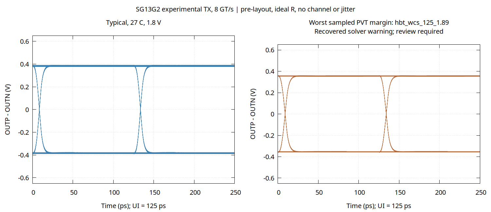

# 99 — Custom PCIe Gen3 x4 PHY development

## Latest development — 13 October 2026

The [hosted serializer study](evidence/pcie-serializer-expanded-tree-20261013.json)
now contains an actual **32:1 transistor TX tree**, with 604 native HBTs and
512 native MOS devices. Its nominal 8 GT/s stimulus screen passes all 768
original source-bit samples at unchanged 0.3/0.5/0.7 UI phases, with zero wrong
bits and a minimum differential output of 281.207 mV. All measured transistor
and interstage voltage gates pass. The complete raw capture is preserved with
its hash in GitHub Releases. The corresponding 4:1 and 8:1 trees also pass the
nominal component screen.

Each clock common-mode reference drives at most three selector pairs. Bias
feeds use native resistors, and succeeding mux transistor inputs load their
preceding stages directly. **Differential clock modulation still comes from
external ideal sources.** This is one experimental transmitter tree, not four
qualified PCIe lanes. It does not close PLL/CDR, physical tree layout, extracted
RC, pad/ESD qualification, link training or full-chip integration. Older
54-device mux layout results do not qualify the new 32:1 tree.

Run `38339670707` exercises this same tree at hot/low and cold/high conditions,
selected independent HBT/resistor corners, and a 0.25 ps maximum simulation
step. Two actual circuit faults cover a disabled intermediate bias feed and
an inverted deepest-stage selector for inputs 15/31. Initial results are in the [32:1 corner record](evidence/pcie-serializer32-corners-20261013.json).
Hot/low and cold/high with worst resistors pass, and disabling the actual
intermediate bias feed produces 184 wrong samples as expected. The deepest
selector fault is also rejected by the original-bit oracle. Hot/low with
fast HBT models fails six final-mux devices: minimum VCE is 0.399209 V against
the unchanged 0.4 V bound. The 0.25 ps step job now passes; the eight-case campaign is complete.
Candidate v5 widens only
two final collector resistors from 17 to 18 micrometers to reduce voltage drop;
run `38342231393` is complete. All seven positive cases pass, including
nominal, hot/low, cold/high, independent HBT/resistor corners and the 0.25 ps
maximum simulation step. The six formerly failing final-data HBTs reach at
least 0.4265 V VCE in the hot/fast case. Both actual faults are rejected:
disabling the intermediate bias produces 184 wrong source-bit samples;
swapping the deepest selector produces 27. The
[complete record](evidence/pcie-serializer32-margin-20261013.json) preserves
all captures and unchanged gates. The earlier
pending run `38340862492` was superseded before execution by the newer source.
All native computation and testing run on GitHub-hosted runners.

The [cascade14 prestage layout](evidence/pcie-cascade14-physical-20261013.json)
now passes 560 native DRC categories with zero markers, strict hierarchical
and flat transistor LVS (54 devices including substrate contacts), and all
five deliberate fault controls. Its 362.4 by 211.03 micrometer macro is one
prestage, not the assembled serializer. Run `38341047720` now passes the actual
173-resistor/270-capacitor wire graph audit and all thirteen corruption
controls; [the extraction record](evidence/pcie-cascade14-wire-extraction-20261013.json)
retains its substrate-resistance and RF-distribution limitations. Run
`38341559330` binds the real devices and wires for loaded-tree simulation.
The composition passed; [loaded-tree results](evidence/pcie-physical-prestage-tree-20261013.json)
show that the 4:1 compact-device control passes but the wired version fails
54 interstage samples below 150 mV and four final-selector VCE bounds. Output
bits still pass. This physical candidate is rejected electrically. The 32:1
compact-device control also passes. Its completed metal-RC case fails 58 HBT
gates and 57 final-interstage samples below 150 mV, despite zero wrong output
bits. Both original wired candidates remain rejected.
[Full-wave diagnosis](evidence/pcie-physical-prestage-wire-loss-20261013.json)
compares identical source bits and time-weighted device measurements. In the
first prestage, the two tail emitter nodes rise by 41.84 and 42.00 mV, while
the reference emitter rises by 9.81 mV. Tail VBE drops by about 31.7 mV and
each tail collector current drops by about 2.52 mA. These are observed node
changes in the wire model; the exact contribution of each physical segment
still needs isolation. Seven hosted diagnosis controls passed.

The [wider HBT access geometry](evidence/pcie-cascade14-wide-access-physical-20261013.json)
passes the same native DRC/LVS and five fault controls. Its
[fresh extraction](evidence/pcie-cascade14-wide-access-extraction-20261013.json)
and [device/wire composition](evidence/pcie-cascade14-wide-access-composition-20261013.json)
pass their structural checks, with 781 wire resistors and 650 capacitors.
Run `38344474745` completed both loaded 4:1 cases. The compact control passes.
[The wired candidate](evidence/pcie-wide-access-loaded-tree-20261013.json)
still fails: 32 samples below 150 mV, minimum common mode 1.799607 V against
1.8 V, and four final-selector HBT VCE failures. Its 142.742 mV minimum
interstage signal is improved but insufficient. No candidate adoption. The earlier request
`38344233026` was cancelled while pending, before any job started, to allow
this independent geometry to run alongside the original 32:1 study.
Macro-to-macro wiring remains ideal and final/TX blocks remain schematic,
so this is not complete routed-serializer acceptance.

The next [supply/return-metal candidate](evidence/pcie-cascade14-supply-access-physical-20261013.json)
widened only supply/return Metal3 escapes from 0.4 to 0.8 micrometers and
TopMetal1 trunks from 1.64 to 2.0 micrometers, retaining eight-column HBT access
vias and all circuit devices. Run `38345129500` passes strict native DRC/LVS
and all five physical fault controls. Fresh extraction and device composition
passed; the [loaded 4:1 study](evidence/pcie-supply-access-loaded-tree-20261013.json)
completed in run `38346082824`. Compact passes, wired fails: minimum interstage
149.041 mV, 14 samples below 150 mV, common-mode minimum 1.798694 V and four
final-selector VCE failures near 0.39635 V. The candidate remains rejected.

The [larger power-trunk geometry](evidence/pcie-cascade14-power-trunks-physical-20261013.json)
adds routing-lane spacing for 3.28 micrometer TopMetal1 power trunks and
32 micrometer TopMetal2 power buses. Native DRC/LVS and five fault controls
pass; its [fresh 781R/643C graph](evidence/pcie-cascade14-power-trunks-extraction-20261013.json)
passes all thirteen corruption controls. Composition `38347455028` passed, but
the [loaded 4:1 wire study](evidence/pcie-power-trunks-loaded-tree-20261013.json)
remains rejected: all 768 bits and the 152.196 mV differential interface minimum
pass; the 1.795959 V common-mode minimum and four selector VCE minima
(0.389535–0.391603 V) fail unchanged limits. The compact control passes.
Wider power metal alone did not close the loaded electrical gates.

The [final v5 physical layout](evidence/pcie-final-v5-physical-20261013.json)
now passes all 560 native DRC categories, strict hierarchical and flattened
54-device transistor LVS, and five physical fault controls. Eighteen hosted
source tests bind its 19 HBTs, eight resistors and 27 separate substrate contacts
to the screened v5 circuit, including an independent check of the generated
reference. The first two layouts failed actual LVS: one shorted an internal
emitter node to supply; the next aligned signal and substrate trunks. Their
failures remain archived. A 38.4 micrometer resistor bank pitch separates both
accesses and trunks. Its [fresh extraction](evidence/pcie-final-v5-extraction-20261013.json) passed
the native graph audit and thirteen raw corruption controls (781 R, 642 C).
[Native device/wire composition](evidence/pcie-final-v5-composition-20261013.json)
also passed. The [combined physical-macro 4:1 study](evidence/pcie-both-physical-macros-loaded-tree-20261013.json)
passed the compact control but rejected the actual wired tree: 128 wrong source
samples at 0.3 UI, seven HBT bound failures, and a 1.762973 V interstage
common-mode minimum. The 0.5/0.7 UI samples passed; the acceptance phases remain
unchanged. An interleaved physical candidate places the same resistors below the HBT
banks to reduce route span. Run `38351576199` passed DRC and both strict LVS
comparisons, but its rail-short fault injection failed before adding the fault:
the two supply buses no longer share an X interval. Run `38352031533` uses an
explicit bridge between verified supply-pin centres; every fault still must
be rejected. Fresh RC and waveform checks remain required. No assembled
serializer or main-chip acceptance follows.

The separate [GMII output hold repair](evidence/cloud-ethernet-hold-estimate-20261013.json)
passes the native Liberty logic-equivalence check and injected-inverter
rejection. Two real delay cells per output improve the fast-corner placement
hold estimate from −0.227544 ns to +0.238373 ns, with slow-corner GMII setup
remaining +2.308341 ns. Existing CPU/PCIe negative groups remain unchanged.
Run `38339178024` combined that candidate with bounded channel placement but
failed fresh global routing with 147 overflow (Metal5: 108); it is rejected. These are placement estimates, **not routed timing
closure**. Original local placement run `38335168863` now finished with
136 global-route overflow, down from 153 but still rejected. The
[exact native diagnosis](evidence/cloud-local-optimize-congestion-20261013.json)
binds 104 markers and 964 involved nets; 71 markers touch Ethernet FIFO SRAM
banks 4/5. The native congestion viewer writes `-` for the marker layer,
so those strings are not metal-layer identities. The combined GMII run
and both broad-placement runs remain in progress. Native
[pin/obstruction diagnosis](evidence/cloud-sram-pin-access-20261013.json)
now checks every transformed pin against OpenDB's placed pin bounds and passes
nine orientation controls. All signal/clock pins on the four hot macros are
Metal2; many congested paths pass across the macro without ending there.
A [conservative Metal5 reservation experiment](evidence/cloud-sram-routing-reservation-20261013.json)
is running as `38347061685`, retaining the proven GMII delay cells and exact
macro geometry. It removes that routing resource only above those SRAM bodies,
forcing another legal layer or a path around them. It changes neither native
obstructions nor acceptance limits. The [continuation record](evidence/cloud-closure-continuation-20261013.json)
is authoritative for subsequent results and open work.

## Latest development — 4 October 2026

[The integrated packet and analog-bank record](108-pcie-packet-and-bank-integration.md)
adds bidirectional sequence/LCRC handling, real ACK/NAK DLLPs, a revised
150 fF RX preamplifier, and an actual four-lane TX/RX GDS/LEF bank with strict
transistor LVS and main DRC checks. This is still a separate macro and digital
boundary: neither is instantiated in the main chip. Receiver initialization
warnings, the remaining PHY/control blocks and chip-context qualification
remain explicit open gates.

[The RX development record](107-pcie-rx-development.md) adds a native-HBT
differential receiver preamplifier with foundry resistor terminations and a
bounded digital LCRC quarantine in front of the existing transaction backend.
The new work is separate from the earlier TX experiments below. Analog
waveform screens, individual-cell geometry checks and digital port tests have
different acceptance scopes; none establishes a complete PCIe Gen3 x4 PHY,
serial link, or full-chip integration. The dated sections below retain the
historical results and limitations of each earlier revision.

## Historical status and scope — 22 September 2026

Custom analog development has started, following the feasibility research in
[docs/91](91-pcie-gen3-feasibility.md). There are now executable SG13G2 HBT
transistor-level netlists for an NRZ transmitter output cell and a four-cell
bank. These are experimental **TX building blocks**, not a working PCIe PHY.
No new PCIe GDS/LEF, extracted layout, receiver, PLL/CDR or link has been
delivered, and these cells are not instantiated in `soc_top` or its layout.

The current milestone is **pre-layout feasibility with ideal resistors**.
The final characterization receipt is
[pcie-tx-characterization-20260922.json](evidence/pcie-tx-characterization-20260922.json).
Numerical warnings and earlier failed attempts are part of that record;
waveform screening is not a substitute for resolving them.
All 43 final simulator logs are published in the
[log archive](evidence/pcie-tx-logs-20260922.tar.gz), with member hashes in
the receipt. Compressed raw waveforms remain in the local run directory;
the commands below reproduce them.

## Circuit and integration boundary

The project-authored sources are
[tx_cml.spice](../hw/soc/analog/pcie/tx_cml.spice) and
[tx_bank4.spice](../hw/soc/analog/pcie/tx_bank4.spice). The simulator loads the
unmodified `npn13G2` VBIC models from the pinned IHP PDK. Device self-heating
remains enabled; it was not disabled to remove solver warnings.

```text
                     AVDD
                 50 ohm  50 ohm        ideal loads for this milestone
                    |      |
             OUTN --+      +-- OUTP
                    C      C
    INP ----------- B XP  XN B ----------- INN
                    E--+---E
                       C
                  XTAIL B ---- IREF ---- B=C XREF
                       E                  E
                       |                  |
                      AVSS               AVSS
```

XP and XN form the current-steering pair. Output polarity follows INP by
taking OUTP from the opposite collector. XREF and XTAIL form a 1:8 mirror;
the externally supplied reference current is nominally 2 mA. All substrate
terminals connect to SUB. The zero-volt VTAIL source only measures current
and becomes a wire in a future physical schematic.

| Interface/device | Present design or testbench assumption |
|---|---|
| AVDD / AVSS / SUB | Nominal 1.8 V analog supply, swept 1.71–1.89 V; ground and substrate tied in the testbench. A separate analog supply distribution is needed. |
| INP / INN | Ideal complementary NRZ sources, 1.36 V common mode and 200 mV differential magnitude; 10 ps transitions. This is **not** a direct 1.2 V CMOS connection. A real level shifter/predriver remains required. |
| OUTP / OUTN | Collector outputs, 100 ohm differential external termination, normally 100 fF to ground on each pin. Neither an ESD model nor an extracted pad/package/channel is included. |
| IREF | One ideal 2 mA source per lane; the on-chip reference, enable and calibration loops remain absent. |
| XREF | `npn13G2 Nx=1`; remaining geometry uses the pinned model defaults. |
| XTAIL / XP / XN | `npn13G2 Nx=8` each. These are model multiplicities, not a completed PCell placement. |
| Load resistors | Two ideal 50 ohm resistors per lane. Foundry `rsil` implementation, tolerance, temperature coefficient, current density and extracted parasitics remain to be characterized. |
| Four-cell bank | Four independent cells with shared AVDD/AVSS/SUB and separate data/reference pins; no lane bonding, shared PLL or serializer. |

The bank test uses a **hypothetical** 0.1 ohm / 100 pH series supply and
100 pF decoupling model, with the substrate grounded ideally. It exercises
simultaneous switching and conducted supply interaction only. It does not
establish the actual package inductance, substrate isolation or lane crosstalk.
The reported supply power excludes the upstream ideal data drivers and all
missing clock, receiver and digital circuitry.

## Reproducible simulations

[characterize_pcie_tx.py](../scripts/characterize_pcie_tx.py) generates and runs
the benches, checks captured time coverage and finite values, measures the
waveforms and retains compressed raw traces, logs and hashes. It refuses
different bytes for either of the two PDK model files. `-n` prevents a user
`.spiceinit` from silently changing the setup. No PDK file is patched.

The actual local simulator is Ubuntu `ngspice 42+ds-3build1`, extracted into
the project's ignored tool directory without a system installation. Package
SHA-256: `466c4c06418107ceaa9c9457065b3bb71a9d9dc5ec6fef186d7de9d5208ce8db`.
The receipt also identifies the executable and exact design/driver/model bytes.

```sh
python3 scripts/characterize_pcie_tx.py \
  --pdk /path/to/c4b8b4e5e7a05f375cca3815d51b3a37721fbf5c/ihp-sg13g2 \
  --ngspice /path/to/ngspice \
  --out hw/soc/out/pcie-tx-characterization

python3 scripts/plot_pcie_tx.py \
  --run hw/soc/out/pcie-tx-characterization \
  --gnuplot /path/to/gnuplot \
  --out hw/soc/out/pcie-tx-eye
```

Use a fresh output directory each time. Exit 0 means this limited screen
passed without numerical warnings; exit 1 means failure; exit 2 means the
screen passed but numerical warnings require review. `--quick` runs eight
smoke/control cases and does not replace the full matrix.

The full matrix contains **43 simulations**:

* 27 single-cell runs: typical/best/worst HBT corner, −40/27/125 °C and
  1.71/1.80/1.89 V. Ideal resistor values do not vary with those corners.
* Two nominal extra loads: 250 and 500 fF per output pin.
* Ten four-cell bank runs: nominal PRBS and simultaneous alternating data,
  plus best/worst HBT corners at both temperature and supply extremes.
* Three deliberately faulty cases: no reference current, swapped output
  polarity and 100 pF per output pin. These must fail the signal screen.
* One nominal repeat at a 0.5 ps maximum step, compared with the 1 ps run.

Data rate is 8 GT/s, UI = 125 ps. Each lane receives 254 bits (two PRBS7
periods), following a 2 ns bias settling interval. Bank PRBS seeds differ
by lane. The first 16 bits are excluded from signal scoring; each remaining
bit is checked at 0.3, 0.5 and 0.7 UI, giving 714 samples per lane.
These are finite, deterministic, noise-free tests; zero sampled sign errors
do **not** establish a BER, a jitter budget or PCIe compliance.

Engineering thresholds are a signed output margin of at least 100 mV,
0.4–1.6 V transistor collector-emitter voltage over the post-settling trace,
and tail emitter current below 24 mA. The latter is a conservative bound on
collector current for Nx=8. These checks cover selected model operating
limits, not complete reliability/SOA/ESD verification. No PCI-SIG electrical
mask is claimed. The timestep repeat requires margin change below 1 mV and
relative supply-power change below 0.2%.

## Measured results and iteration record

Final result: **REVIEW**, not unconditional PASS. All 40 non-faulty cases
passed the defined waveform/stress screen, and all three faulty cases were
detected. Thirteen hot-corner runs retained numerical warnings. Across all
non-faulty cases, the checked VCE range was **0.416–1.265 V**.

| Measured condition | Signed margin | Sampled eye height | Analog supply power |
|---|---:|---:|---:|
| One lane, typical, 27 °C, 1.80 V | 369.37 mV | 739.25 mV | 31.36 mW |
| One lane, worst HBT, 125 °C, 1.89 V; numerical review required | 346.12 mV | 693.62 mV | 32.28 mW |
| One lane, nominal, 500 fF per output | 305.37 mV | 611.54 mV | 31.36 mW |
| Four lanes, nominal PRBS; lane 0 signal metrics | 369.37 mV | 739.25 mV | 125.43 mW total |

The nominal median positive-to-negative differential swing was **755.13 mV**.
At half the timestep, margin changed by **1.45 µV** and supply power by
**0.000215%**, passing the numerical-resolution comparison. This does not
resolve the separate hot-corner initialization warnings.

Fifteen Python controls passed, including maximal-length PRBS checks and
rejection of truncated/nonfinite/wrong-vector waveforms, polarity errors,
overvoltage and overcurrent. They supplement the actual SPICE fault runs.
The broader focused publication/metadata regression passed **199 tests**.

The first 1.30 V input-common-mode candidate passed the nominal signal screen
but reached only about **0.372 V minimum VCE at −40 °C**, below the chosen
0.4 V lower model-range screen. Raising common mode to **1.36 V** fixes that
observed headroom issue without changing the voltage limit or PDK model.
The receipt preserves both aborted early sweeps, rather than presenting only
the final candidate.

Some 125 °C operating-point solves report an intermediate temperature-limiter
NaN and/or gmin recovery. A recovered finite transient does not erase the
warning. Explicit node guesses improve some starts but do not eliminate all
warnings. Separate source-stepping and fixed-gmin experiments also failed;
neither is adopted as a workaround. Resolving these numerical diagnostics,
including checking a newer supported simulator and an independent solver,
remains a prerequisite to analog signoff.



The figure overlays actual captured differential output waveforms; it is
generated by [plot_pcie_tx.py](../scripts/plot_pcie_tx.py) using gnuplot,
without smoothing or a fabricated eye mask. The second panel is the
single-cell PVT case with the smallest sampled margin, not the worst of
every possible load/channel/mismatch condition.

## Work required before layout integration

The intended physical partition is four analog lane slices plus shared
clock/reference/control infrastructure, adjacent to the high-speed pads.
Dimensions, placement, macro obstructions and pin coordinates are **not yet
chosen**; speculative rectangles would not constitute a PHY layout.

| Next gate | Concrete acceptance work |
|---|---|
| Simulation/model closure | Resolve hot-corner warnings; compare independent solver/timestep results; add DC transfer/output impedance, mismatch, noise and wider data-pattern coverage. |
| Physical TX schematic | Replace ideal resistors with sized foundry devices and their OSDI models; design bias/reference, CMOS-to-CML predriver, calibrated swing, electrical idle, receiver detection and Gen3 equalization taps. Qualify lower-rate behavior. |
| TX layout | Use actual IHP HBT/passive PCells, symmetric routing and substrate contacts; size supply/return conductors using measured current and foundry current-density rules. Add compatible high-speed ESD/pads. |
| Extracted TX acceptance | Unmodified foundry DRC, LVS against the physical schematic, R/C extraction, corner replay, EM/IR and pad/package/channel simulation. Replace the illustrative PDN with extracted/characterized data. |
| RX/clock | Termination, CTLE/VGA/slicer, CDR, PLL, reference clock/SSC modes, calibration and test access; measured jitter/noise/equalization budgets. |
| Four-lane PHY and link | Serializer/deserializer, PCS, 128b/130b, lane alignment, Gen1/2 fallback, PIPE/control boundary, full DLL/LTSSM and controller integration. The standalone TLP blocks in docs/98 do not supply these. |
| SoC integration views | Verified GDS/LEF, pins/obstructions, CDL/SPICE/LVS, timing/power/noise models and clock/reset/test constraints, then a new SoC route containing the real macro. |
| Product acceptance | Package/board channels, manufactured silicon, interoperability/compliance and required radiation/qualification tests. |

The currently running full-core physical flow still excludes PCIe. Completing
that existing route cannot close this new analog macro's gates. All product
and external-audit obligations in [docs/92](92-product-acceptance.md) and
[docs/96](96-second-audit-closure.md) remain in force.

## References

The [IHP Open PDK](https://github.com/IHP-GmbH/IHP-Open-PDK) supplies the HBT
models and physical-device resources used as the development basis. The
[ngspice documentation](https://ngspice.sourceforge.io/docs.html) describes
the simulator and control language. High-speed SG13G2 research and its
limitations are assessed in [docs/91](91-pcie-gen3-feasibility.md); no external
research netlist or unlicensed layout has been copied into these cells.

## Native resistor implementation continuation

The [26 September local work](103-local-closure-progress.md#native-resistor-tx)
adds self-heating, three-terminal IHP `rsil` load cells, their native PCell
geometry and a separate characterization driver. The original ideal-resistor
sources and their historical measurements are retained. The new unit geometry
is one resistor, not the TX bank or a complete PHY; contact-current, extracted
interconnect and substrate-contact integration remain qualification work.

## Routed TX cell continuation, 26 September 2026

[The complete experimental TX cell layout](103-local-closure-progress.md#complete-experimental-tx-cell-layout)
adds four native HBT instances, both native loads and eight explicitly modelled
substrate contacts. Final main DRC and strict LVS pass, and all four deliberately
incorrect references fail. The 87-case device-netlist screen retains its
numerical warnings and does not include interconnect RC. Wider power paths and
via arrays have been rechecked geometrically. This closes the absent **single
TX-cell geometry** sub-item; it does not supply a full Gen3 x4 PHY, controller,
padframe, chip integration or PCIe qualification.

## Clocked receiver and protected pad continuation, 4 October 2026

[The next native development record](109-pcie-replay-clock-and-pad-development.md)
tracks a clocked HBT receiver sampler, physical differential pad/ESD checks and
their exact analog limitations. These experiments do not provide CDR/PLL or a
complete main-chip PCIe PHY.

## Cloud-only continuation, 13 October 2026: physical return path

The interleaved final-v5 layout passed native DRC, strict hierarchical/flat
54-device LVS and all five physical fault controls in run 38352031533. Fresh
781R/646C extraction and composition passed, but the actual loaded 4:1 wire
study 38352789660 still failed: 128 early sample errors, seven HBT headroom
violations and a 1.766211 V minimum interstage common mode. Its compact control
passed. These are rejected electrical results, not PHY acceptance.

Hosted full-wave comparisons (38353069824 and 38353682503) observed about
15.6 mV of reference-emitter rise versus 57.8 mV at the final-stage tails;
tail VBE fell about 41.7 mV and collector current about 4.66 mA. A physical
Metal5 emitter-return candidate initially shorted the substrate via stack.
Moving only the reference branch 4.8 micrometres cleared that crossing.
Run 38354499415 passed all 560 DRC categories, both strict LVS checks and
five fault controls. Its fresh extraction 38355262540 passed with 837R/681C
and thirteen corruption controls. Electrical waveform acceptance is pending.
See the source-bound [physical](evidence/pcie-final-v5-kelvin-physical-20261013.json)
and [extraction](evidence/pcie-final-v5-kelvin-extraction-20261013.json) records.

All CAD, simulations and tests now execute on hosted GitHub runners. Local
activity is source editing and verified packaging, transfer and cleanup only.
The full serial PHY, assembled analog layout, chip routing, qualified RF/body
extraction and final setup/hold remain open.

The fresh Kelvin-return loaded-tree run 38355959100 completed on hosted runners.
Its compact control passed, but the extracted-wire case still failed 128 early
samples (minimum signed margin -0.112321 V). It is rejected for electrical
adoption; unchanged sample phases and device/interface gates remain enforced.
Full reports and immutable artifact receipts are retained in the
[Kelvin loaded-tree record](evidence/pcie-kelvin-macros-loaded-tree-20261013.json).

The hosted crossing diagnosis 38357221710 located the main extra delay in the
final MUX: median clock-to-MUX zero crossing increased from 8.509 ps in the
compact control to 29.849 ps with physical wires. MUX-to-TX delay changed from
4.529 ps to 4.848 ps. The wired 100 mV output crossing reached 47.404 ps median,
after the unchanged first sample at 37.5 ps. All 128 changing-bit events were
unambiguous; no oracle phase or acceptance limit was changed.

A separate geometry moves the emitter-return crossbar from -92.4 to +64.8
micrometres, above the final tail/reference banks. The native device circuit,
M5 width, reference jog and via counts remain the same. Run 38357052327 passed
560 DRC categories, strict hierarchical/flat LVS and all five injected faults.
Its new parasitic extraction and electrical comparison remain required.

The short-return wire study 38357948303 was also rejected: 128 early errors,
19 HBT margin failures and 60 interstage samples below 150 mV (minimum
136.696 mV); the compact control passed. Shortening that return alone does not
close the physical circuit. The complete failed captures remain archived.

A separate source inspection found that M3-to-TopMetal1 escapes still used
the via helper's two-column default, despite eight columns at HBT pin access.
The native coefficient table is unchanged. Candidate
`critical_buses_kelvin_short_vias` increases only those lower-via arrays to
eight columns; TopVia1/2 defaults are unchanged. Run 38358182094 passed native
DRC, both strict LVS checks and all five fault controls. Fresh extraction and
waveform comparison are required; this is not electrical adoption. See the
[source hypothesis](evidence/pcie-upper-access-via-hypothesis-20261013.json).

The via-array final macro passed fresh native extraction (2537R/1781C plus
thirteen raw corruption controls) and composition. Hosted loaded-tree run
38359379142 reduced wrong early samples from 128 to 96 and failing HBTs from
19 to six; minimum signed output margin improved from -111.263 to -26.233 mV.
It still fails: the final interface retains 60 samples below 150 mV and an
out-of-range common mode. Compact controls pass. No candidate is adopted.

Independent hosted DC metal-network analysis 38359571709 confirmed that the
two supply-terminal path resistances fell from 20.224/20.210 ohms to
13.493/13.480 ohms. It checks analytical series/parallel networks, corruption
controls, KCL residual and unit-current energy conservation. Semiconductor
devices are excluded and capacitors are open; this is not a loaded or RF
acceptance test. All coefficients and original wire graphs are preserved.
The same escape-via improvement is now under native physical validation for
the two cascade14 prestages (38359973320), requiring its own fresh RC and
composition before testing the combined tree.
